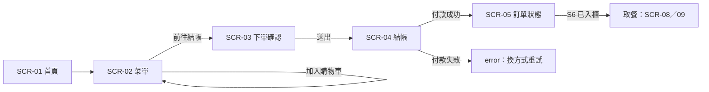

# UX.md（示範答案）｜雲端早餐店訂餐管理系統

> **這是參考範本，不是標準答案。** 你的 baseline 不同，產出必然不同——但「完整長什麼樣」應該一樣。
> 對應講義 §1.4 的第 1 項產出；格式見 `04_ux_template.md`。

---

## 前言

| 欄位 | 內容 |
|---|---|
| 版本 | v1.0（2026-10-26） |
| 範圍 | 11 個介面；MVP（L3）＝ SCR-03／04／05／06／07 |
| 依據 | baseline v1.0、DESIGN.md v1.0、DESIGN-DISPLAY.md v1.0、服務需求索引與 US-B |
| ID 規則 | `SCR／FLOW／ST／IX／MSG／US-B／US-I／AC` 一旦編定不重編 |

---

## 1. 範圍與設計原則

### 1.1 MVP 範圍

| 級 | 頁面 |
|---|---|
| **L3（做到底）** | SCR-03 下單確認、SCR-04 結帳、SCR-05 訂單狀態、SCR-06 店員訂單台、SCR-07 KDS |
| L2（規格＋HTML） | SCR-01 首頁、SCR-02 菜單、SCR-08 看板 |
| L1（規格＋線框） | SCR-09 取餐櫃面板、SCR-10 菜單維護、SCR-11 銷售報表 |

### 1.2 設計原則（每條都要能回溯）

| # | 原則 | 回溯 |
|---|---|---|
| 1 | 一步一決策：每頁只問使用者一件事 | CJM「下單」階段的焦慮＝怕填錯 |
| 2 | 等待要可預期：任何時刻都能回答「還要多久」 | CJM 最低點 −2 |
| 3 | 錯誤不責備：提示指出怎麼修 | UX 原則五 |
| 4 | 跨端一致：同一訂單在四端顯示同一狀態碼 | Blueprint 5 個 handoff |
| 5 | 遠距優先可讀：看板在 4 m 外仍可辨識 | 設施角色需求 |

### 1.3 不可違反的限制

WCAG AA（內文 4.5:1）、中文內文 ≥16px、手機優先 375px、看板對比 ≥7:1、看板無互動元素。

---

## 2. 線框清單

| ID | 端 | 承接任務 | 承接狀態 | 進入點 | 離開點 | 深度 |
|---|---|---|---|---|---|---|
| SCR-01 | 顧客 | T1 決定吃什麼 | 營業中／未營業／載入中 | 開啟 App | SCR-02 | L2 |
| SCR-02 | 顧客 | T1 決定、T2 客製加購 | 有品項／全售完／SX1 缺貨 | SCR-01 | SCR-03 | L2 |
| SCR-03 | 顧客 | T2 客製、T3 確認與取餐時間 | S1 草稿／驗證中／驗證失敗 | SCR-02（cart 非空） | SCR-04 | **L3** |
| SCR-04 | 顧客 | T4 付款 | 待付款／處理中／成功／SX2／待確認 | SCR-03（必填完成） | SCR-05 | **L3** |
| SCR-05 | 顧客 | T5 等多久、T6 找櫃位 | S2–S7 ＋ SX3 | SCR-04 成功／推播 | 已取餐 | **L3** |
| SCR-06 | 店員 | T7 接單、T8 備妥入櫃、T9 收款 | S2／S3／S5／S6／S7 | 平板常駐 | 常駐 | **L3** |
| SCR-07 | 廚房 | T10 排序與回報 | S2／S4／S5 | 大屏常駐 | 常駐 | **L3** |
| SCR-08 | 設施 | T11 顯示可取餐號碼 | S6 | 常駐 | 常駐 | L2 |
| SCR-09 | 設施 | T12 開櫃取餐 | S6→S7 | 掃碼／輸入 | 櫃門開啟 | L1 |
| SCR-10 | 老闆 | T13 維護菜單 | 上架／售完／隱藏 | 後台登入 | 常駐 | L1 |
| SCR-11 | 老闆 | T13 看營收 | 日／週 | 後台登入 | 常駐 | L1 |

---

## 3. 任務流與狀態機

### 3.1 主流程（FLOW-01 顧客下單）



### 3.2 跨端狀態同步（FLOW-02）

```
顧客送出 ──▶ S2 ──▶ 店員確認(SCR-06) ──▶ S3 ──▶ KDS(SCR-07)
                                                      │
   顧客可見(SCR-05) ◀── S4 製作中 ◀───────────────────┘
                                                      │
   顧客可見「製作中」(不得顯示號碼) ◀── S5 完成待確認 ◀─┘
                                                      │
   店員入櫃(SCR-06) ──▶ S6 可取餐 ──▶ 看板(SCR-08)／面板(SCR-09)
                                                      │
   店員交付 ──▶ S7 已取餐 ──▶ 全部移除
```

### 3.3 頁面狀態表（5 頁 × 6 態）

**SCR-03 下單確認**

| 狀態 | 顯示 | 主要動作 | MSG |
|---|---|---|---|
| default | 品項摘要、取餐時段選單、姓名 | 送出 | MSG-01 |
| loading | 按鈕轉圈、鎖住返回 | — | MSG-02 |
| empty | 「購物車是空的」＋回菜單 | 回菜單 | MSG-03 |
| error | 欄位下方紅字（柔和） | 修正後再送 | MSG-04 |
| success | 導向 SCR-04 | — | — |
| interrupted | 品項售完提示＋建議替換 | 換品項 | MSG-05 |

**SCR-04 結帳**

| 狀態 | 顯示 | 主要動作 | MSG |
|---|---|---|---|
| default | 付款方式、合計 | 付款 | MSG-06 |
| loading | 「處理中，請勿關閉」 | — | MSG-07 |
| empty | 不適用（一定有待付訂單） | — | — |
| error | 「付款沒有完成」＋重試 | 換方式 | MSG-08 |
| success | 導向 SCR-05 | — | MSG-09 |
| interrupted | 「銀行確認中」＋稍後查看 | 稍後查看 | MSG-10 |

**SCR-05 訂單狀態**（頁面 success 會隨訂單狀態變化）

| 頁面狀態 | 對應訂單狀態 | 顯示 | MSG |
|---|---|---|---|
| default | S2/S3 | 訂單號、預計時間、進度條 | MSG-11 |
| loading | — | 骨架屏 | — |
| empty | 無訂單 | 「目前沒有進行中的訂單」 | MSG-12 |
| error | SX3 | 「通知未送達，請看店內看板」 | MSG-13 |
| success | S6/S7 | 取餐號碼、櫃位、開櫃提示 | MSG-14 |
| interrupted | SX4 | 「已送出修改要求，等待店員確認」 | MSG-15 |

**SCR-06 店員訂單台**

| 狀態 | 顯示 | 主要動作 | MSG |
|---|---|---|---|
| default | 訂單列表（依時間排序） | 確認／入櫃／收款 | MSG-16 |
| loading | 列表骨架 | — | — |
| empty | 「目前沒有待處理訂單」 | — | MSG-17 |
| error | 「連線中斷，重試中」＋手動重試 | 重試 | MSG-18 |
| success | 新單高亮＋嗶聲，3 秒後轉為一般 | 確認 | — |
| interrupted | 「顧客取消」或「品項缺貨」標記 | 處理 | MSG-19 |

**SCR-07 KDS**

| 狀態 | 顯示 | 主要動作 | MSG |
|---|---|---|---|
| default | 佇列卡片（訂單號、品項、計時） | 開始製作 | MSG-20 |
| loading | 卡片骨架 | — | — |
| empty | 「目前沒有待製作」 | — | MSG-21 |
| error | 「與系統斷線，重試中」 | 重試 | MSG-22 |
| success | 卡片轉「完成（待店員確認）」 | — | MSG-23 |
| interrupted | 「缺貨」標記＋通知店員 | 標記缺貨 | MSG-24 |

---

## 4. 互動規格（IX）

| ID | 元件 | 行為 | 時機 |
|---|---|---|---|
| IX-01 | 表單欄位 | 顯示錯誤 | **失焦時** |
| IX-02 | 主按鈕 | 送出後 disabled | 送出瞬間 |
| IX-03 | 錯誤提示 | 顯示在欄位下方 | 驗證失敗 |
| IX-04 | 數量加減 | 到 0 時詢問是否移除 | 點減號到 0 |
| IX-05 | 付款 | 處理中鎖住返回鍵 | 送出付款 |
| IX-06 | 店員台新單 | 嗶聲 ＋ 高亮 3 秒 | 新單進入 |
| IX-07 | KDS 計時器 | 綠→黃→紅（3／6 分） | 持續 |
| IX-08 | 看板 | 號碼變更時淡入 300ms | 狀態改變 |

---

## 5. 內容與文案（MSG）

| ID | 類型 | 文字 | 字數 | 依據 |
|---|---|---|---|---|
| MSG-01 | 按鈕 | 送出訂單 | 4 | 動詞 |
| MSG-02 | 載入 | 正在送出你的訂單⋯ | 9 | — |
| MSG-03 | 空狀態 | 購物車還是空的，先看看今天的套餐？ | 18 | 不責備 |
| MSG-04 | 錯誤 | 請選取一個取餐時間，讓我們準時為你準備 | 20 | 指出怎麼修 |
| MSG-05 | 例外 | 這項剛剛賣完了，換一個試試？ | 14 | 提供出路 |
| MSG-06 | 按鈕 | 前往付款 | 4 | 動詞 |
| MSG-07 | 載入 | 正在處理付款，請不要關閉畫面 | 15 | 降低焦慮 |
| MSG-08 | 錯誤 | 付款沒有完成，可以換一種付款方式再試 | 19 | 不責備＋出路 |
| MSG-09 | 成功 | 付款完成，我們開始準備你的早餐 | 15 | 正向回饋 |
| MSG-10 | 例外 | 銀行還在確認，稍後回來看結果就好 | 17 | 誠實＋低壓 |
| MSG-11 | 標籤 | 已下單／已確認／製作中 | 3–4 | 對應 S2–S4 |
| MSG-12 | 空狀態 | 目前沒有進行中的訂單 | 11 | — |
| MSG-13 | 錯誤 | 通知沒送到，請直接看店內看板 | 14 | 降級說明 |
| MSG-14 | 成功 | 可取餐：A-03 櫃｜開櫃碼 8821 | 16 | 資訊優先 |
| MSG-15 | 例外 | 已送出修改，店員確認後會更新 | 14 | 說明下一步 |
| MSG-16 | 按鈕 | 確認接單 | 4 | 動詞 |
| MSG-17 | 空狀態 | 目前沒有待處理訂單 | 10 | — |
| MSG-18 | 錯誤 | 連線中斷，正在重試 | 9 | 說明狀態 |
| MSG-19 | 例外 | 顧客取消／品項缺貨 | 5–6 | 標記 |
| MSG-20 | 按鈕 | 開始製作 | 4 | 動詞 |
| MSG-21 | 空狀態 | 目前沒有待製作 | 8 | — |
| MSG-22 | 錯誤 | 與系統斷線，重試中 | 9 | — |
| MSG-23 | 成功 | 完成（等待店員確認） | 9 | **不可寫「可取餐」** |
| MSG-24 | 例外 | 標記缺貨 | 4 | 動詞 |

---

## 6. 可用性與走查結果

| 檢查 | 標準 | 結果 |
|---|---|---|
| 對比 | 內文 ≥4.5:1；看板 ≥7:1 | Prototype 關鍵樣本 8.90–17.13:1；見 `validation/review-report.md` RV-05／RV-06 |
| 觸控目標 | 手持 ≥44px；KDS ≥88px | `tokens-display.css` 基準 120px；Prototype 走查已記錄 |
| 鍵盤焦點 | 可達、可見、順序合理 | `scr-05-order-status` Tab 走查 PASS；見 RV-07 |
| 減少動效 | `prefers-reduced-motion` 降級 | 實測為 reduce 時轉場／動畫為 0s；見 RV-08 |
| 遠距可讀 | 1920 縮到 1/5 仍可讀 | 384px 看板、768px KDS 等效縮放走查 PASS；見 RV-09／RV-10 |

本示範案例不把外部使用者與實體現場測試冒充成已完成：

| 項目 | 狀態 | 範圍說明 |
|---|---|---|
| 等待頁是否降低焦慮 | N/A | 需要 3–5 位真實使用者；學生專案須自行執行 |
| 店員台一頁三任務是否過載 | N/A | 需要店家／助教以 10 張單現場執行；學生專案須自行執行 |
| KDS 戴手套、距離測試 | N/A | 需要實體設備；學生專案須在目標場域執行 |

上述三項在 `validation/review-report.md` 與 Prototype 走查台記為 `N/A`，不是 `pending`，也不代表通過。
