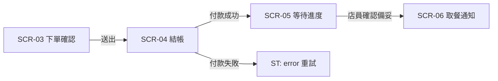

# 04 UX 輸出格式範本

> 本範本只定義 `UX.md` 的**輸出格式**（6 章）。
> 方法論見 `04_ux_README.md`；研究工作表見 `04_ux_rd_template.md`。

---

## UX.md 必須包含的結構

### 0. 前言

| 欄位 | 填什麼 |
|---|---|
| 版本／日期 | v1.0／YYYY-MM-DD |
| 範圍 | 全部 SCR 清單；MVP（L3）是哪幾頁 |
| 依據 | CJM／Blueprint、服務需求索引與 US-B、DESIGN.md、DESIGN-DISPLAY.md 版本 |
| ID 規則 | `SCR／FLOW／ST／IX／MSG／US-B／US-I／AC` 一旦編定不重編 |

### 1. 範圍與設計原則

| 項目 | 內容 |
|---|---|
| MVP（L3） | SCR-03／04／05／07／09（依本案） |
| 設計原則 | 3–5 條，每條要能回溯到 US-B、CJM 或 Persona |
| 不可違反 | WCAG AA、中文可讀、手機優先、遠距 ≥ 距離/200 |

### 2. 線框清單

| ID | 端 | **承接任務** | **承接狀態** | 進入點 | 離開點 | 深度 |
|---|---|---|---|---|---|---|
| SCR-05 | 顧客 | T5 等多久、T6 找櫃位 | S2–S7 ＋ 通知失敗 | 送出成功 | 已取餐 | L3 |

> 一頁可承接多個任務，一個任務可跨多頁——這是**二分圖**，不是一對一。
> 每一列都必須寫「承接哪些狀態」；不寫就無法檢查狀態覆蓋率。

**端別只能四選一**：顧客／店員／廚房／設施。
**設施角色必須出現**（看板、取餐櫃）。

### 3. 任務流與狀態機

**狀態表（頁面層級，6 欄固定）**

| 狀態 | 顯示 | 主要動作 | MSG |
|---|---|---|---|
| default | | | |
| loading | | | |
| empty | | | |
| error | | | |
| success | | | |
| interrupted | | | |

> 頁面狀態 6 種；元件狀態（normal/hover/focus/active/disabled）屬第 4 章，不混用。

### 4. 互動規格（IX）

| ID | 元件 | 行為 | 觸發時機 | 備註 |
|---|---|---|---|---|
| IX-01 | 表單欄位 | 驗證 | **失焦時**，不是輸入時 | 避免邊打字邊報錯 |
| IX-02 | 主按鈕 | 送出後 disabled | 送出瞬間 | 防重複提交 |
| IX-03 | 錯誤提示 | 顯示在欄位下方 | 驗證失敗 | 不用彈窗 |

### 5. 內容與文案（MSG）

| ID | 類型 | 文字 | 字數 | 語氣依據 |
|---|---|---|---|---|
| MSG-01 | 錯誤 | 請選取一個取餐時間，讓我們準時為你準備 | 22 | 張家豪「不期望焦慮」 |
| MSG-02 | 按鈕 | 送出訂單 | 4 | 動詞 |

**規則**：錯誤要指出怎麼修；按鈕用動詞；不用「確定／送出資料」。

### 6. 可用性與待驗證

| 檢查 | 標準 | 結果 |
|---|---|---|
| 對比 | 內文 ≥ 4.5:1；大字 ≥ 3:1 | |
| 觸控目標 | 手持 ≥ 44px；KDS ≥ 88px | |
| 鍵盤焦點 | 可達、可見、順序合理 | |
| 減少動效 | `prefers-reduced-motion` 有降級 | |
| 遠距可讀 | 1920 縮到 1/5 仍可讀 | |

| # | 待驗證 | 方法 |
|---|---|---|
| 1 | 等代的焦慮是否真的降低 | 使用者測試 |
| 2 | 店員在尖峰的誤觸率 | 現場觀察 |

---

## ⚠ 此文件**不含**什麼

| 不寫 | 寫在哪 |
|---|---|
| 色碼、字級、間距 | `DESIGN.md`／`DESIGN-DISPLAY.md` |
| 資料表、API、型別 | `spec.md` |
| 完整版面色塊 | 線框圖 |

---

## 附：與物件的接口（新增）

SCR 表除了「承接任務／承接狀態」，還要記**涉及物件**與**資訊需求**——這是 IA 的來源。

| SCR | 涉及物件 | 該角色需要的資訊需求 | 呈現方式 |
|---|---|---|---|
| SCR-02 | 菜單品項（OBJ-01） | 實物照（份量）、價格、辣度 | 卡片（1:1 圖） |
| SCR-06 | 訂單（OBJ-02） | 訂單號、品項、剩餘時間 | 列表＋卡片（無圖） |
| SCR-08 | 取餐號碼（OBJ-05） | 號碼、櫃位 | 96px 大字 |

> 同一個物件在不同端有不同「視圖」，但**狀態來源必須唯一**。
> 物件清單與判準見 `../12_role-tasks/12_role-tasks_generated_reference.md`。

---

## 附：時效敏感度（新增）

SCR 表除了「涉及物件／資訊需求」，還要標**時效敏感度**——它決定後面 spec 的一致性與延遲需求。

| SCR | 涉及物件 | 時效敏感度 | 依據（誰在等） |
|---|---|---|---|
| SCR-05 | 訂單、取餐號碼 | **≤1 秒** | 顧客站在櫃前 |
| SCR-07 | 訂單 | **≤3 秒** | 廚師盯佇列 |
| SCR-08 | 取餐號碼 | **≤1 秒** | 4 公尺外看板 |
| SCR-11 | 營收 | **≤1 小時** | 沒有人在等 |

> 原則：時效由「誰在等」決定，不由技術決定。
> 完整方法見 `15_UX_screen-state-matrix.md` 與 `../validation/README.md`。
