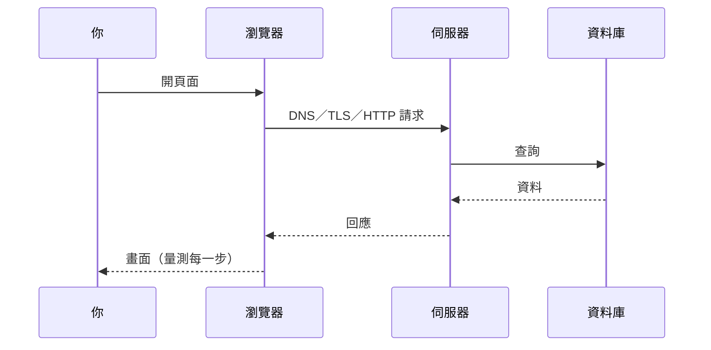

# 第 1 講｜學生操作手冊：全端地圖與請求生命週期

> 你這一講要交出：**四層圖＋八步流程＋三個卡點**。
> 每一步都有「這樣算完成」，做完再往下。

## Step 1：畫出你的四層

> 前置環境：無（練習資料：[01_系統摘要.md](../00_練習資料/01_系統摘要.md)）

在紙上或白板畫四個方塊，由上到下：用戶端／邊緣／伺服器／資料層。

在每個方塊旁寫上你專案裡對應的東西：

| 層 | 你的專案對應 | 這樣算完成 |
|---|---|---|
| 用戶端 | 例如你的 11 個畫面 | 寫得出「哪個檔案」 |
| 邊緣 | 例如靜態主機 | 寫得出「誰在送檔案」 |
| 伺服器 | 例如你的應用服務 | 寫得出「哪個程式」 |
| 資料層 | 例如你的資料庫 | 寫得出「哪張表」 |

## Step 2：標上箭頭

> 前置環境：完成 Step 1

在方塊之間畫箭頭：**請求往下、回應往上**。

- 如果一個箭頭你畫不出來，代表那一層在你的架構裡還不清楚。
- 這樣算完成：每個箭頭都寫得出「帶什麼過去、帶什麼回來」。

## Step 3：走一次請求

> 前置環境：完成 Step 2；可開啟的網站

打開開發者工具（F12）→ Network，重新整理一個頁面。

依序對照八個步驟，把觀察到的填進表格：

| # | 步驟 | 你觀察到什麼 | 花多久 |
|---:|---|---|---|
| 1 | DNS | | |
| 2 | 連線（TLS） | | |
| 3 | 送出請求 | | |
| 4 | 路由與驗證 | | |
| 5 | 業務邏輯 | | |
| 6 | 資料存取 | | |
| 7 | 組回應 | | |
| 8 | 渲染 | | |

這樣算完成：至少填出「哪一步最花時間」。

## Step 4：讀懂狀態碼

> 前置環境：完成 Step 3

找四個回應（可以自己觸發）：

| 情境 | 狀態碼 | 誰的錯 | 該不該重試 |
|---|---|---|---|
| 正常載入 | | | |
| 參數錯誤 | | | |
| 沒有權限 | | | |
| 伺服器錯誤 | | | |

這樣算完成：你能說出「4xx 不要重試、5xx 可以有限次重試」的理由。

## Step 5：拆解「1 秒」

> 前置環境：完成 Step 3

把 spec 的非功能需求抄下來，拆成四段：

| 段 | 估計值 | 量測方式 |
|---|---|---|
| 網路（DNS＋TLS） | | |
| 伺服器處理 | | |
| 資料存取 | | |
| 渲染 | | |

這樣算完成：四段加起來接近你的需求值，且每一段都有量測方式。

## Step 6：寫三個卡點

> 前置環境：完成 Step 3–5

| # | 卡點 | 會出現什麼症狀 | 怎麼量 |
|---:|---|---|---|
| 1 | | | |
| 2 | | | |
| 3 | | | |

這樣算完成：三個卡點分屬不同層（不要三個都在伺服器）。

## 手動修改實驗：把網路變慢

> 前置環境：完成 Step 3；瀏覽器 DevTools

| 項目 | 內容 |
|---|---|
| 目的 | 看見「慢」發生在哪一步 |
| 改哪裡 | 開發者工具 → Network → 節流（Slow 3G） |
| 改前 | No throttling |
| 改後 | Slow 3G |
| 觀察 | 哪一步先出現轉圈、哪一步才出現畫面 |
| 記錄 | 三個時間點：開始、看到版面、可互動 |

這樣算完成：你能指出「慢」是網路、伺服器還是渲染，並改回 No throttling。

## 流程圖

## 交件檢查

> 前置環境：完成前面全部步驟

- [ ] 四層圖（含請求／回應箭頭）
- [ ] 八步流程表（至少填出最花時間的一步）
- [ ] 四個狀態碼判讀
- [ ] 1 秒的四段拆分
- [ ] 三個卡點與量測方式

## 參考答案

| 步驟／單元 | 參考答案要點 |
|---|---|
| Step 1 | 四層：用戶端／邊緣／伺服器／資料層 |
| Step 2 | 請求由上往下、回應由下往上 |
| Step 3 | 八步：DNS、連線、請求、路由、業務、資料、回應、渲染 |
| Step 4 | 400 不重試、500 可有限次重試 |
| Step 5 | 四段：網路／伺服器／資料／渲染，各有估計值 |
| Step 6 | 三個卡點要分屬不同層 |
| 手動修改實驗 | Slow 3G 下先看到轉圈，才知道慢在網路或伺服器 |

> 答案為要點，不是唯一寫法；能說出理由即可。
