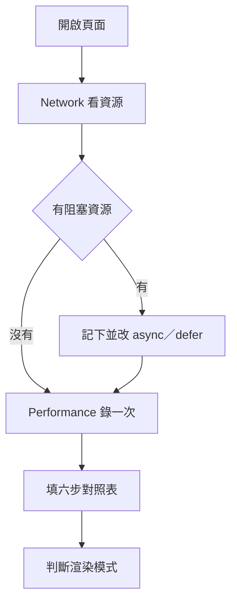

# 第 2 講｜學生操作手冊：瀏覽器與渲染路徑

> 你要交出：**渲染六步對照＋一個阻塞資源＋一種卡住原因**。
> 每一步都有「這樣算完成」。

## Step 1：標出六步

> 前置環境：無

打開你的頁面，用開發者工具的 Performance 錄一次載入。

| 步 | 在哪裡看到 | 你的觀察 |
|---|---|---|
| 解析 HTML | | |
| 解析 CSS | | |
| 渲染樹 | | |
| 版面 | | |
| 繪製 | | |
| 合成 | | |

這樣算完成：六步都寫出「你看到什麼」。

## Step 2：找阻塞資源

> 前置環境：完成 Step 1

在 Network 面板看哪個資源「下載時畫面停住」。

| 資源 | 大小 | 有沒有 async／defer | 是否阻塞 |
|---|---|---:|---|

這樣算完成：至少指出一個阻塞資源，並說明它擋住了什麼。

## Step 3：製造一次卡住

> 前置環境：完成 Step 1；DevTools Console

在 Console 執行一段同步大迴圈（例如跑 3 秒），觀察畫面。

| 觀察 | 結果 |
|---|---|
| 畫面有沒有更新 | |
| 點擊有沒有反應 | |

這樣算完成：你能說出「為什麼主執行緒被佔用，畫面就不動」。

## Step 4：判斷渲染模式

> 前置環境：完成 Step 2

| 問題 | 你的答案 |
|---|---|
| 第一次看到畫面時，HTML 裡有沒有內容 | |
| 需要 JS 跑完才看得到嗎 | |
| 資料多久變一次 | |

這樣算完成：寫出 CSR／SSR／SSG 其中一種，並給一個理由。

## 手動修改實驗：讓腳本不阻塞

> 前置環境：完成 Step 1

| 項目 | 內容 |
|---|---|
| 目的 | 比較「阻塞」與「不阻塞」 |
| 改哪裡 | 頁面的 `<script>` 標籤 |
| 改前 | 放 `<head>`，無 `defer` |
| 改後 | 加 `defer`（或移到 `</body>` 前） |
| 觀察 | 首次看到版面的時間是否提前 |
| 記錄 | 兩個時間：白畫面結束、可互動 |

這樣算完成：你能說出「哪個資源擋住解析」，並改回原寫法。

## 流程圖

## Step 5：交件檢查

> 前置環境：完成前一個 Step

- [ ] 六步對照表
- [ ] 一個阻塞資源與影響
- [ ] 一次卡住實驗與解釋
- [ ] 渲染模式判斷與理由

## 參考答案

| 步驟／單元 | 參考答案要點 |
|---|---|
| Step 1 | 解析 HTML／CSS、渲染樹、版面、繪製、合成 |
| Step 2 | 至少一個阻塞資源（含大小與是否 defer） |
| Step 3 | 主執行緒被佔用→畫面不更新 |
| Step 4 | 依「第一次看到畫面時資料要多新」選 CSR／SSR／SSG |
| 手動修改實驗 | 加 defer 後首次看到版面提前 |

> 答案為要點，不是唯一寫法；能說出理由即可。
