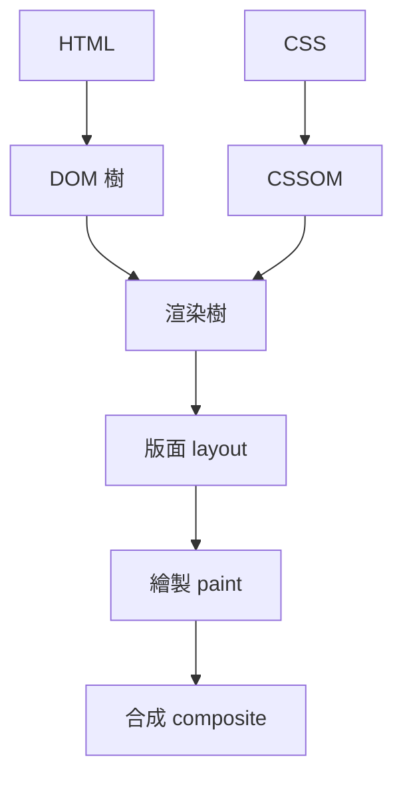

# 第 2 講｜瀏覽器：HTML／CSS／JS 與渲染路徑

> 對應：W11 · 主題 2 · 可驗收產出：指出哪一步會卡住

## 0. 三個問題

1. 同樣的頁面，為什麼有的先看到字、有的先看到白畫面？
2. 一行 JavaScript 為什麼可以讓整頁「卡住」？
3. 你的 spec 要求「1 秒內看到新狀態」，瀏覽器這一段佔多少？

## 1. 三個語言，三種角色

| 語言 | 管什麼 | 不管什麼 |
|---|---|---|
| HTML | 結構與語意 | 外觀、行為 |
| CSS | 外觀與版面 | 內容、邏輯 |
| JavaScript | 行為與資料 | 結構本身 |

## 2. 渲染路徑（六步）

| # | 步驟 | 產出 | 卡住會怎樣 |
|---:|---|---|---|
| 1 | 解析 HTML | DOM 樹 | 白畫面 |
| 2 | 解析 CSS | CSSOM | 樣式閃動（FOUC） |
| 3 | 合併 | 渲染樹 | 隱藏元素不參與 |
| 4 | 版面（layout） | 每個元素的位置大小 | 跳動、重排 |
| 5 | 繪製（paint） | 像素 | 閃爍 |
| 6 | 合成（composite） | 圖層疊合 | 動畫卡頓 |

**重排（reflow）比重繪（repaint）貴**：改尺寸會重排，改顏色只重繪。

## 3. JavaScript 為什麼會卡住畫面

- 瀏覽器的主執行緒同時負責 JS 與渲染。
- 一段長時間的 JS 會讓畫面**完全不能更新**。
- 事件迴圈（event loop）：同步程式先跑完，才輪到渲染與計時器。

| 寫法 | 效果 |
|---|---|
| 同步大迴圈 | 卡住整個畫面 |
| 切成小段（或 Web Worker） | 畫面可以更新 |
| 大量 DOM 操作 | 多次重排 |

## 4. 資源載入：三種腳本

| 屬性 | 行為 | 適用 |
|---|---|---|
| 一般 `<script>` | 下載並執行，**阻塞解析** | 極少 |
| `async` | 下載完就執行，順序不保證 | 獨立的小工具 |
| `defer` | 解析完才依序執行 | 大多數應用程式 |

## 5. 伺服器端渲染與水合

| 模式 | 第一次看到畫面 | 之後 |
|---|---|---|
| CSR（用戶端渲染） | 白畫面→JS 跑完才有 | 都在瀏覽器 |
| SSR（伺服器端渲染） | 伺服器先給 HTML | 水合（hydration）後可互動 |
| SSG（靜態生成） | 建置時就產生 HTML | 同 SSR，但資料較舊 |

> 水合（hydration）＝伺服器給的畫面「接上」互動。水合慢，使用者會覺得「看得到但按不動」。

## 6. 回到你的 1 秒

| 段 | 瀏覽器這裡發生什麼 |
|---|---|
| 網路 | 下載 HTML／CSS／JS |
| 渲染 | 解析、版面、繪製 |
| 互動 | JS 執行、水合 |

## 經典例子：阻塞與不阻塞

同一份 HTML，兩種載入方式：

| 寫法 | 瀏覽器行為 | 使用者看到 |
|---|---|---|
| `<script src="app.js">` 放在 `<head>` | 下載並執行完才繼續解析 | 白畫面較久 |
| `<script src="app.js" defer>` | 先解析 HTML，最後依序執行 | 先看到版面 |

| 寫法 | 樣式套用時機 | 症狀 |
|---|---|---|
| CSS 放 `<head>` | 先有樣式再畫 | 正常 |
| CSS 放 `<body>` 末端 | 先畫無樣式內容 | 樣式閃一下（FOUC） |

> 判準：**畫面要早出現，就把阻塞解析的資源往後放或加 `defer`。**

## 實作範例：量一次 FCP 與 LCP

「FCP（首次內容繪製）」是看到第一個內容的時間；「LCP（最大內容繪製）」是主要內容出現的時間。

````js
new PerformanceObserver((list) => {
  for (const e of list.getEntries()) {
    console.log(e.name, Math.round(e.startTime) + "ms");
  }
}).observe({ type: "largest-contentful-paint", buffered: true });
````

| 指標 | 意思 | 什麼時候看 |
|---|---|---|
| FCP | 第一個內容出現 | 白畫面多久 |
| LCP | 最大內容出現 | 主要內容多久 |
| CLS | 版面跳動 | 載入時有沒有抖 |

> 用法：開 DevTools → Performance 錄一次載入，對照這三個時間。

## 架構圖



## 7. 檢查點（可驗收）

1. 打開你的頁面，指出渲染路徑六步各對應哪個畫面變化。
2. 找出一個「阻塞解析」的資源，說明為什麼。
3. 寫出一個會讓主執行緒卡住的操作，並提出切分方法。
4. 說明你的頁面是 CSR、SSR 還是 SSG，理由是什麼。
