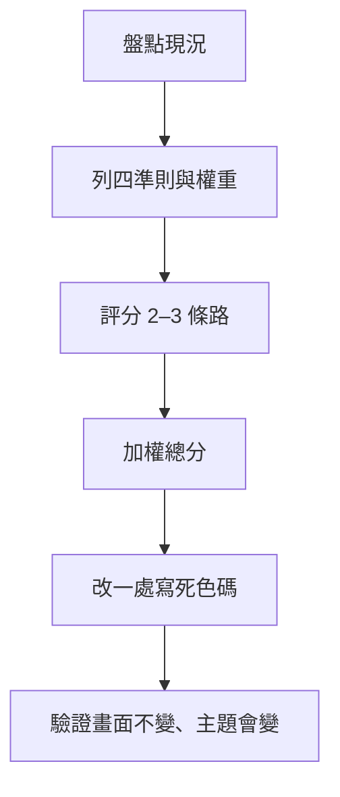

# 第 3 講｜學生操作手冊：樣式策略

> 你要交出：**一張決策矩陣＋一個改寫死的色碼**。
> 每一步都有「這樣算完成」。

## Step 1：盤點你現在的樣式

| 項目 | 你的現況 |
|---|---|
| 顏色寫在哪裡 | |
| 間距寫在哪裡 | |
| 有沒有設計變數 | |
| 有沒有人同時改樣式 | |

這樣算完成：你能指出「改一個顏色要動幾個地方」。

## Step 2：建立四個準則

把四個準則寫下來，各給一個權重（1–3）。

| 準則 | 權重 | 理由 |
|---|---:|---|
| 一致性 | | |
| 客製成本 | | |
| 鎖定風險 | | |
| 維護成本 | | |

這樣算完成：權重加起來是 10，且每個都有理由。

## Step 3：評分

把你考慮的兩到三條路放進矩陣，1–5 分。

| 準則 | 權重 | 路線 A | 路線 B |
|---|---:|---:|---:|
| | | | |

這樣算完成：加權總分算得出來，並寫下「哪一項分數讓你改變決定」。

## Step 4：改一個寫死的色碼

找一個寫死的顏色，改成設計變數。

| 位置 | 原本 | 改成 | 影響頁面 |
|---|---|---|---|

這樣算完成：改完後畫面沒有變化（顏色一樣），但換主題時會跟著變。

## 手動修改實驗：改一個變數，數幾處變

| 項目 | 內容 |
|---|---|
| 目的 | 檢查顏色是否真的集中 |
| 改哪裡 | 設計變數 `--color-primary` |
| 改前 | 例如 `#2563EB` |
| 改後 | 改成 `#DC2626` |
| 觀察 | 畫面有幾處跟著變；有沒有「沒變」的按鈕 |
| 記錄 | 變了幾個地方、漏了幾個地方 |

這樣算完成：漏掉的地方你能指出「色碼被寫死」，改成變數後再測一次。

## 流程圖

## Step 5：交件檢查

- [ ] 四準則與權重
- [ ] 決策矩陣與加權分數
- [ ] 一處色碼改成變數
- [ ] 一句話說明「元件庫 vs 設計系統」
