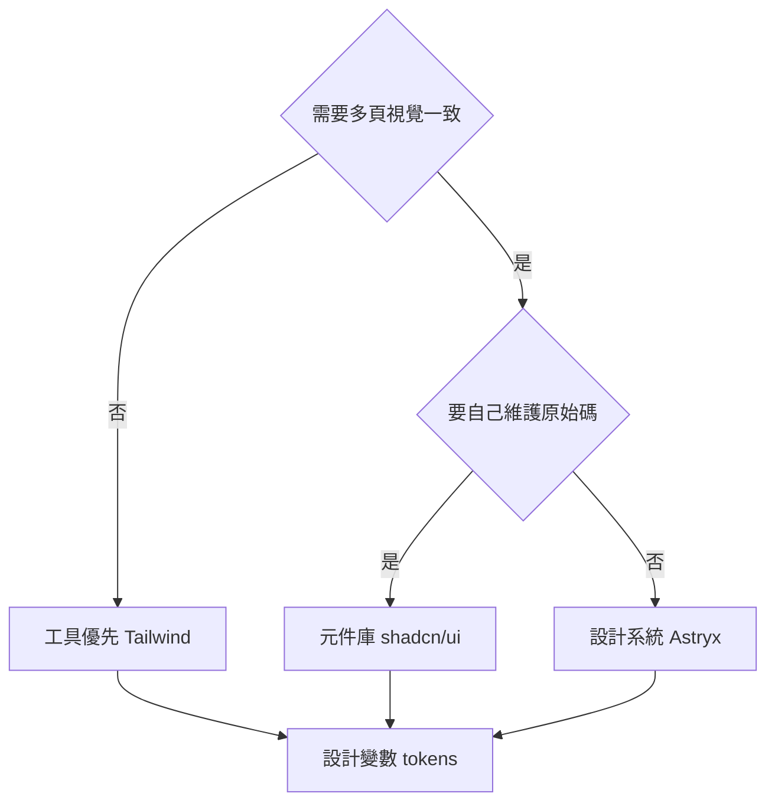

# 第 3 講｜樣式策略：工具優先／元件庫／設計系統

> 對應：W12 · 主題 3 · 可驗收產出：三條路各寫優缺點

## 0. 三個問題

1. 一樣的按鈕，為什麼三個專案長得都不一樣？
2. 改一個品牌色，要動幾個檔案？
3. 引入一個元件庫，是「省事」還是「綁死」？

## 1. 三條路，不是三選一的同類

| 路線 | 代表 | 你拿到什麼 | 你付出什麼 |
|---|---|---|---|
| **工具優先**（utility-first） | Tailwind CSS | 樣式寫在 class，改動快 | HTML 變長、需要設計變數約束 |
| **元件庫**（component library） | shadcn/ui | 原始碼放進你的專案，可改 | 要自己維護、升級靠自己 |
| **設計系統**（design system） | Astryx（Meta，Beta） | 150+ 元件、主題、無障礙 | 綁定其世界觀；Beta 有變動風險 |

> 三者不是替代關係：設計系統可以搭配工具優先的寫法；元件庫也可以吃設計變數。

## 2. 決策的四個準則

| 準則 | 問什麼 |
|---|---|
| 一致性 | 多頁、多人時，樣式會不會漂移 |
| 客製成本 | 改品牌色、改間距要動幾處 |
| 鎖定風險 | 換掉它要重寫多少 |
| 維護成本 | 誰負責升級、誰修 bug |

## 3. 唯一來源：設計變數（tokens）

| 做法 | 結果 |
|---|---|
| 顏色寫死在每個元件 | 改一次要全檔案搜尋 |
| 顏色集中在變數 | 改一處、全部同步 |

> 規則：**畫面不得出現寫死的色碼**；顏色只能來自變數。

## 4. 一個決策矩陣的示範

| 準則 | 權重 | 工具優先 | 元件庫 | 設計系統 |
|---|---:|---:|---:|---:|
| 一致性 | 3 | 4 | 4 | 5 |
| 客製成本 | 3 | 5 | 4 | 2 |
| 鎖定風險 | 2 | 4 | 3 | 2 |
| 維護成本 | 2 | 3 | 3 | 4 |

> 分數不是重點，**準則與權重**才是。換一組權重，答案就不同。

## 架構圖

## 5. 檢查點（可驗收）

1. 為你的專案選一條路，寫出理由與代價。
2. 用四個準則做一張小矩陣（可以只有兩列）。
3. 找出你專案裡一個寫死的色碼，改成變數。
4. 說明「元件庫」與「設計系統」的差別。
