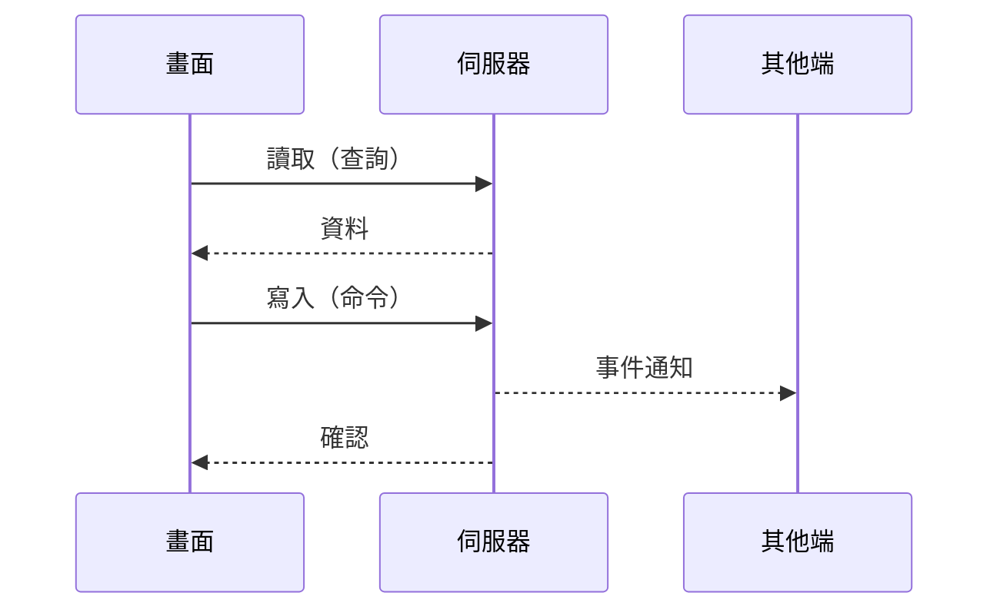

# 第 4 講｜學生操作手冊：React 與狀態

> 你要交出：**一頁的模式選擇＋三條資料線＋一個錯誤**。
> 每一步都有「這樣算完成」。

## Step 1：挑一頁

挑你最複雜的一頁（例如訂單狀態頁）。

| 項目 | 你的答案 |
|---|---|
| 頁面名稱 | |
| 這頁顯示什麼資料 | |
| 資料多久變一次 | |

這樣算完成：說得出「這頁的資料誰在改」。

## Step 2：選渲染模式

| 問題 | 你的答案 |
|---|---|
| 第一次看到畫面時，可以接受資料多舊 | |
| 需不需要搜尋引擎看到 | |
| 有沒有登入後才看得到的內容 | |

這樣算完成：寫出 CSR／SSR／SSG 與一個理由。

## Step 3：畫三條線

| 線 | 從 | 到 | 帶什麼 |
|---|---|---|---|
| 讀取 | | | |
| 寫入 | | | |
| 通知 | | | |

這樣算完成：三條線都畫得出來；畫不出來的，就是你架構還沒想清楚的地方。

## Step 4：找一個狀態錯置

找一個「伺服器端狀態被放進元件」的地方。

| 位置 | 現在怎麼存 | 會出現什麼問題 | 改法 |
|---|---|---|---|

這樣算完成：說得出「兩個版本」會怎麼發生。

## 手動修改實驗：把伺服器資料複製一份

| 項目 | 內容 |
|---|---|
| 目的 | 看見「兩個版本」怎麼發生 |
| 改哪裡 | 把 `GET /orders` 的結果存進 `useState` |
| 改前 | 每次進頁面都重新查 |
| 改後 | 只查一次，之後用複製的那份 |
| 觀察 | 在另一端改狀態後，這一頁會不會更新 |
| 記錄 | 過期的欄位與時間差 |

這樣算完成：你能指出「哪一筆變成舊的」，並改回直接讀伺服器。

## 流程圖

## Step 5：交件檢查

- [ ] 頁面與資料來源
- [ ] 渲染模式與理由
- [ ] 三條資料線
- [ ] 一個狀態錯置與改法
