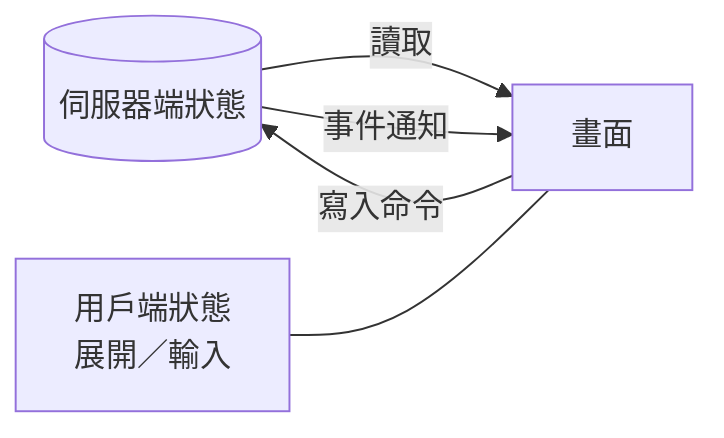

# 第 4 講｜React＋渲染模式＋伺服器端／用戶端狀態

> 對應：W12 · 主題 4 · 可驗收產出：為一頁選模式並畫資料流

## 0. 三個問題

1. 為什麼同一個資料，畫面有時候顯示舊的？
2. 「重新整理就好」——這句話透露了什麼？
3. 資料的真相（source of truth）在哪裡？

## 1. React 的三個概念

| 概念 | 意思 |
|---|---|
| 元件（component） | 畫面的可重複單位 |
| 狀態（state） | 會讓畫面改變的資料 |
| 單向資料流 | 資料由上往下傳，事件由下往上回報 |

> React 只做一件事：**狀態改變 → 重算畫面**。它不管資料從哪來。

## 2. 兩種狀態，不要混

| 種類 | 例子 | 真相在 | 生命週期 |
|---|---|---|---|
| **伺服器端狀態**（server state） | 訂單狀態、庫存 | 伺服器 | 跨頁、跨人 |
| **用戶端狀態**（client state） | 展開／收合、輸入中的字 | 瀏覽器 | 離開就消失 |

把伺服器端狀態放進元件裡自己管，就會出現「兩個版本」。

## 3. 渲染模式

| 模式 | 誰產生 HTML | 適合 |
|---|---|---|
| CSR | 瀏覽器 | 後台、強互動 |
| SSR | 伺服器（每次請求） | 需要即時資料的公開頁 |
| SSG | 建置時 | 不常變的內容 |

> 選模式的判準：**第一次看到畫面時，資料要多新？**

### 三種渲染模式的優缺點

| 模式 | 優點 | 缺點 | 常用情境 |
|---|---|---|---|
| CSR | 互動快、部署簡單 | 首屏慢、SEO 弱 | 後台、登入後頁面 |
| SSR | 首屏好、SEO 好 | 伺服器成本、水合較慢 | 公開頁、需即時資料 |
| SSG | 最快、最便宜 | 資料較舊 | 內容頁、文件 |

**怎麼選**：問「第一次看到畫面時，資料要多新？」和「需不需要搜尋引擎看到？」。

## 4. 資料流怎麼畫

一個畫面至少有三條線：

| 線 | 方向 | 內容 |
|---|---|---|
| 讀取 | 伺服器 → 畫面 | 查詢、訂閱 |
| 寫入 | 畫面 → 伺服器 | 命令、表單 |
| 通知 | 伺服器 → 其他端 | 事件、推播 |

> 你的 1 秒需求，就是「通知」這條線的速度。

## 5. 常見錯誤

| 錯誤 | 症狀 |
|---|---|
| 把查詢結果放進全域狀態 | 多頁不同步 |
| 只用輪詢 | 慢、浪費 |
| 寫入後不更新本地 | 使用者以為沒成功 |
| 沒有處理失敗 | 畫面停在「處理中」 |

## 經典例子：訂單狀態頁的兩種狀態

| 資料 | 種類 | 真相在哪 | 重新整理後 |
|---|---|---|---|
| 訂單目前狀態 | 伺服器端狀態 | 資料庫 | 還在 |
| 取餐號碼 | 伺服器端狀態 | 資料庫 | 還在 |
| 展開的訂單明細 | 用戶端狀態 | 瀏覽器 | 消失 |
| 輸入到一半的備註 | 用戶端狀態 | 瀏覽器 | 消失 |

三條資料線對應：

| 線 | 動作 | 端點示例 |
|---|---|---|
| 讀取 | 取得訂單 | `GET /orders/1042` |
| 寫入 | 更新狀態 | `PATCH /orders/1042` |
| 通知 | 狀態變了 | `SSE /events` |

## 實作範例：伺服器端與用戶端的分界

### 怎麼用這段程式

| 項目 | 內容 |
|---|---|
| 放哪裡 | `app/orders/page.tsx`（Server）與 `app/orders/OrderList.tsx`（Client） |
| 前置 | 完成 Step 1；Next.js 專案可啟動 |
| 怎麼跑 | `bun run dev` → 開 `/orders` |
| 看什麼 | Network 只有一次資料請求；點卡片會展開、不會重新查資料 |
| 常見錯 | Client Component 忘記加 `"use client"`；把 fetch 寫在 Client 造成重複請求 |


```tsx
// app/orders/page.tsx（Server Component）
export default async function Page() {
  const orders = await getOrders();      // 伺服器端讀資料
  return <OrderList orders={orders} />;  // 交給用戶端互動
}
```

```tsx
"use client";
// app/orders/OrderList.tsx（Client Component）
import { useState } from "react";

export function OrderList({ orders }) {
  const [open, setOpen] = useState(null); // 用戶端狀態
  return orders.map(o => (
    <div key={o.id} onClick={() => setOpen(o.id)}>
      {o.status}{open === o.id && <p>取餐號碼：{o.pickupNumber}</p>}
    </div>
  ));
}
```

| 資料 | 放在哪 | 原因 |
|---|---|---|
| 訂單狀態 | Server Component | 真相在伺服器 |
| 展開哪一筆 | Client Component | 只存在畫面 |

## 架構圖



## 6. 檢查點（可驗收）

> 沒有自己的專案時，用 [00_練習資料 使用說明](../00_練習資料/00_使用說明.md) 的示範系統完成本講檢查點。

1. 為你的其中一頁選 CSR／SSR／SSG，寫出理由。
2. 畫出那一頁的三條資料線（讀取／寫入／通知）。
3. 指出一個「伺服器端狀態被當成用戶端狀態」的地方。
4. 說明你的 1 秒需求落在哪一條線上。
