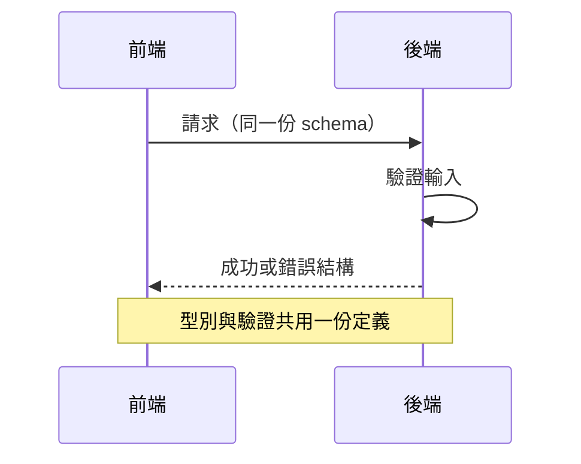

# 第 5 講｜學生操作手冊：TypeScript 與 Zod

> 你要交出：**一份 schema＋推型別＋錯誤結構**。
> 每一步都有「這樣算完成」。

## Step 1：挑一個 API

> 前置環境：無（練習資料：[03_api_contracts.md](../00_練習資料/03_api_contracts.md)）

挑你系統裡最常用的一個（例如「建立訂單」）。

| 項目 | 你的答案 |
|---|---|
| 端點 | |
| 必填欄位 | |
| 選填欄位 | |
| 誰會呼叫 | |

這樣算完成：欄位清單完整，包含型別。

## Step 2：寫 schema

> 前置環境：完成 Step 1

用 Zod 定義一次（或寫成等效的規格表）。

| 欄位 | 型別 | 規則 | 錯誤訊息 |
|---|---|---|---|

這樣算完成：每個欄位都有型別與至少一條規則。

## Step 3：從 schema 推型別

> 前置環境：完成 Step 2

寫下你怎麼從 schema 得到型別（例如 `z.infer`）。

| 用途 | 在哪裡使用 |
|---|---|
| 型別 | |
| 驗證 | |

這樣算完成：型別與驗證共用同一份定義，沒有第二份手寫型別。

## Step 4：錯誤結構

> 前置環境：完成 Step 2

| 情境 | code | message | retryable |
|---|---|---|---|
| 欄位沒填 | | | |
| 時段已滿 | | | |
| 伺服器錯誤 | | | |

這樣算完成：三個情境都能讓前端判斷「要不要重試」。

## Step 5：找出沒驗證的邊界

> 前置環境：完成 Step 1–4

| 邊界 | 現在有沒有驗證 | 缺了會怎樣 |
|---|---|---|

這樣算完成：至少找到一個「外部資料沒驗證」的地方。

## 手動修改實驗：拿掉一條驗證

> 前置環境：完成 Step 2

| 項目 | 內容 |
|---|---|
| 目的 | 看見「沒有驗證」的後果 |
| 改哪裡 | schema 的 `.min(1)`（或 `.max(10)`） |
| 改前 | 有長度限制 |
| 改後 | 移除限制 |
| 觀察 | 送空字串或超長字串，是否還能通過 |
| 記錄 | 通過了哪些不該通過的資料 |

這樣算完成：你能指出「資料在哪一層被擋下」，並把規則加回。

## 進階實作：錯誤訊息對到三個欄位

> 前置環境：完成 Step 1–4

| 步驟 | 做什麼 | 這樣算完成 |
|---:|---|---|
| 1 | 為「建立訂單」寫 schema | 三個欄位都有規則 |
| 2 | 送三個錯誤請求（缺欄位、數量 0、備註過長） | 每個都回 400 |
| 3 | 把回傳的 `errors` 對到表單 | 錯誤顯示在對應欄位下方 |
| 4 | 把 `code` 改成 `message` | 畫面文字變成人看得懂的句子 |

> 完成條件：三個錯誤都出現在正確欄位，且不是一句「格式錯誤」。

## 流程圖

## Step 6：交件檢查

> 前置環境：完成前一個 Step

- [ ] API 欄位表
- [ ] 一份 schema（或等效規格）
- [ ] 型別與驗證共用
- [ ] 錯誤結構三例
- [ ] 一個未驗證邊界

## 參考答案

| 步驟／單元 | 參考答案要點 |
|---|---|
| Step 1 | 端點、必填／選填欄位 |
| Step 2 | 每欄位有型別與至少一條規則 |
| Step 3 | 用 `z.infer` 得到型別，驗證共用同一份 |
| Step 4 | 四欄：code／message／retryable／requestId |
| Step 5 | 至少一個外部資料沒驗證的邊界 |
| 手動修改實驗 | 移除 `.min(1)` 後空字串會通過 |
| 進階實作 | 三個錯誤顯示在對應欄位 |

> 答案為要點，不是唯一寫法；能說出理由即可。
