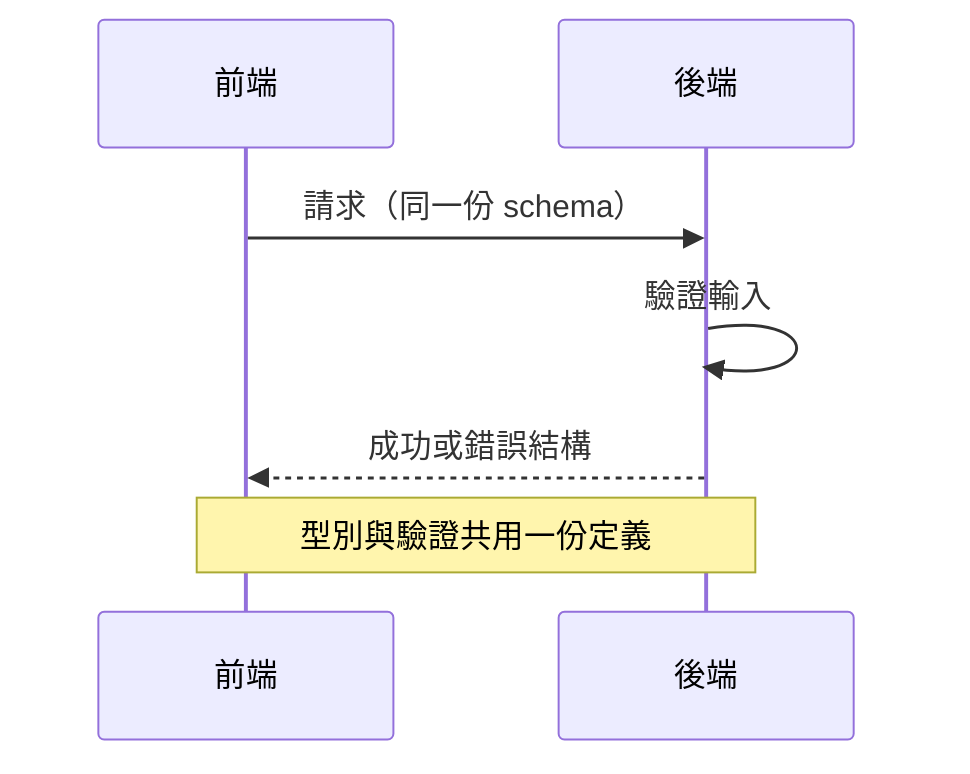

# 第 5 講｜學生操作手冊：TypeScript 與 Zod

> 你要交出：**一份 schema＋推型別＋錯誤結構**。
> 每一步都有「這樣算完成」。

## Step 1：挑一個 API

挑你系統裡最常用的一個（例如「建立訂單」）。

| 項目 | 你的答案 |
|---|---|
| 端點 | |
| 必填欄位 | |
| 選填欄位 | |
| 誰會呼叫 | |

這樣算完成：欄位清單完整，包含型別。

## Step 2：寫 schema

用 Zod 定義一次（或寫成等效的規格表）。

| 欄位 | 型別 | 規則 | 錯誤訊息 |
|---|---|---|---|

這樣算完成：每個欄位都有型別與至少一條規則。

## Step 3：從 schema 推型別

寫下你怎麼從 schema 得到型別（例如 `z.infer`）。

| 用途 | 在哪裡使用 |
|---|---|
| 型別 | |
| 驗證 | |

這樣算完成：型別與驗證共用同一份定義，沒有第二份手寫型別。

## Step 4：錯誤結構

| 情境 | code | message | retryable |
|---|---|---|---|
| 欄位沒填 | | | |
| 時段已滿 | | | |
| 伺服器錯誤 | | | |

這樣算完成：三個情境都能讓前端判斷「要不要重試」。

## Step 5：找出沒驗證的邊界

| 邊界 | 現在有沒有驗證 | 缺了會怎樣 |
|---|---|---|

這樣算完成：至少找到一個「外部資料沒驗證」的地方。

## 流程圖

## Step 6：交件檢查

- [ ] API 欄位表
- [ ] 一份 schema（或等效規格）
- [ ] 型別與驗證共用
- [ ] 錯誤結構三例
- [ ] 一個未驗證邊界
