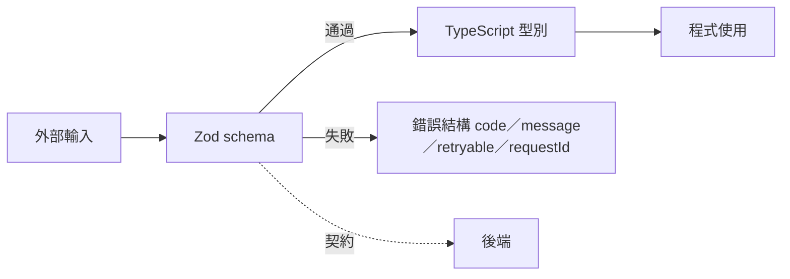

# 第 5 講｜TypeScript＋Zod：結構定義當唯一事實

> 對應：W13 · 主題 5 · 可驗收產出：由 schema 產型別與驗證

## 0. 三個問題

1. 前端與後端對「同一筆資料」的想像，怎麼保證一樣？
2. 型別檢查在編譯後就消失，那執行時誰來擋？
3. 錯誤訊息要寫給誰看：工程師、還是使用者？

## 1. 編譯期 vs 執行期

| 階段 | 誰在檢查 | 擋什麼 |
|---|---|---|
| 編譯期 | TypeScript | 寫錯欄位、型別不符 |
| 執行期 | Zod 等驗證器 | 使用者輸入、外部 API、壞資料 |

> 只有 TypeScript 不夠：**外部來的資料一律不可信**。

## 2. 一個 schema，三種用途

| 用途 | 說明 |
|---|---|
| 型別 | 從 schema 推出 TypeScript 型別 |
| 驗證 | 執行時檢查輸入／輸出 |
| 契約 | 前後端共用同一份定義 |

> 這就叫「唯一事實」：不是文件，是**程式可執行的定義**。

## 3. 定義在哪裡

| 邊界 | 要驗什麼 |
|---|---|
| 使用者輸入 | 表單欄位、格式、長度 |
| API 請求 | 必填、型別、範圍 |
| API 回應 | 後端回來的格式 |
| 事件 | 事件名稱與內容 |

## 4. 錯誤要長什麼樣

| 欄位 | 給誰看 | 例子 |
|---|---|---|
| code | 程式 | `INVALID_PICKUP_SLOT` |
| message | 人 | 取餐時段已額滿 |
| retryable | 程式 | 可重試嗎 |
| requestId | 雙方 | 追查用 |

> 錯誤不是「一句話」，是**一個結構**。

## 5. 常見錯誤

| 錯誤 | 後果 |
|---|---|
| 只在後端驗證 | 前端顯示壞資料 |
| 只在驗證器寫規則 | 型別與驗證不一致 |
| 錯誤只回 500 | 前端無法判斷能不能重試 |
| schema 分散多處 | 兩邊各寫一份，遲早不同步 |

## 經典例子：一份 schema，三種用途

```ts
const OrderInput = z.object({
  customer: z.string().min(1),
  quantity: z.number().int().min(1).max(10),
  note: z.string().max(50).optional()
});
type OrderInput = z.infer<typeof OrderInput>; // 型別
OrderInput.safeParse(req.body);               // 驗證
```

| 用途 | 在哪裡用 | 失敗時 |
|---|---|---|
| 型別 | 前端與後端程式 | 編譯期就擋 |
| 驗證 | API 入口 | 回 400＋錯誤碼 |
| 契約 | 前後端共用 | 兩邊規則一致 |

## 實作範例：把驗證錯誤對到表單欄位

### 怎麼用這段程式

| 項目 | 內容 |
|---|---|
| 放哪裡 | `app/api/orders/route.ts`（或任何 API 入口） |
| 前置 | 完成 Step 1；API 契約（練習資料 [03_api_contracts.md](../00_練習資料/03_api_contracts.md)） |
| 怎麼跑 | 用 curl 送錯誤資料：`curl -X POST /api/orders -d '{}'` |
| 看什麼 | 回 400 與 `errors` 陣列；每個錯誤有 `field` |
| 常見錯 | 只在表單驗證、API 沒驗；錯誤只回一句字串 |


```ts
const result = OrderInput.safeParse(req.body);
if (!result.success) {
  const errors = result.error.issues.map((i) => ({
    field: i.path.join("."),
    code: i.code,
    message: i.message
  }));
  return res.status(400).json({
    code: "VALIDATION_FAILED",
    retryable: false,
    errors
  });
}
```

前端把 `field` 對到表單欄位：

```ts
const [fieldErrors, setFieldErrors] = useState({});
// 收到 400 後
setFieldErrors(Object.fromEntries(res.errors.map(e => [e.field, e.message])));
```

| 後端回傳 | 前端顯示 |
|---|---|
| `field: "quantity"` | 數量欄位下方紅字 |
| `code: "too_small"` | 「至少 1 份」 |
| `retryable: false` | 不顯示「重試」按鈕 |

> 錯誤訊息分兩層：**code 給程式、message 給人**；表單只顯示 message。

## 架構圖



## 6. 檢查點（可驗收）

> 沒有自己的專案時，用 [00_練習資料 使用說明](../00_練習資料/00_使用說明.md) 的示範系統完成本講檢查點。

1. 為一個 API 寫一份 schema。
2. 從 schema 推出型別，並在程式裡使用。
3. 寫出驗證失敗的錯誤結構（四個欄位）。
4. 指出你專案裡「沒有驗證」的邊界。
