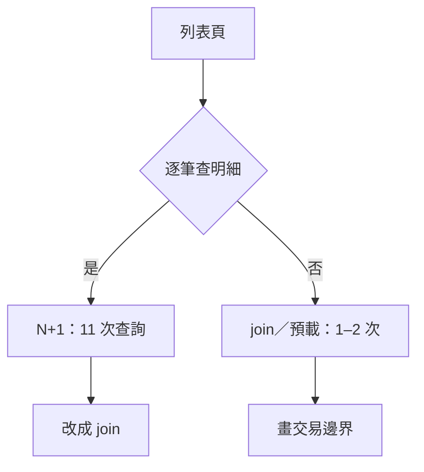

# 第 6 講｜學生操作手冊：資料模型與 ORM

> 你要交出：**一張表的兩種寫法＋一個 N+1＋一個交易邊界**。
> 每一步都有「這樣算完成」。

## Step 1：挑一張表

挑你最核心的表（例如訂單）。

| 欄位 | 型別 | 約束 | 為什麼需要 |
|---|---|---|---|

這樣算完成：每個欄位都有「為什麼需要」，沒有「以備不時之需」。

## Step 2：兩種寫法

用 Prisma 與 Drizzle（或等效的兩種風格）各寫一次「取一筆訂單」。

| 工具 | 寫法（貼上片段） | 你覺得差在哪 |
|---|---|---|
| A | | |
| B | | |

這樣算完成：兩段都能執行，並寫出一句差異（不是「差不多」）。

## Step 3：找 N+1

看你的一個列表頁：先查清單，再逐筆查明細？

| 查詢 | 次數 | 能不能合併 |
|---|---:|---|

這樣算完成：指出一處可能 N+1 的地方與合併方法。

## Step 4：畫交易邊界

挑一個流程（例如建立訂單）。

| 步驟 | 在交易內 | 在交易外 | 理由 |
|---|---|:---:|---|

這樣算完成：外部呼叫（通知、金流）都放在交易外。

## 手動修改實驗：拿掉預載

| 項目 | 內容 |
|---|---|
| 目的 | 看見 N+1（先查清單、再逐筆查） |
| 改哪裡 | `findMany({ include: { items: true } })` |
| 改前 | 有 `include` |
| 改後 | 移除 `include`，在迴圈裡逐筆查 |
| 觀察 | 查詢次數與頁面變慢的程度 |
| 記錄 | 查詢次數：改前／改後 |

這樣算完成：你能從日誌數出查詢次數，並把 `include` 加回。

## 流程圖

## Step 5：交件檢查

- [ ] 一張表的欄位與約束
- [ ] 兩種寫法與差異
- [ ] 一處 N+1 與改法
- [ ] 一個交易邊界
