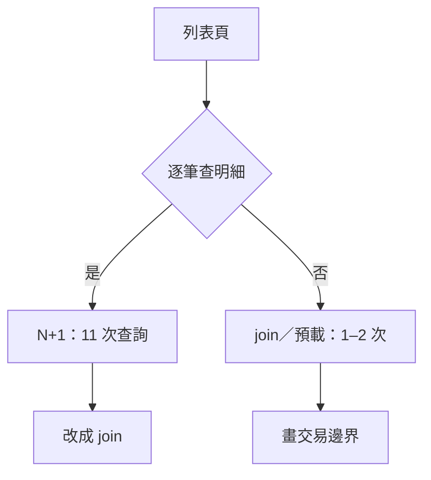

# 第 6 講｜學生操作手冊：資料模型與 ORM

> 你要交出：**一張表的兩種寫法＋一個 N+1＋一個交易邊界**。
> 每一步都有「這樣算完成」。

## Step 1：挑一張表

> 前置環境：無

挑你最核心的表（例如訂單）。

| 欄位 | 型別 | 約束 | 為什麼需要 |
|---|---|---|---|

這樣算完成：每個欄位都有「為什麼需要」，沒有「以備不時之需」。

## Step 2：兩種寫法

> 前置環境：完成 Step 1

用 Prisma 與 Drizzle（或等效的兩種風格）各寫一次「取一筆訂單」。

| 工具 | 寫法（貼上片段） | 你覺得差在哪 |
|---|---|---|
| A | | |
| B | | |

這樣算完成：兩段都能執行，並寫出一句差異（不是「差不多」）。

## Step 3：找 N+1

> 前置環境：完成 Step 2

看你的一個列表頁：先查清單，再逐筆查明細？

| 查詢 | 次數 | 能不能合併 |
|---|---:|---|

這樣算完成：指出一處可能 N+1 的地方與合併方法。

## Step 4：畫交易邊界

> 前置環境：完成 Step 1

挑一個流程（例如建立訂單）。

| 步驟 | 在交易內 | 在交易外 | 理由 |
|---|---|:---:|---|

這樣算完成：外部呼叫（通知、金流）都放在交易外。

## 看懂練習（不必動手）

> 前置環境：讀完本講講義

| 問題 | 你的答案 |
|---|---|
| 「N+1」的 N 是什麼？ | |
| 為什麼 `include` 只要 2 次查詢？ | |
| 拿掉 `@unique` 會發生什麼？ | |

這樣算完成：三題都能用自己的話說一次，不需要實際建表。

## 流程圖

## Step 5：交件檢查

> 前置環境：完成前一個 Step

- [ ] 一張表的欄位與約束
- [ ] 兩種寫法與差異
- [ ] 一處 N+1 與改法
- [ ] 一個交易邊界

## 參考答案

| 步驟／單元 | 參考答案要點 |
|---|---|
| Step 1 | 每欄位都有「為什麼需要」 |
| Step 2 | 兩段可執行寫法＋一句差異 |
| Step 3 | 指出列表→逐筆查並改成預載 |
| Step 4 | 外部呼叫（通知、金流）在交易外 |
| 看懂練習 | N＝清單筆數；`include` 用 join；`@unique` 擋重複 |

> 答案為要點，不是唯一寫法；能說出理由即可。
