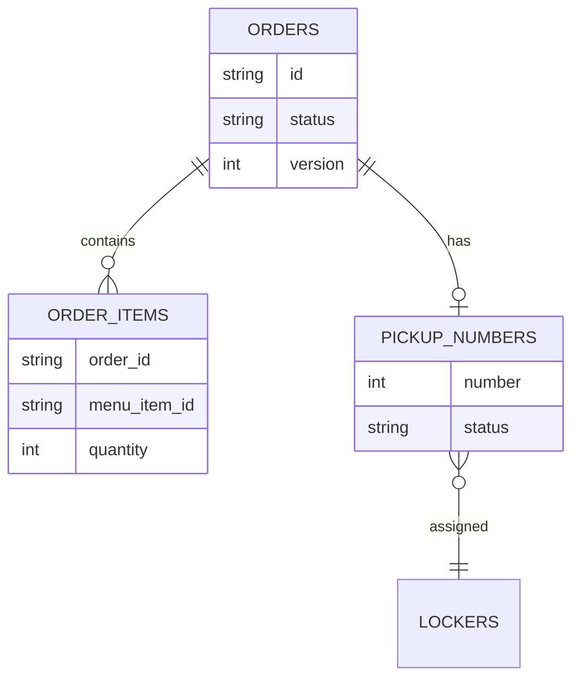

# 第 6 講｜資料模型與 ORM（Prisma／Drizzle）

> 對應：W13 · 主題 6 · 可驗收產出：同一模型寫兩次

## 0. 三個問題

1. 資料庫的資料表，跟程式裡的物件，是同一件事嗎？
2. 為什麼「查一筆資料」會變成「查一百次」？
3. 換一個 ORM，代價是什麼？

## 1. ORM 做什麼、不做什麼

| 做 | 不做 |
|---|---|
| 把資料表映射成程式物件 | 幫你想資料模型 |
| 產生查詢 | 保證查詢效率 |
| 管理遷移（migration） | 處理跨服務一致性 |
| 提供交易介面 | 決定隔離層級 |

> ORM 是「翻譯」，不是「設計」。

## 2. 三種工具，三種哲學

| 工具 | 哲學 | 適合 |
|---|---|---|
| **Prisma** | schema 優先，產生 client | 快速開發、型別完整 |
| **Drizzle** | SQL 優先，薄封裝 | 想控制查詢、邊緣環境 |
| **Kysely** | 型別安全的查詢建構器 | 想手寫 SQL 但要有型別 |

### 三種工具的優缺點

| 工具 | 優點 | 缺點 | 常用情境 |
|---|---|---|---|
| Prisma | 型別完整、遷移方便 | 查詢控制較少、冷啟動 | 快速開發 |
| Drizzle | 接近 SQL、較輕 | 生態較小 | 邊緣環境、要控制查詢 |
| Kysely | 型別安全的查詢建構 | 要自己寫 SQL | 複雜查詢 |

**怎麼選**：要快 → Prisma；要控制 SQL → Drizzle；只要型別 → Kysely。

## 3. N+1：最常見的效能陷阱

| 寫法 | 查詢次數 |
|---|---|
| 先查 10 張訂單，再逐張查明細 | 11 次 |
| 一次 join 或預載 | 1–2 次 |

> 症狀：頁面小資料很快，資料一多就變慢。

## 4. 遷移（migration）

| 原則 | 說明 |
|---|---|
| 版本化 | 每次結構變更一個檔案 |
| 可回滾 | 至少知道怎麼退 |
| 不手改正式資料庫 | 一定走遷移 |

## 5. 交易（transaction）邊界

| 情境 | 要不要交易 |
|---|---|
| 建訂單＋扣庫存 | 要 |
| 只讀報表 | 不用 |
| 發通知 | 不放在交易裡 |

> 交易內只做「必須同時成功」的事；外部呼叫放外面。

## 經典例子：N+1 與預載

```ts
// 11 次查詢
const orders = await db.order.findMany();
for (const o of orders) await db.item.findMany({ where: { orderId: o.id } });

// 2 次查詢
const orders2 = await db.order.findMany({ include: { items: true } });
```

| 寫法 | 查詢次數 | 10 筆訂單時 |
|---|---:|---|
| 逐筆查 | 1＋10 | 明顯變慢 |
| 預載 | 1–2 | 穩定 |

> 症狀：資料少時很快，資料一多就慢。

> **看懂即可**：這一節不要求自己寫 migration／連線池／交易；重點是知道資料表長相、查詢次數與規則的作用。

## 實作範例：Prisma 模型與遷移

```prisma
model Order {
  id        String   @id @default(cuid())
  status    String
  version   Int      @default(0)
  items     OrderItem[]
  pickup    PickupNumber?
  createdAt DateTime @default(now())
}

model OrderItem {
  id       String @id @default(cuid())
  orderId  String
  order    Order  @relation(fields: [orderId], references: [id])
  name     String
  quantity Int
}

model PickupNumber {
  id      String @id @default(cuid())
  number  Int    @unique
  orderId String @unique
  order   Order  @relation(fields: [orderId], references: [id])
}
```

產生的遷移（migration，資料庫結構的版本化變更）：

```sql
CREATE TABLE "PickupNumber" (
  "id" TEXT PRIMARY KEY,
  "number" INTEGER NOT NULL,
  "orderId" TEXT NOT NULL,
  CONSTRAINT "PickupNumber_number_key" UNIQUE ("number"),
  CONSTRAINT "PickupNumber_orderId_key" UNIQUE ("orderId")
);
```

| 查詢寫法 | 次數 |
|---|---:|
| 先 `findMany()`，再逐筆 `findMany({ where: { orderId } })` | 1＋N |
| `findMany({ include: { items: true } })` | 2 |

> `@unique` 不是裝飾：它會真的在資料庫建立唯一索引，擋住重複。

## 架構圖



## 6. 檢查點（可驗收）

1. 用 Prisma 與 Drizzle 各寫一次同一張表的讀取，寫出差異。
2. 找出你專案裡可能 N+1 的查詢。
3. 寫出一個需要交易的流程，並標出邊界。
4. 說明你選哪個 ORM、代價是什麼。
