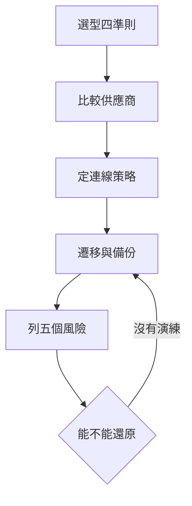

# 第 7 講｜學生操作手冊：資料庫與 serverless

> 你要交出：**選型理由＋連線策略＋遷移備份＋五個風險**。
> 每一步都有「這樣算完成」。

## Step 1：四個準則

| 準則 | 你的答案 |
|---|---|
| 資料形狀 | |
| 一致性需求 | |
| 存取模式 | |
| 維運能力 | |

這樣算完成：四個都寫，且與你的資料模型一致。

## Step 2：選供應商

| 候選 | 優點 | 缺點 | 適不適合 |
|---|---|---|---|

這樣算完成：至少比較兩個，並寫出選擇理由。

## Step 3：連線策略

| 問題 | 你的答案 |
|---|---|
| 應用怎麼連資料庫 | |
| 會不會每次請求都開連線 | |
| 併發上限是多少 | |

這樣算完成：能說出「為什麼不會把連線用完」。

## Step 4：遷移與備份

| 項目 | 你的做法 | 多久做一次 |
|---|---|---|
| 遷移 | | |
| 備份 | | |
| 還原演練 | | |

這樣算完成：還原演練有寫「誰做、多久一次」。

## Step 5：五個風險

| # | 風險 | 影響 | 檢查方式 |
|---:|---|---|---|

這樣算完成：五個風險分屬不同類（連線、查詢、遷移、備份、成本）。

## 手動修改實驗：把連線池設成 1

| 項目 | 內容 |
|---|---|
| 目的 | 看見「連線用完」 |
| 改哪裡 | 連線池上限（pool max） |
| 改前 | 例如 10 |
| 改後 | 1 |
| 觀察 | 同時送 10 個請求，後面的要等多久 |
| 記錄 | 等待時間與失敗數 |

這樣算完成：你能說出「排隊」與「失敗」的差別，並改回原設定。

## 流程圖

## Step 6：交件檢查

- [ ] 四準則
- [ ] 供應商比較
- [ ] 連線策略
- [ ] 遷移與備份
- [ ] 五個風險
