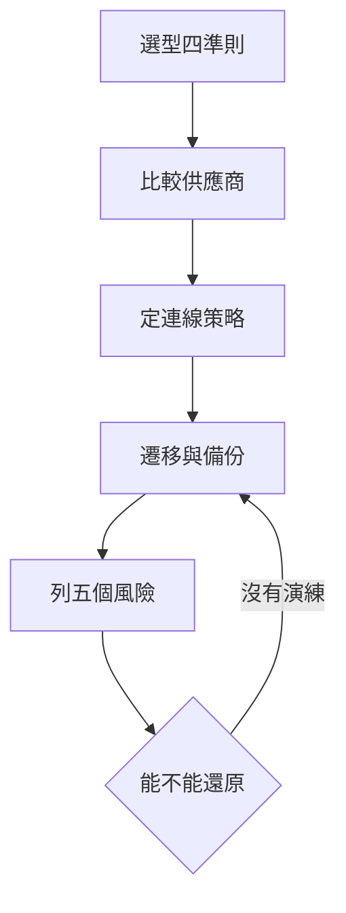

# 第 7 講｜學生操作手冊：資料庫與 serverless

> 你要交出：**選型理由＋連線策略＋遷移備份＋五個風險**。
> 每一步都有「這樣算完成」。

## Step 1：四個準則

> 前置環境：無（練習資料：[01_系統摘要.md](../00_練習資料/01_系統摘要.md)）

| 準則 | 你的答案 |
|---|---|
| 資料形狀 | |
| 一致性需求 | |
| 存取模式 | |
| 維運能力 | |

這樣算完成：四個都寫，且與你的資料模型一致。

## Step 2：選供應商

> 前置環境：完成 Step 1

| 候選 | 優點 | 缺點 | 適不適合 |
|---|---|---|---|

這樣算完成：至少比較兩個，並寫出選擇理由。

## Step 3：連線策略

> 前置環境：完成 Step 2

| 問題 | 你的答案 |
|---|---|
| 應用怎麼連資料庫 | |
| 會不會每次請求都開連線 | |
| 併發上限是多少 | |

這樣算完成：能說出「為什麼不會把連線用完」。

## Step 4：遷移與備份

> 前置環境：完成 Step 3

| 項目 | 你的做法 | 多久做一次 |
|---|---|---|
| 遷移 | | |
| 備份 | | |
| 還原演練 | | |

這樣算完成：還原演練有寫「誰做、多久一次」。

## Step 5：五個風險

> 前置環境：完成 Step 1–4

| # | 風險 | 影響 | 檢查方式 |
|---:|---|---|---|

這樣算完成：五個風險分屬不同類（連線、查詢、遷移、備份、成本）。

## 看懂練習（不必動手）

> 前置環境：讀完本講講義

| 問題 | 你的答案 |
|---|---|
| 連線池為什麼能避免「連線用完」？ | |
| 冷啟動在什麼時候發生？ | |
| 備份沒有還原過，風險是什麼？ | |
| 連線字串為什麼要用 `-pooler`？ | |

這樣算完成：四個名詞各能用一句話解釋。

## 流程圖

## Step 6：交件檢查

> 前置環境：完成前一個 Step

- [ ] 四準則
- [ ] 供應商比較
- [ ] 連線策略
- [ ] 遷移與備份
- [ ] 五個風險

## 參考答案

| 步驟／單元 | 參考答案要點 |
|---|---|
| Step 1 | 四準則都寫，且與資料模型一致 |
| Step 2 | 至少比較兩個，寫出選擇理由 |
| Step 3 | 能說出為什麼不會把連線用完 |
| Step 4 | 遷移可回滾、備份有還原演練 |
| Step 5 | 五風險分屬連線／查詢／遷移／備份／成本 |
| 看懂練習 | 連線池共用連線；冷啟動是久未使用；pooler 由平台管理連線 |

> 答案為要點，不是唯一寫法；能說出理由即可。
