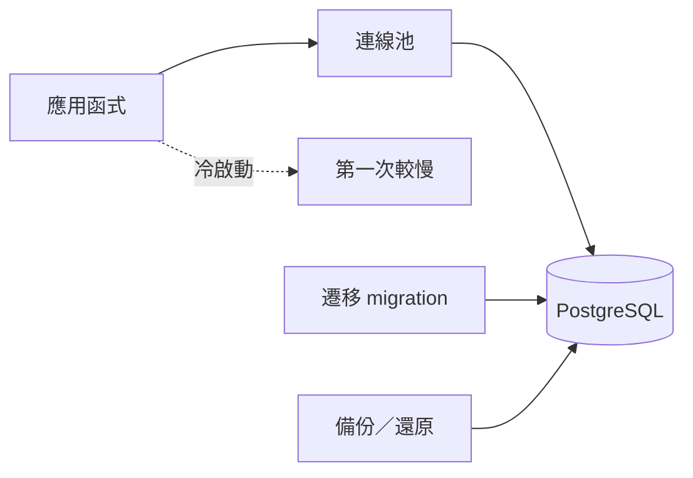

# 第 7 講｜資料庫與 serverless（連線池、遷移）

> 對應：W14 · 主題 7 · 可驗收產出：上線前五個風險

## 0. 三個問題

1. 本機跑得好好的，上線第一小時就掛掉，最常見的原因是什麼？
2. 「serverless 資料庫」省了什麼、貴了什麼？
3. 資料備份與還原，多久測一次？

## 1. 選資料庫先看四件事

| 準則 | 問什麼 |
|---|---|
| 資料形狀 | 關聯式還是文件式 |
| 一致性需求 | 能不能接受短暫不一致 |
| 存取模式 | 讀多寫多、查詢複雜度 |
| 維運能力 | 誰備份、誰升級 |

> 早餐店案例選關聯式：有唯一約束、交易、報表彙總。

## 2. serverless 的三個代價

| 代價 | 說明 | 對策 |
|---|---|---|
| **連線池**（connection pool） | 每個函式都開連線，很快用完 | 用連線池服務或 HTTP 驅動 |
| **冷啟動**（cold start） | 久沒用，第一次慢 | 保持暖機、縮小依賴 |
| 計價 | 按用量計費，查詢多就貴 | 加索引、減少查詢 |

## 3. 供應商對照

| 供應商 | 特色 | 注意 |
|---|---|---|
| Neon | Postgres、分支功能 | 冷啟動 |
| Supabase | Postgres＋周邊服務 | 自管部分較多 |
| Turso／D1 | 邊緣、SQLite 系 | 一致性模型不同 |

### 供應商怎麼選

| 供應商 | 適合 | 不適合 |
|---|---|---|
| Neon | 需要 Postgres、分支、pooler | 需要大量長連線 |
| Supabase | 想要 Postgres 加周邊服務 | 想全部自己管 |
| Turso／D1 | 邊緣、讀多寫少 | 複雜交易 |

**怎麼選**：先問「資料形狀」與「一致性需求」，再看「誰維護」。

## 4. 遷移與備份

| 項目 | 最低要求 |
|---|---|
| 遷移 | 版本化、可回滾 |
| 備份 | 每日、異地 |
| 還原演練 | 至少一次，記下時間 |

## 5. 上線前五個風險（示範）

| # | 風險 | 檢查方式 |
|---:|---|---|
| 1 | 連線數爆掉 | 壓測併發 |
| 2 | 沒有索引的查詢 | 看查詢計畫 |
| 3 | 遷移失敗無法回滾 | 在測試庫演練 |
| 4 | 備份沒還原過 | 實際還原一次 |
| 5 | 計費超出預算 | 設上限與告警 |

## 經典例子：連線池的差別

| 設定 | 併發 50 個請求 | 結果 |
|---|---|---|
| 每個請求開一條連線 | 50 條 | 超過上限，後面的失敗 |
| 連線池上限 10 | 10 條輪流 | 排隊，但不會爆 |

| 現象 | 原因 | 對策 |
|---|---|---|
| 冷啟動慢 | 函式久未使用 | 暖機、縮小依賴 |
| 連線用完 | 每次請求都開 | 連線池或 HTTP 驅動 |

> **看懂即可**：以下程式不要求自己寫，只要知道「為什麼要這樣寫」。

## 實作範例：Prisma 單例與 pooler

````ts
// lib/prisma.ts
import { PrismaClient } from "@prisma/client";

const globalForPrisma = globalThis as unknown as { prisma?: PrismaClient };
export const prisma = globalForPrisma.prisma ?? new PrismaClient();

if (process.env.NODE_ENV !== "production") globalForPrisma.prisma = prisma;
````

| 寫法 | 為什麼 |
|---|---|
| 只建立一個 `PrismaClient` | 避免每次請求都開新連線 |
| `.env` 用 `-pooler` 連線字串 | serverless 環境的連線由 pooler 管理 |
| `sslmode=require` | 連線加密 |

> 這就是「連線池」在程式裡長什麼樣子；看不懂細節沒關係，知道它避免「連線用完」。

## 架構圖



## 6. 檢查點（可驗收）

1. 用四個準則選一個資料庫，寫理由。
2. 說明你的連線策略（連線池或 HTTP）。
3. 寫出遷移與備份的做法。
4. 列出你的五個上線風險。
