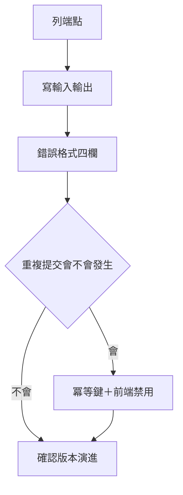

# 第 8 講｜學生操作手冊：REST 契約與錯誤

> 你要交出：**三個端點＋一份錯誤格式＋防重複提交**。
> 每一步都有「這樣算完成」。

## Step 1：列端點

| 動作 | 方法 | 路徑 | 誰會用 |
|---|---|---|---|

這樣算完成：至少三個端點，路徑都是名詞。

## Step 2：寫輸入輸出

挑一個端點，寫清楚：

| 項目 | 內容 |
|---|---|
| 必填欄位 | |
| 選填欄位 | |
| 成功回應 | |
| 失敗回應 | |

這樣算完成：成功與失敗都寫得出來。

## Step 3：錯誤格式

| 情境 | code | message | retryable | requestId |
|---|---|---|---|---|
| 參數錯 | | | | |
| 沒權限 | | | | |
| 衝突 | | | | |
| 伺服器錯 | | | | |

這樣算完成：前端能靠 retryable 決定要不要重試。

## Step 4：防重複提交

| 情境 | 你的做法 |
|---|---|
| 使用者連點 | |
| 網路重送 | |
| 兩人同時改 | |

這樣算完成：三個情境都有做法，且不是「請使用者小心」。

## 流程圖

## Step 5：交件檢查

- [ ] 三個端點
- [ ] 一個端點的輸入輸出
- [ ] 錯誤格式四情境
- [ ] 防重複提交三情境
