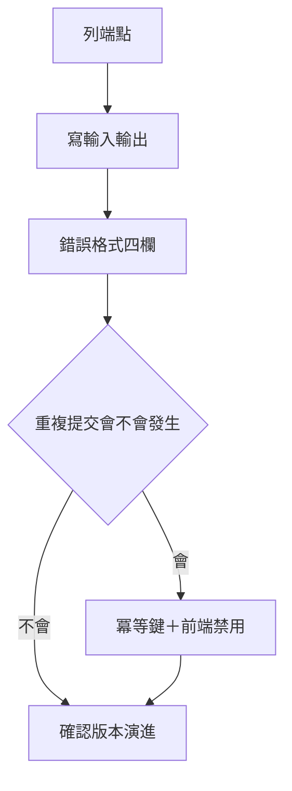

# 第 8 講｜學生操作手冊：REST 契約與錯誤

> 你要交出：**三個端點＋一份錯誤格式＋防重複提交**。
> 每一步都有「這樣算完成」。

## Step 1：列端點

> 前置環境：無（使用練習資料：90_技術與架構/00_練習資料/03_api_contracts.md）

| 動作 | 方法 | 路徑 | 誰會用 |
|---|---|---|---|

這樣算完成：至少三個端點，路徑都是名詞。

## Step 2：寫輸入輸出

> 前置環境：完成 Step 1

挑一個端點，寫清楚：

| 項目 | 內容 |
|---|---|
| 必填欄位 | |
| 選填欄位 | |
| 成功回應 | |
| 失敗回應 | |

這樣算完成：成功與失敗都寫得出來。

## Step 3：錯誤格式

> 前置環境：完成 Step 2

| 情境 | code | message | retryable | requestId |
|---|---|---|---|---|
| 參數錯 | | | | |
| 沒權限 | | | | |
| 衝突 | | | | |
| 伺服器錯 | | | | |

這樣算完成：前端能靠 retryable 決定要不要重試。

## Step 4：防重複提交

> 前置環境：完成 Step 2

| 情境 | 你的做法 |
|---|---|
| 使用者連點 | |
| 網路重送 | |
| 兩人同時改 | |

這樣算完成：三個情境都有做法，且不是「請使用者小心」。

## 手動修改實驗：拿掉 retryable

> 前置環境：完成 Step 3

| 項目 | 內容 |
|---|---|
| 目的 | 看見錯誤格式的作用 |
| 改哪裡 | 錯誤回應的 `retryable` 欄位 |
| 改前 | 有 `retryable` |
| 改後 | 移除 |
| 觀察 | 前端是否還能判斷「要不要重試」 |
| 記錄 | 前端的預設行為（全部重試？全部不重試？） |

這樣算完成：你能指出「少了哪一個欄位，前端只能猜」，並加回。

## 進階實作：寫契約、做一次破壞性變更

> 前置環境：完成 Step 2

| 步驟 | 做什麼 | 這樣算完成 |
|---:|---|---|
| 1 | 為 `GET /orders/{id}` 寫 OpenAPI 片段 | 成功與 404 都有 |
| 2 | 把 `pickupNumber` 改名為 `pickup_no` | 舊前端讀不到 |
| 3 | 改成「同時回兩個欄位」或開 `/v2` | 舊前端仍可用 |
| 4 | 在文件標 `deprecated` | 有移除時程 |

> 完成條件：你能指出哪一步是破壞性變更，以及為什麼「先加後刪」。

## 流程圖

## Step 5：寫出 REST 與 gRPC 三個差異

> 前置環境：讀完本講第 6 節

不看講義，先自己寫：

| 面向 | REST | gRPC |
|---|---|---|
| 資料格式 | | |
| 瀏覽器直連 | | |
| 串流 | | |

再對照講義第 6 節修正。

這樣算完成：三格都寫對，並能說出「為什麼瀏覽器要 proxy」。

## Step 6：交件檢查

> 前置環境：完成前一個 Step

- [ ] 三個端點
- [ ] 一個端點的輸入輸出
- [ ] 錯誤格式四情境
- [ ] 防重複提交三情境

## 參考答案

| 步驟／單元 | 參考答案要點 |
|---|---|
| Step 1 | 至少三個端點，路徑用名詞 |
| Step 2 | 必填／選填／成功／失敗都寫 |
| Step 3 | 四情境，前端能靠 retryable 決定重試 |
| Step 4 | 連點、重送、同時改都有做法 |
| 手動修改實驗 | 少了 retryable，前端只能猜 |
| 進階實作 | 改名是破壞性；先加後刪 |
| Step 5 | 格式（JSON／Protobuf）、瀏覽器（原生／需 proxy）、串流（另外做／原生） |

> 答案為要點，不是唯一寫法；能說出理由即可。
