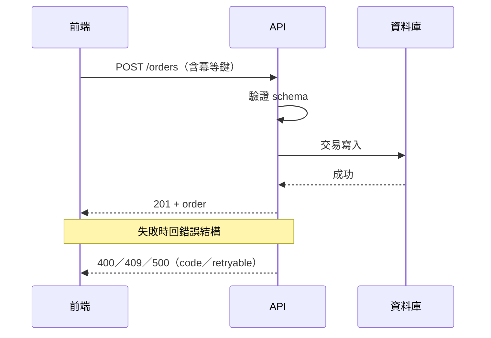

# 第 8 講｜REST 契約（contract）與錯誤處理

> 對應：W14 · 主題 8 · 可驗收產出：一份 API 契約

## 0. 三個問題

1. 前端要怎麼知道「這個錯誤能不能重試」？
2. 同一個動作，該用 POST 還是 PATCH？
3. 介面改了，舊的用戶端怎麼辦？

## 1. 契約的四件事

| 項目 | 內容 |
|---|---|
| 端點（endpoint） | 路徑與方法 |
| 輸入 | 參數、必填、型別 |
| 輸出 | 成功與失敗的格式 |
| 錯誤 | 錯誤碼、可重試、請求識別碼 |

> 契約不是文件，是**雙方同意且可驗證的約定**。

## 2. 方法與路徑

| 動作 | 方法 | 例子 |
|---|---|---|
| 讀取 | GET | `GET /orders` |
| 建立 | POST | `POST /orders` |
| 部分更新 | PATCH | `PATCH /orders/{id}` |
| 取代 | PUT | 少用 |
| 刪除 | DELETE | `DELETE /orders/{id}` |

> 路徑用名詞（資源），動詞放在方法裡。

## 3. 錯誤格式（四欄）

| 欄位 | 例子 | 給誰 |
|---|---|---|
| code | `PICKUP_SLOT_FULL` | 程式 |
| message | 取餐時段已額滿 | 人 |
| retryable | false | 程式 |
| requestId | `req_8f2c` | 雙方追查 |

## 4. 一致性與重複提交

| 情境 | 做法 |
|---|---|
| 使用者連點兩次 | 前端禁用＋後端冪等（idempotent）鍵 |
| 網路逾時重送 | 帶同一個冪等（idempotent）鍵 |
| 同時改同一筆 | 版本號或樂觀鎖 |

## 5. 版本演進

| 做法 | 說明 |
|---|---|
| 新增欄位 | 通常安全 |
| 改欄位型別 | 破壞性，要版本 |
| 移除欄位 | 先標棄用，再移除 |
| 錯誤碼新增 | 前端要有預設處理 |

## 經典例子：一個端點的完整契約

| 項目 | 內容 |
|---|---|
| 方法與路徑 | `GET /orders/{id}` |
| 成功 | `200`＋`{ id, status, pickupNumber }` |
| 參數錯 | `400`＋`{ code:"INVALID_ID", retryable:false }` |
| 沒權限 | `403`＋`{ code:"FORBIDDEN", retryable:false }` |
| 找不到 | `404`＋`{ code:"NOT_FOUND", retryable:false }` |
| 伺服器錯 | `500`＋`{ code:"INTERNAL", retryable:true }` |

> `retryable` 是給程式看的：決定「要不要再試一次」。

## 實作範例：OpenAPI 契約片段

### 怎麼用這段程式

| 項目 | 內容 |
|---|---|
| 放哪裡 | 專案的 `docs/openapi.yaml` |
| 前置 | 完成 Step 1；練習資料 [03_api_contracts.md](../00_練習資料/03_api_contracts.md) |
| 怎麼跑 | 貼到 `editor.swagger.io`，或用 VS Code 的 OpenAPI 預覽 |
| 看什麼 | 200 與 404 的回應結構；錯誤有沒有 `retryable` |
| 常見錯 | YAML 縮排錯；只寫成功、沒寫錯誤 |


「OpenAPI（介面描述格式）」用一份檔案描述端點、輸入、輸出與錯誤。

```yaml
openapi: 3.0.3
info: { title: Breakfast API, version: "1.0" }
paths:
  /orders/{id}:
    get:
      parameters:
        - { name: id, in: path, required: true, schema: { type: string } }
      responses:
        "200":
          description: 成功
          content:
            application/json:
              schema:
                type: object
                properties:
                  id: { type: string }
                  status: { type: string }
                  pickupNumber: { type: string, nullable: true }
        "404":
          description: 找不到
```

版本演進：

| 變更 | 類型 | 做法 |
|---|---|---|
| 新增欄位 | 非破壞性 | 直接加 |
| 改欄位名 | 破壞性 | 開 `/v2` 或先回兩個欄位 |
| 移除欄位 | 破壞性 | 先標 `deprecated`，至少一版後移除 |

> 契約是「雙方同意且可驗證」的檔案；不是寫給人看的說明書。

## 架構圖



## 6. REST 與 gRPC：前端視角

| 面向 | REST（以資源為中心） | gRPC（遠端程序呼叫） |
|---|---|---|
| 契約 | OpenAPI（YAML／JSON） | `.proto` |
| 資料格式 | JSON（文字，可直接讀） | Protobuf（二進位，較小） |
| 瀏覽器直連 | 原生支援 | **不行**，需 gRPC-Web＋proxy |
| 串流 | 另外做 SSE／WebSocket | 原生支援四種串流 |
| 快取 | HTTP 快取成熟 | 較難 |
| 除錯 | curl／瀏覽器可直接看 | 需 grpcurl 等工具 |
| 程式碼產生 | 選用 | 內建 |
| 典型場景 | 公開 API、前端直連 | 服務與服務之間、高頻內部呼叫 |

前端要記住的三件事：

1. **瀏覽器不能直接說 gRPC**：多一層 proxy，部署與除錯都變重。
2. **REST 靠 HTTP 語意**：狀態碼、快取、快取失效都由 HTTP 負責。
3. **兩者都要有契約**：只是一個用 OpenAPI、一個用 `.proto`。

> 本課的選擇：**REST＋SSE**。gRPC 知道差異與成本即可，不要求實作。

### 各自優缺點

| 面向 | REST | gRPC |
|---|---|---|
| **優點** | 瀏覽器原生、HTTP 快取成熟、可讀、工具多 | 二進位較小、契約強制、可產生程式碼、原生串流 |
| **缺點** | 文字較大、沒有原生串流、契約要另外維護 | 瀏覽器需 proxy、除錯較難、快取較弱 |
| **常用情境** | 公開 API、前端直連、CRUD | 服務與服務之間、高頻、內部系統 |
| **不適合** | 高頻二進位、雙向串流 | 瀏覽器直連、需要 HTTP 快取 |

### 怎麼選（三個問題）

1. **呼叫方是瀏覽器嗎？** 是 → REST。
2. **是服務與服務之間、且量大嗎？** 是 → gRPC。
3. **需要伺服器主動推嗎？** 單向 → SSE；雙向 → WebSocket（不是 gRPC）。

### 選錯的代價

| 選錯 | 會發生什麼 |
|---|---|
| 前端直連選 gRPC | 多一層 proxy，部署與除錯變重 |
| 服務間選 REST | 文字量大、契約靠人工同步 |
| 單向推播選 WebSocket | 連線管理變複雜，卻用不到雙向 |

## 7. 檢查點（可驗收）

> 沒有自己的專案時，用 [00_練習資料 使用說明](../00_練習資料/00_使用說明.md) 的示範系統完成本講檢查點。

1. 為你的系統寫三個端點（含方法與路徑）。
2. 為其中一個端點寫錯誤格式（四欄）。
3. 說明「連點兩次」你怎麼防。
4. 說明一個破壞性變更與你的處理方式。
5. 說出 REST 與 gRPC 的三個差異（格式、瀏覽器、串流／工具）。
6. 什麼情況下你會選 REST 而不是 gRPC？
