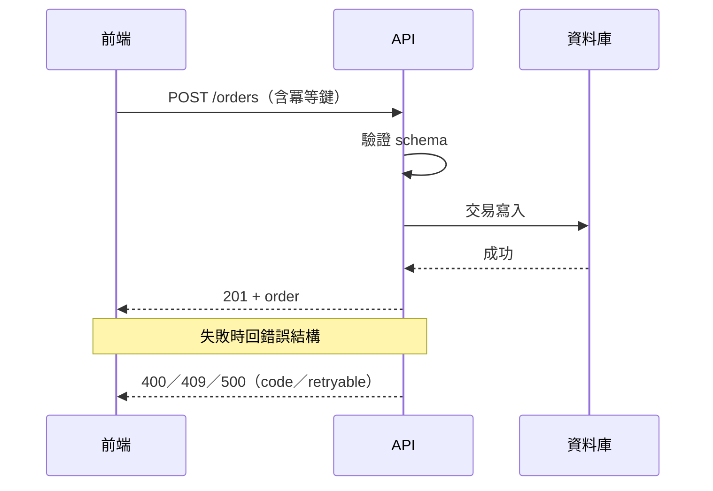

# 第 8 講｜REST 契約（contract）與錯誤處理

> 對應：W14 · 主題 8 · 可驗收產出：一份 API 契約

## 0. 三個問題

1. 前端要怎麼知道「這個錯誤能不能重試」？
2. 同一個動作，該用 POST 還是 PATCH？
3. 介面改了，舊的用戶端怎麼辦？

## 1. 契約的四件事

| 項目 | 內容 |
|---|---|
| 端點（endpoint） | 路徑與方法 |
| 輸入 | 參數、必填、型別 |
| 輸出 | 成功與失敗的格式 |
| 錯誤 | 錯誤碼、可重試、請求識別碼 |

> 契約不是文件，是**雙方同意且可驗證的約定**。

## 2. 方法與路徑

| 動作 | 方法 | 例子 |
|---|---|---|
| 讀取 | GET | `GET /orders` |
| 建立 | POST | `POST /orders` |
| 部分更新 | PATCH | `PATCH /orders/{id}` |
| 取代 | PUT | 少用 |
| 刪除 | DELETE | `DELETE /orders/{id}` |

> 路徑用名詞（資源），動詞放在方法裡。

## 3. 錯誤格式（四欄）

| 欄位 | 例子 | 給誰 |
|---|---|---|
| code | `PICKUP_SLOT_FULL` | 程式 |
| message | 取餐時段已額滿 | 人 |
| retryable | false | 程式 |
| requestId | `req_8f2c` | 雙方追查 |

## 4. 一致性與重複提交

| 情境 | 做法 |
|---|---|
| 使用者連點兩次 | 前端禁用＋後端冪等（idempotent）鍵 |
| 網路逾時重送 | 帶同一個冪等（idempotent）鍵 |
| 同時改同一筆 | 版本號或樂觀鎖 |

## 5. 版本演進

| 做法 | 說明 |
|---|---|
| 新增欄位 | 通常安全 |
| 改欄位型別 | 破壞性，要版本 |
| 移除欄位 | 先標棄用，再移除 |
| 錯誤碼新增 | 前端要有預設處理 |

## 架構圖

## 6. 檢查點（可驗收）

1. 為你的系統寫三個端點（含方法與路徑）。
2. 為其中一個端點寫錯誤格式（四欄）。
3. 說明「連點兩次」你怎麼防。
4. 說明一個破壞性變更與你的處理方式。
