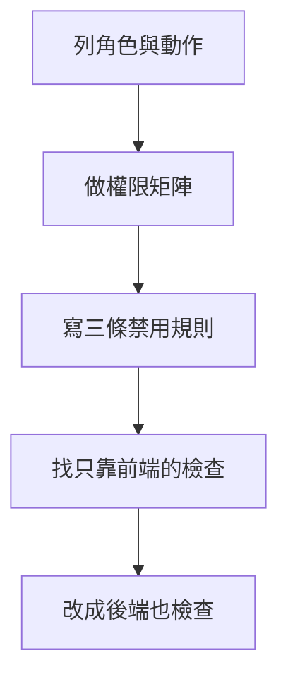

# 第 9 講｜學生操作手冊：身分驗證與授權

> 你要交出：**權限矩陣＋三條禁用規則＋一個風險**。
> 每一步都有「這樣算完成」。

## Step 1：列角色與動作

| 角色 | 主要動作 |
|---|---|
| 顧客 | |
| 店員 | |
| 廚師 | |
| 老闆 | |

這樣算完成：每個角色至少三個動作。

## Step 2：做權限矩陣

| 動作 | 顧客 | 店員 | 廚師 | 老闆 |
|---|:---:|:---:|:---:|:---:|
| 建立訂單 | | | | |
| 確認接單 | | | | |
| 回報完成 | | | | |
| 入櫃 | | | | |
| 取餐 | | | | |
| 改菜單 | | | | |

這樣算完成：每格填「可／不可」，並在下面寫理由。

## Step 3：三條禁用規則

| # | 規則 | 誰不能做 | 理由 |
|---:|---|---|---|

這樣算完成：三條都寫得出「誰、不能做什麼、為什麼」。

## Step 4：找出只靠前端的檢查

| 位置 | 現在怎麼擋 | 直接打 API 會怎樣 | 改法 |
|---|---|---|---|

這樣算完成：你能示範「繞過前端」會發生什麼。

## 手動修改實驗：拿掉後端檢查

| 項目 | 內容 |
|---|---|
| 目的 | 證明「前端不是安全邊界」 |
| 改哪裡 | 後端的權限檢查（示範環境） |
| 改前 | 有 `assertRole(...)` |
| 改後 | 註解掉 |
| 觀察 | 用店員身分直接呼叫顧客端點，是否成功 |
| 記錄 | 哪些端點被繞過 |

這樣算完成：你能示範「繞過前端」，並把檢查加回；測試只在示範環境做。

## 流程圖

## Step 5：交件檢查

- [ ] 角色與動作
- [ ] 權限矩陣
- [ ] 三條禁用規則
- [ ] 一個只靠前端的風險與改法
