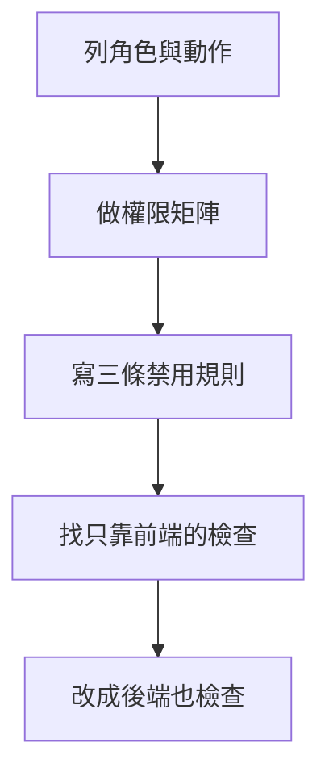

# 第 9 講｜學生操作手冊：身分驗證與授權

> 你要交出：**權限矩陣＋三條禁用規則＋一個風險**。
> 每一步都有「這樣算完成」。

## Step 1：列角色與動作

> 前置環境：無

| 角色 | 主要動作 |
|---|---|
| 顧客 | |
| 店員 | |
| 廚師 | |
| 老闆 | |

這樣算完成：每個角色至少三個動作。

## Step 2：做權限矩陣

> 前置環境：完成 Step 1

| 動作 | 顧客 | 店員 | 廚師 | 老闆 |
|---|:---:|:---:|:---:|:---:|
| 建立訂單 | | | | |
| 確認接單 | | | | |
| 回報完成 | | | | |
| 入櫃 | | | | |
| 取餐 | | | | |
| 改菜單 | | | | |

這樣算完成：每格填「可／不可」，並在下面寫理由。

## Step 3：三條禁用規則

> 前置環境：完成 Step 2

| # | 規則 | 誰不能做 | 理由 |
|---:|---|---|---|

這樣算完成：三條都寫得出「誰、不能做什麼、為什麼」。

## Step 4：找出只靠前端的檢查

> 前置環境：完成 Step 3

| 位置 | 現在怎麼擋 | 直接打 API 會怎樣 | 改法 |
|---|---|---|---|

這樣算完成：你能示範「繞過前端」會發生什麼。

## 手動修改實驗：拿掉後端檢查

> 前置環境：完成 Step 1–4

| 項目 | 內容 |
|---|---|
| 目的 | 證明「前端不是安全邊界」 |
| 改哪裡 | 後端的權限檢查（示範環境） |
| 改前 | 有 `assertRole(...)` |
| 改後 | 註解掉 |
| 觀察 | 用店員身分直接呼叫顧客端點，是否成功 |
| 記錄 | 哪些端點被繞過 |

這樣算完成：你能示範「繞過前端」，並把檢查加回；測試只在示範環境做。

## 進階實作（選做）：三個權限測試

> 前置環境：完成 Step 1–4（選做）

| 測試 | 請求 | 預期 | 實際 |
|---|---|---|---|
| 店員確認接單 | `PATCH /orders/1/confirm` | 200 | |
| 廚師確認接單 | 同上，廚師憑證 | 403 | |
| 未帶憑證 | 同上，不帶 token | 401 | |

完成條件：

1. 三個結果都符合。
2. 把中介層拿掉後，廚師的請求變成 200（證明邊界在下游）。
3. 把中介層加回，恢復 403。

## 流程圖

## Step 5：交件檢查

> 前置環境：完成前一個 Step

- [ ] 角色與動作
- [ ] 權限矩陣
- [ ] 三條禁用規則
- [ ] 一個只靠前端的風險與改法

## 參考答案

| 步驟／單元 | 參考答案要點 |
|---|---|
| Step 1 | 四角色各至少三個動作 |
| Step 2 | 每格可／不可，並寫理由 |
| Step 3 | 三條都寫出誰、不能做什麼、為什麼 |
| Step 4 | 能示範繞過前端會發生什麼 |
| 手動修改實驗 | 拿掉檢查後廚師請求變 200 |
| 進階實作 | 店員 200、廚師 403、無憑證 401 |

> 答案為要點，不是唯一寫法；能說出理由即可。
