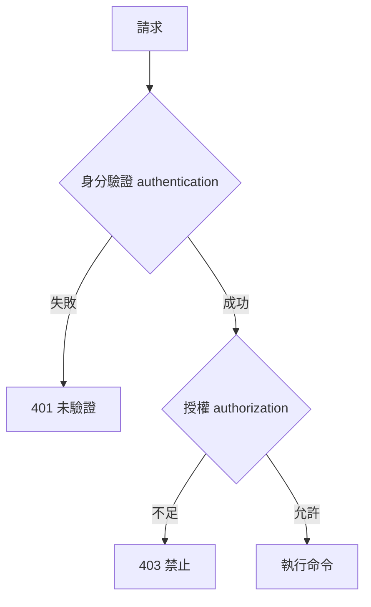

# 第 9 講｜身分驗證（authentication）與授權（authorization）

> 對應：W15 · 主題 9 · 可驗收產出：權限矩陣＋三條禁用規則

## 0. 三個問題

1. 「他是誰」與「他能做什麼」，為什麼要分開問？
2. 前端把按鈕藏起來，後端就可以不做檢查嗎？
3. 店員能不能替顧客按下「已取餐」？

## 1. 兩個詞，兩件事

| 詞 | 中文 | 回答 | 失敗時 |
|---|---|---|---|
| authentication | 身分驗證 | 你是誰 | 401 未驗證 |
| authorization | 授權 | 你能做什麼 | 403 禁止 |

> 先驗證身分，再判斷權限；順序不能反。

## 2. 三種常見做法

| 做法 | 說明 | 適用 |
|---|---|---|
| Session＋Cookie | 伺服器存狀態 | 傳統網站 |
| Token（JWT） | 用戶端帶憑證 | 前後端分離 |
| 外部供應商 | 交給第三方驗證 | 想省維運 |

> 選哪一種，取決於「你要不要自己管登入」。

## 3. 角色與範圍（actor scope）

| 角色 | 能做 | 不能做 |
|---|---|---|
| 顧客 | 看自己的訂單、取餐 | 改別人訂單 |
| 店員 | 接單、入櫃、收款 | 改菜單價格 |
| 廚師 | 回報製作進度 | 收款 |
| 老闆 | 菜單、報表 | 代替顧客取餐 |

> 示範環境可用「角色切換」，但**命令仍要檢查權限**，不能只靠畫面。

## 4. 前端不是安全邊界

| 想法 | 事實 |
|---|---|
| 按鈕藏起來就安全 | 直接打 API 就繞過 |
| 前端驗證就夠 | 任何人都能改請求 |
| Token 放前端很安全 | 要防 XSS 竊取 |

> 前端做「體驗」，後端做「安全」。兩邊都要，但責任不同。

## 5. 禁用規則（三條示範）

| # | 規則 | 理由 |
|---:|---|---|
| 1 | 顧客不得讀取他人訂單 | 隱私 |
| 2 | 店員不得修改已入櫃的取餐號碼 | 一致性 |
| 3 | 廚師不得把訂單推進到可取餐 | 角色邊界 |

## 經典例子：權限矩陣與兩種錯誤

| 動作 | 顧客 | 店員 | 廚師 | 老闆 |
|---|:---:|:---:|:---:|:---:|
| 建立訂單 | 可 | 可 | 不可 | 可 |
| 確認接單 | 不可 | 可 | 不可 | 可 |
| 回報完成 | 不可 | 不可 | 可 | 可 |
| 入櫃 | 不可 | 可 | 不可 | 可 |
| 取餐 | 可 | 可 | 不可 | 不可 |

| 狀態碼 | 意思 | 什麼時候 |
|---|---|---|
| 401 | 未通過身分驗證 | 沒帶憑證、憑證過期 |
| 403 | 已驗證但沒有權限 | 店員去改菜單 |

> **前端視角**：權限矩陣與 401／403 必會；中介層程式看懂即可，不要求自己寫。

## 實作範例：權限中介層

「中介層（middleware）」是請求進入業務邏輯前的一道檢查。

````ts
type Role = "customer" | "staff" | "cook" | "owner";

const MATRIX: Record<Role, string[]> = {
  customer: ["order:create", "order:pickup"],
  staff:    ["order:create", "order:confirm", "order:locker", "order:pickup"],
  cook:     ["order:complete"],
  owner:    ["order:create", "order:confirm", "order:locker", "menu:edit"]
};

export function requireRole(action: string) {
  return (req, res, next) => {
    if (!req.user) {
      return res.status(401).json({ code: "UNAUTHENTICATED", retryable: false });
    }
    if (!MATRIX[req.user.role]?.includes(action)) {
      return res.status(403).json({ code: "FORBIDDEN", retryable: false });
    }
    next();
  };
}

app.patch("/orders/:id/confirm", requireRole("order:confirm"), handler);
````

| 測試 | 預期 |
|---|---|
| 店員呼叫 `order:confirm` | 200 |
| 廚師呼叫 `order:confirm` | 403 |
| 未帶憑證 | 401 |

> 前端隱藏按鈕只影響體驗；**這個中介層才是權限的邊界**。

## 架構圖



## 6. 檢查點（可驗收）

1. 做一張權限矩陣（角色 × 動作）。
2. 寫出三條禁用規則與理由。
3. 說明「401」與「403」什麼時候出現。
4. 指出你系統裡一個「只靠前端」的檢查。
