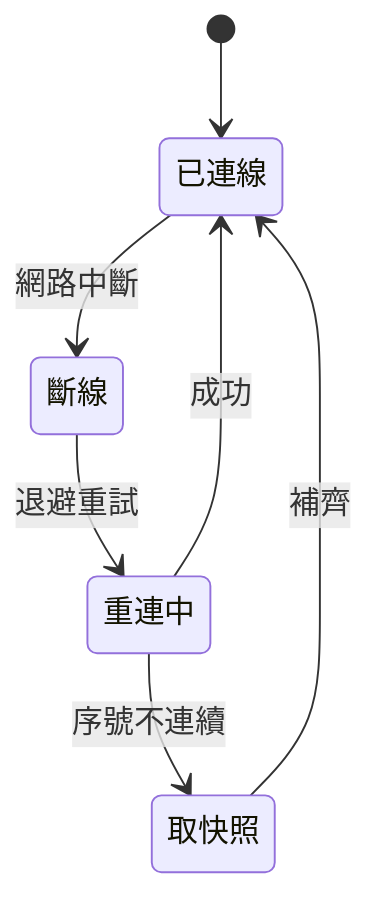

# 第 10 講｜學生操作手冊：即時更新與可觀測性

> 你要交出：**選型理由＋復原流程＋事件紀錄欄位**。
> 每一步都有「這樣算完成」。

> 名詞：快照（snapshot，某個時間點的完整狀態）／降級（graceful degradation，主要通道失效時改用替代通道）／事件序號（sequence，遞增編號用來判斷新舊）。

## Step 1：列出要即時的資料

| 資料 | 多久變一次 | 誰在看 | 延遲容忍 |
|---|---|---|---|

這樣算完成：至少三筆，且寫得出「幾秒可以接受」。

## Step 2：選方式

| 候選 | 延遲 | 成本 | 適不適合 |
|---|---|---|---|
| 輪詢 | | | |
| SSE | | | |
| WebSocket | | | |

這樣算完成：選一個並寫「為什麼不是另外兩個」。

## Step 3：復原流程

| 情境 | 第一步 | 第二步 | 第三步 |
|---|---|---|---|
| 短暫斷線 | | | |
| 長時間斷線 | | | |

這樣算完成：兩條流程都包含「快照」與「補事件」。

## Step 4：降級方案

| 主通道失效 | 替代通道 | 使用者會看到什麼 |
|---|---|---|

這樣算完成：替代通道真的可行（不是「請使用者重試」）。

## Step 5：事件紀錄

| 欄位 | 你的值 |
|---|---|
| 事件名稱 | |
| 對象 | |
| 之前／之後 | |
| 誰 | |
| 何時 | |
| 請求識別碼 | |
| 序號 | |

這樣算完成：七個欄位都能填，且能回答「這筆是誰改的」。

## 手動修改實驗：拿掉事件序號

| 項目 | 內容 |
|---|---|
| 目的 | 看見「亂序」與「重複」 |
| 改哪裡 | 事件的 `sequence` 欄位 |
| 改前 | 有遞增序號 |
| 改後 | 移除 |
| 觀察 | 斷線重連後，事件順序是否正確、是否重複 |
| 記錄 | 錯亂的事件與次數 |

這樣算完成：你能說出「序號用來判斷新舊」，並加回。

## 進階實作：斷線後補回事件

| 步驟 | 做什麼 | 這樣算完成 |
|---:|---|---|
| 1 | 用 `EventSource` 連 `/events` | 收到第一筆事件 |
| 2 | 記下 `lastSeq` | 序號會遞增 |
| 3 | DevTools 設 `Offline` 10 秒 | 連線中斷 |
| 4 | 恢復連線 | 自動重連 |
| 5 | 檢查事件 | 沒有重複、沒有跳號 |

> 完成條件：你能出示「斷線期間的事件被補回」或「跳號時取快照」。

## 流程圖

## Step 6：交件檢查

- [ ] 即時資料清單
- [ ] 方式選擇與理由
- [ ] 復原流程
- [ ] 降級方案
- [ ] 事件紀錄七欄
