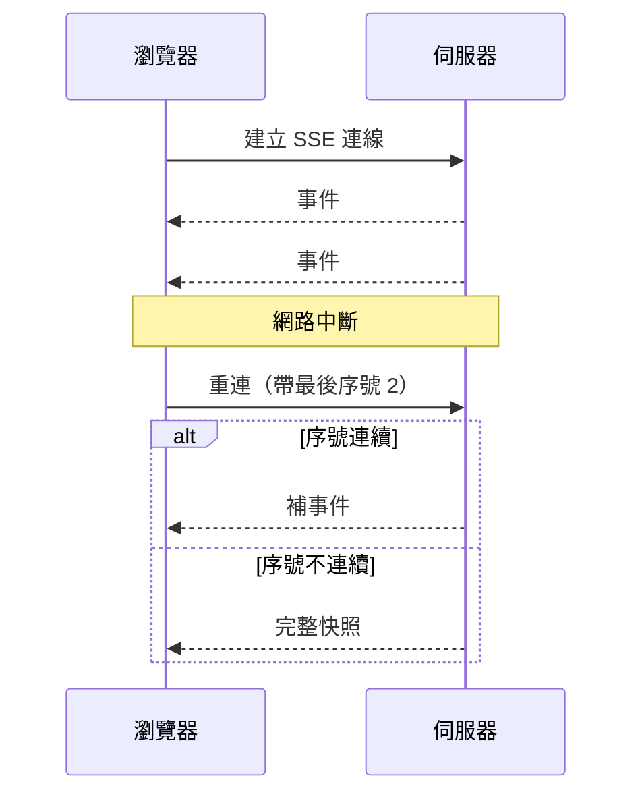

# 第 10 講｜即時更新（SSE／WebSocket／輪詢）與可觀測性

> 對應：W15 · 主題 10 · 可驗收產出：為 1 秒需求選一個並寫事件紀錄

> 狀態代號：S1 草稿／S2 已下單／S3 已確認／S4 製作中／S5 製作完成（待店員確認）／S6 可取餐／S7 已取餐；SX1–SX4 為例外（缺貨／付款失敗／通知未送達／修改待確認）。完整定義見 `18_spec.md` §5。

## 0. 三個問題

1. 顧客要「1 秒內看到新狀態」，方法有哪幾種？代價各是什麼？
2. 通知送不到的時候，顧客還看得到嗎？
3. 出事的時候，你怎麼知道「是誰、什麼時候、做了什麼」？

## 1. 三種即時方式

| 方式 | 方向 | 延遲 | 成本 | 適合 |
|---|---|---|---|---|
| 輪詢（polling） | 用戶端問 | 取決於間隔 | 請求多 | 少量、低頻 |
| SSE | 伺服器推 | 低 | 連線長 | 單向通知（狀態、看板） |
| WebSocket | 雙向 | 最低 | 連線管理複雜 | 雙向互動（聊天、協作） |

> 早餐店案例：狀態推播用 SSE；命令仍走一般請求。

## 2. 斷線與復原

| 問題 | 做法 |
|---|---|
| 斷線後重連 | 自動重連＋退避 |
| 漏掉的事件 | 用事件序號（sequence）補 |
| 舊事件蓋新狀態 | 收到較小序號就丟棄 |
| 完全斷線 | 重新取得完整快照（snapshot） |

> 順序：**先拿快照，再用事件補**。

## 3. 降級（graceful degradation）

| 主通道 | 替代通道 |
|---|---|
| 推播通知 | 店內看板 |
| 即時更新 | 手動重新整理 |
| 外部服務 | 本地暫存＋重試 |

> 降級不是「關掉功能」，是「換一條路讓使用者仍拿得到資訊」。

## 4. 可觀測性：三種紀錄

| 種類 | 內容 | 回答什麼 |
|---|---|---|
| 事件紀錄 | 誰在什麼時候改了什麼 | 發生什麼事 |
| 請求紀錄 | 路徑、狀態碼、耗時、requestId | 哪裡慢、哪裡錯 |
| 對帳紀錄 | 金額、數量 | 有沒有少 |

## 5. 事件紀錄的最小欄位

| 欄位 | 例子 |
|---|---|
| 事件名稱 | `order.status_changed` |
| 對象 | `order:1042` |
| 之前／之後 | S4 → S5 |
| 誰 | 廚師 A |
| 何時 | 時間戳 |
| 請求識別碼 | `req_8f2c` |
| 序號 | 37 |

## 架構圖

## 6. 檢查點（可驗收）

1. 為你的 1 秒需求選一種方式，寫理由與代價。
2. 寫出斷線後的三步復原流程。
3. 寫出一個降級方案。
4. 寫出事件紀錄的七個欄位。
