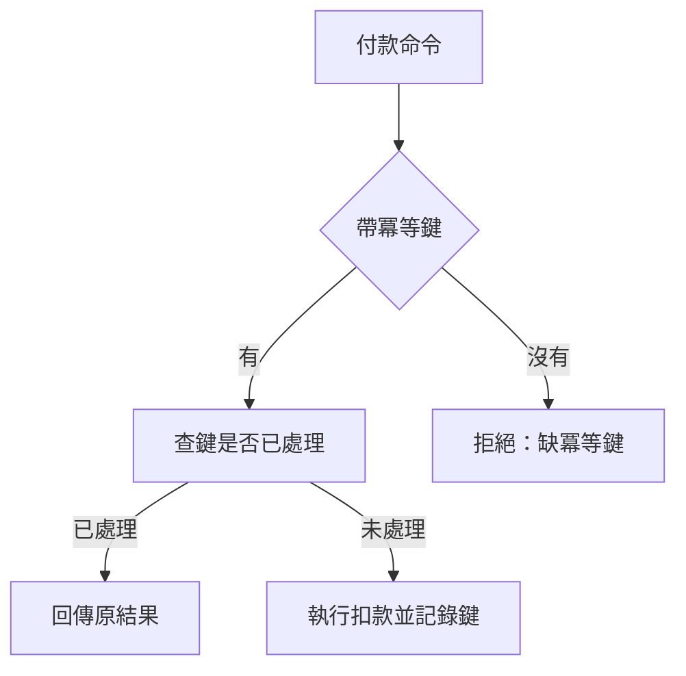

# 第 11 講｜學生操作手冊：一致性、冪等（idempotent）與競態（race condition）

> 你要交出：**強一致清單＋兩條規則＋一個改法**。
> 每一步都有「這樣算完成」。

> 名詞：冪等（idempotent，同一個操作重送多次只生效一次）／競態（race condition，兩個動作同時改同一筆）／一致性（consistency）。

## Step 1：分資料

| 資料 | 強一致或最終一致 | 理由 |
|---|---|---|

這樣算完成：至少五筆，且每筆都有理由。

## Step 2：畫交易邊界

挑一個流程：

| 步驟 | 交易內／外 | 理由 |
|---|---|---|

這樣算完成：外部呼叫都在交易外。

## Step 3：付款冪等規則

| 項目 | 你的設計 |
|---|---|
| 冪等鍵從哪來 | |
| 存在哪裡 | |
| 重送時怎麼判斷 | |
| 回傳什麼 | |

這樣算完成：能回答「第二次送出會發生什麼」。

## Step 4：競態規則

| 情境 | 現在的做法 | 會不會撞 | 改法 |
|---|---|---|---|

這樣算完成：至少一處寫出「用唯一約束或版本號」。

## 手動修改實驗：拿掉唯一約束

| 項目 | 內容 |
|---|---|
| 目的 | 看見「撞號」 |
| 改哪裡 | 取餐號碼的唯一約束（unique constraint）（unique constraint） |
| 改前 | 有唯一約束 |
| 改後 | 移除（用遷移（migration）或測試庫） |
| 觀察 | 兩個並行請求是否拿到同一個號碼 |
| 記錄 | 重複的號碼與次數 |

這樣算完成：你能說明「為什麼唯一約束比先查後寫可靠」，並加回。

## 流程圖

## Step 5：交件檢查

- [ ] 強一致清單
- [ ] 交易邊界
- [ ] 付款冪等規則
- [ ] 競態改法
