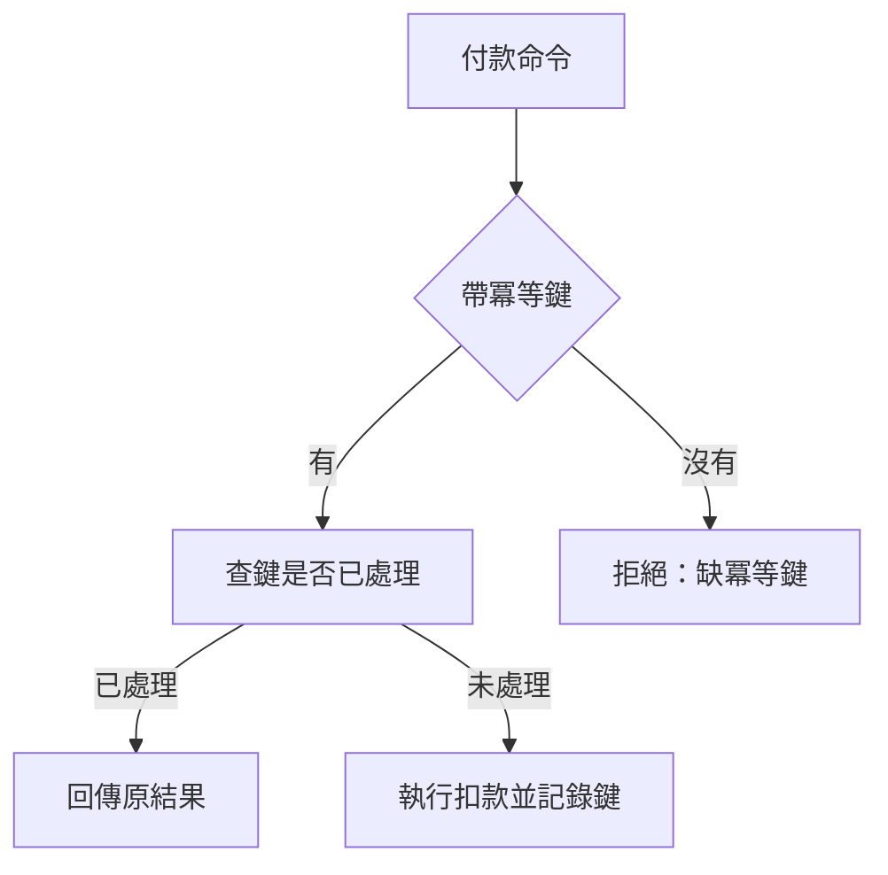

# 第 11 講｜學生操作手冊：一致性、冪等（idempotent）與競態（race condition）

> 你要交出：**強一致清單＋兩條規則＋一個改法**。
> 每一步都有「這樣算完成」。

> 名詞：冪等（idempotent，同一個操作重送多次只生效一次）／競態（race condition，兩個動作同時改同一筆）／一致性（consistency）。

## Step 1：分資料

> 前置環境：無（使用練習資料：90_技術與架構/00_練習資料/01_系統摘要.md 的資料表）

| 資料 | 強一致或最終一致 | 理由 |
|---|---|---|

這樣算完成：至少五筆，且每筆都有理由。

## Step 2：畫交易邊界

> 前置環境：完成 Step 1

挑一個流程：

| 步驟 | 交易內／外 | 理由 |
|---|---|---|

這樣算完成：外部呼叫都在交易外。

## Step 3：付款冪等規則

> 前置環境：完成 Step 2

| 項目 | 你的設計 |
|---|---|
| 冪等鍵從哪來 | |
| 存在哪裡 | |
| 重送時怎麼判斷 | |
| 回傳什麼 | |

這樣算完成：能回答「第二次送出會發生什麼」。

## Step 4：競態規則

> 前置環境：完成 Step 1

| 情境 | 現在的做法 | 會不會撞 | 改法 |
|---|---|---|---|

這樣算完成：至少一處寫出「用唯一約束或版本號」。

## 看懂練習（不必動手）

> 前置環境：讀完本講講義

| 問題 | 你的答案 |
|---|---|
| 為什麼「先查最大號再加一」會撞號？ | |
| 冪等鍵怎麼讓第二次回傳相同結果？ | |
| 交易為什麼不包含「發通知」？ | |

這樣算完成：能畫出「插入 key → 扣款 → 寫回結果」三步，不必實作。

## 流程圖

## Step 5：交件檢查

> 前置環境：完成前一個 Step

- [ ] 強一致清單
- [ ] 交易邊界
- [ ] 付款冪等規則
- [ ] 競態改法

## 參考答案

| 步驟／單元 | 參考答案要點 |
|---|---|
| Step 1 | 至少五筆，每筆有強／最終一致的理由 |
| Step 2 | 外部呼叫都在交易外 |
| Step 3 | 能回答第二次送出會發生什麼 |
| Step 4 | 至少一處用唯一約束或版本號 |
| 看懂練習 | 先查再寫會撞號；冪等鍵回原結果；通知不放在交易內 |

> 答案為要點，不是唯一寫法；能說出理由即可。
