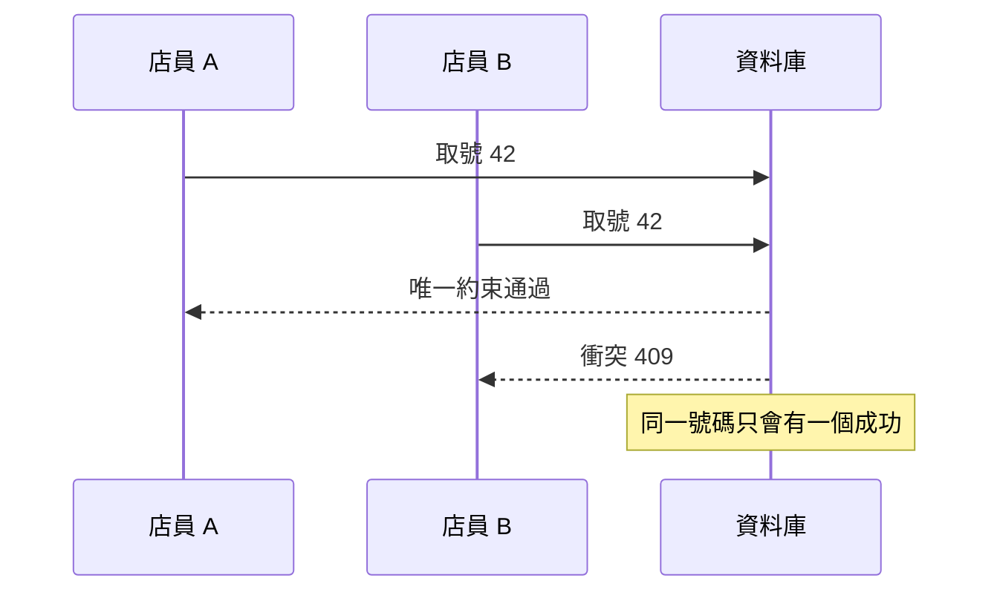

# 第 11 講｜一致性、冪等（idempotent）、競態條件（race condition）

> 對應：W16 · 主題 11 · 可驗收產出：付款與號碼各一條規則

## 0. 三個問題

1. 兩張單同時搶最後一個號碼，誰該拿到？
2. 付款按兩次，為什麼不能扣兩次？
3. 「全部成功或全部失敗」是誰在保證？

## 1. 一致性（consistency）是什麼

| 層級 | 意思 | 例子 |
|---|---|---|
| 強一致 | 讀到的永遠是最新 | 取餐號碼 |
| 最終一致 | 短暫落後，最後會相同 | 營收報表 |

> 不是「越強越好」：強一致要付效能代價。**分資料決定**。

## 2. 交易（transaction）

| 原則 | 說明 |
|---|---|
| 原子性 | 一組操作要嘛全成功 |
| 隔離 | 同時進行的事互不干擾 |
| 持久 | 一旦成功就留著 |

> 交易內只放「必須同時成功」的事；外部呼叫（通知、金流）放外面。

## 3. 冪等（idempotent）

同一個操作重送多次，結果只生效一次。

| 做法 | 說明 |
|---|---|
| 冪等鍵（idempotency key） | 每次操作帶一個唯一鍵 |
| 唯一約束 | 資料庫擋重複 |
| 先查後寫 | 效能差，仍有競態 |

> 付款：同一個鍵只會產生一筆扣款結果。

## 4. 競態條件（race condition）

| 情境 | 錯誤做法 | 正確做法 |
|---|---|---|
| 發號碼 | 先查最大號再加一 | 唯一約束＋交易 |
| 扣庫存 | 先讀再寫 | 條件式更新或鎖 |
| 改訂單 | 後寫蓋前寫 | 版本號（樂觀鎖） |

## 5. 兩條規則（示範）

| # | 規則 | 保證 |
|---:|---|---|
| 1 | 付款命令必帶冪等鍵，同一鍵只產生一筆結果 | 不重複扣款 |
| 2 | 取餐號碼由唯一約束保證，同一號碼不得同時給兩張未完成訂單 | 不撞號 |

## 經典例子：兩個人同時取號

| 做法 | 結果 |
|---|---|
| 先查最大號再加一 | 兩人都拿到 42，撞號 |
| 唯一約束＋交易 | 一人成功拿到 42，另一人得到 409 |

| 做法 | 結果 |
|---|---|
| 付款重送沒有冪等鍵 | 扣兩次 |
| 付款帶冪等鍵 | 第二次回傳第一次的結果 |

> 競態條件（race condition）不是「很少發生」，是「一定會發生，只是還沒遇到」。

> **看懂即可**：這一節不要求自己寫 migration／連線池／交易；重點是知道資料表長相、查詢次數與規則的作用。

## 實作範例：冪等鍵資料表

````sql
CREATE TABLE idempotency_keys (
  key          TEXT PRIMARY KEY,
  request_hash TEXT NOT NULL,
  response     JSONB,
  created_at   TIMESTAMPTZ NOT NULL DEFAULT now()
);
````

流程（同一個交易內）：

1. `INSERT INTO idempotency_keys(key, request_hash) VALUES ($1,$2) ON CONFLICT DO NOTHING;`
2. 若插入成功 → 執行付款 → 把結果寫回 `response` → 提交。
3. 若發生衝突 → 讀出「已存在」的那筆，回傳相同結果。

````ts
const inserted = await tx.idempotencyKeys.createMany({
  data: [{ key, requestHash }],
  skipDuplicates: true
});
if (inserted.count === 0) {
  return tx.idempotencyKeys.findUnique({ where: { key } });
}
// 執行扣款、寫入 response，再提交
````

取餐號碼的競態（race condition）解法：

````sql
INSERT INTO pickup_numbers (number, order_id) VALUES ($1, $2);
-- 若撞號，資料庫回 23505（unique violation），重試下一個號碼
````

| 做法 | 結果 |
|---|---|
| 先 `SELECT MAX(number)` 再 `+1` | 兩人可能拿到同一號 |
| 唯一約束＋重試 | 一定只有一個成功 |

## 架構圖



## 6. 檢查點（可驗收）

1. 列出你系統裡需要強一致的資料（至少三項）。
2. 為付款寫一條冪等規則。
3. 為號碼或櫃位寫一條競態規則。
4. 指出一個「先查後寫」的地方並提出改法。
