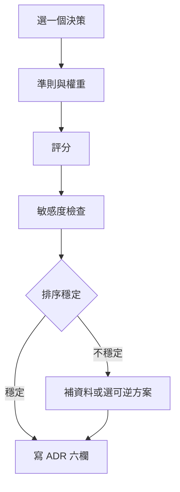

# 第 12 講｜學生操作手冊：選型方法

> 你要交出：**一張決策矩陣＋一次敏感度檢查＋一篇 ADR**。
> 每一步都有「這樣算完成」。

## Step 1：選一個決策

> 前置環境：無（使用練習資料：[01_系統摘要.md](../00_練習資料/01_系統摘要.md) 的頁面與決策）

| 項目 | 你的答案 |
|---|---|
| 決策問題 | |
| 候選（2–4 個） | |
| 為什麼現在要決定 | |

這樣算完成：問題是一句話，候選不超過四個。

## Step 2：列準則與權重

> 前置環境：完成 Step 1

| 準則 | 權重 | 為什麼重要 |
|---|---:|---|

這樣算完成：4–6 個準則，權重加總 10。

## Step 3：評分

> 前置環境：完成 Step 2

| 準則 | 權重 | 候選 A | 候選 B | 候選 C |
|---|---:|---:|---:|---:|

| 加權總分 | A | B | C |
|---|---:|---:|---:|

這樣算完成：總分算得出來，並寫下「哪一項差距最大」。

## Step 4：敏感度檢查

> 前置環境：完成 Step 3

把最大權重的準則加一倍，重算一次。

| 情境 | 第一名 | 有沒有翻 |
|---|---|---|
| 原權重 | | |
| 調整後 | | |

這樣算完成：你能說出「這個決策穩不穩」。

## Step 5：寫 ADR

> 前置環境：完成 Step 3

| 欄位 | 內容 |
|---|---|
| 標題 | |
| 背景 | |
| 決策 | |
| 理由 | |
| 代價 | |
| 何時翻案 | |

這樣算完成：六欄都有，且「理由」寫的是「為什麼不選其他」。

## 手動修改實驗：改一個權重

> 前置環境：完成 Step 3

| 項目 | 內容 |
|---|---|
| 目的 | 看見「決策穩不穩」 |
| 改哪裡 | 決策矩陣其中一個準則的權重 |
| 改前 | 例如維運成本權重 2 |
| 改後 | 改成 4 |
| 觀察 | 第一名是否翻轉 |
| 記錄 | 翻轉前後的名次與總分 |

這樣算完成：你能說出「這個決策對哪個權重最敏感」，並把權重改回。

## 流程圖

## Step 6：交件檢查

> 前置環境：完成前一個 Step

- [ ] 決策問題與候選
- [ ] 準則與權重
- [ ] 加權矩陣
- [ ] 敏感度檢查
- [ ] 一篇 ADR（六欄）

## 參考答案

| 步驟／單元 | 參考答案要點 |
|---|---|
| Step 1 | 問題一句話、候選不超過四個 |
| Step 2 | 4–6 準則，權重加總 10 |
| Step 3 | 總分算得出，指出差距最大項 |
| Step 4 | 能說出決策穩不穩 |
| Step 5 | 六欄都有，理由寫「為什麼不選其他」 |
| 手動修改實驗 | 改權重後第一名翻轉＝決策對該權重敏感 |

> 答案為要點，不是唯一寫法；能說出理由即可。
