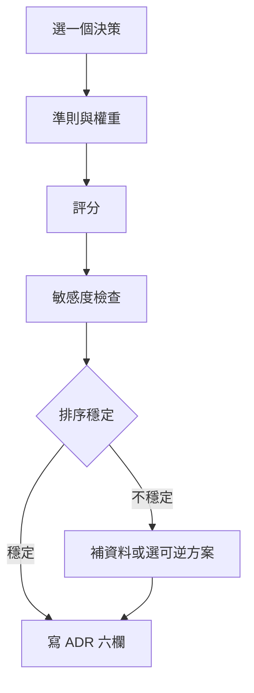

# 第 12 講｜學生操作手冊：選型方法

> 你要交出：**一張決策矩陣＋一次敏感度檢查＋一篇 ADR**。
> 每一步都有「這樣算完成」。

## Step 1：選一個決策

| 項目 | 你的答案 |
|---|---|
| 決策問題 | |
| 候選（2–4 個） | |
| 為什麼現在要決定 | |

這樣算完成：問題是一句話，候選不超過四個。

## Step 2：列準則與權重

| 準則 | 權重 | 為什麼重要 |
|---|---:|---|

這樣算完成：4–6 個準則，權重加總 10。

## Step 3：評分

| 準則 | 權重 | 候選 A | 候選 B | 候選 C |
|---|---:|---:|---:|---:|

| 加權總分 | A | B | C |
|---|---:|---:|---:|

這樣算完成：總分算得出來，並寫下「哪一項差距最大」。

## Step 4：敏感度檢查

把最大權重的準則加一倍，重算一次。

| 情境 | 第一名 | 有沒有翻 |
|---|---|---|
| 原權重 | | |
| 調整後 | | |

這樣算完成：你能說出「這個決策穩不穩」。

## Step 5：寫 ADR

| 欄位 | 內容 |
|---|---|
| 標題 | |
| 背景 | |
| 決策 | |
| 理由 | |
| 代價 | |
| 何時翻案 | |

這樣算完成：六欄都有，且「理由」寫的是「為什麼不選其他」。

## 流程圖

## Step 6：交件檢查

- [ ] 決策問題與候選
- [ ] 準則與權重
- [ ] 加權矩陣
- [ ] 敏感度檢查
- [ ] 一篇 ADR（六欄）
