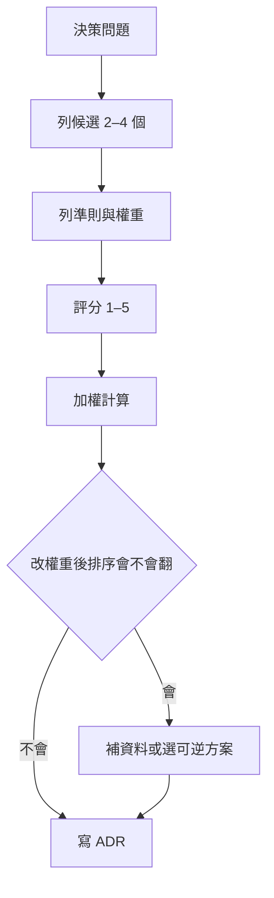

# 第 12 講｜選型方法：決策矩陣（decision matrix）與 ADR

> 對應：W16 · 主題 12 · 可驗收產出：用案例五個決策評分

## 0. 三個問題

1. 同樣的需求，兩個人選了不同技術，怎麼判斷誰對？
2. 「因為大家都用」算不算理由？
3. 半年後有人問「為什麼選這個」，去哪裡找答案？

## 1. 選型不是選最好，是選**最合適**

| 想法 | 問題 |
|---|---|
| 選功能最多的 | 用不到的功能是成本 |
| 選最紅的 | 紅不代表適合你的限制 |
| 選最熟的 | 團隊能力是準則之一，但不能是唯一 |

> 合適＝**需求 × 限制 × 成本** 的交集。

## 2. 決策矩陣（decision matrix）

| 步驟 | 做什麼 |
|---|---|
| 1 | 列候選（2–4 個） |
| 2 | 列準則（4–6 個） |
| 3 | 給權重（加總 10） |
| 4 | 評分（1–5） |
| 5 | 加權計算 |
| 6 | 敏感度檢查：改權重，排序會不會翻 |

### 準則範例

| 準則 | 問什麼 |
|---|---|
| 契合需求 | 能不能滿足非功能需求 |
| 團隊能力 | 現有人會不會 |
| 維運成本 | 誰顧、出錯怎麼查 |
| 鎖定風險 | 換掉要重寫多少 |
| 生態與成熟度 | 文件、社群、版本穩定 |

## 3. 敏感度檢查

| 情境 | 結果 |
|---|---|
| 權重不變 | A 勝 |
| 把「維運」權重加倍 | B 勝 |

> 如果排序很容易翻，代表**這個決策不穩**，要嘛補資料，要嘛選可逆的那個。

## 4. ADR（架構決策紀錄）

| 欄位 | 內容 |
|---|---|
| 標題 | 一句話說明決策 |
| 背景 | 當時的限制與需求 |
| 決策 | 選了什麼 |
| 理由 | 為什麼不選其他 |
| 代價 | 接受了什麼缺點 |
| 何時翻案 | 什麼條件下要重新考慮 |

> ADR 的價值不在「記錄選了什麼」，在**記錄為什麼不選別的**。

## 5. 案例演練（五個決策）

| # | 決策 | 候選 |
|---:|---|---|
| 1 | 即時更新 | 輪詢／SSE／WebSocket |
| 2 | 介面風格 | REST／gRPC-Web |
| 3 | 資料存取 | Prisma／Drizzle |
| 4 | 資料庫 | Neon／Supabase |
| 5 | 渲染模式 | CSR／SSR |

## 6. 介面風格：REST 與 gRPC 的取捨

| 情境 | 建議 | 理由 |
|---|---|---|
| 前端直接呼叫 | REST | 瀏覽器原生支援 |
| 服務與服務之間、高頻 | gRPC | 二進位、契約與產生程式碼 |
| 需要伺服器主動推、單向 | SSE | 比 WebSocket 簡單 |
| 需要雙向互動 | WebSocket | 雙向長連線 |

> 這門課的決策：**REST＋SSE**；gRPC 列為對照，不進入實作。

### 四種介面風格的優缺點

| 風格 | 優點 | 缺點 | 常用情境 |
|---|---|---|---|
| REST | 瀏覽器原生、快取成熟 | 文字較大、無原生串流 | 公開 API、前端直連 |
| gRPC | 二進位小、契約強、可串流 | 瀏覽器需 proxy、除錯難 | 服務之間、高頻 |
| SSE | 單向推送、實作簡單 | 只能單向 | 狀態更新、通知 |
| WebSocket | 雙向、低延遲 | 管理複雜 | 聊天、協作 |

**決策順序**：誰呼叫（瀏覽器／服務）→ 需不需要推（單向／雙向）→ 資料量與延遲。

## 7. 常見錯誤

| 錯誤 | 後果 |
|---|---|
| 只比功能 | 忽略維運與鎖定 |
| 沒有權重 | 每個準則等重，等於沒判斷 |
| 沒有代價 | 決策看起來完美，實際上埋雷 |
| 沒有翻案條件 | 環境變了還抱著舊決策 |

## 經典例子：即時更新的決策矩陣

| 準則 | 權重 | SSE | WebSocket |
|---|---:|---:|---:|
| 延遲 | 3 | 4 | 5 |
| 維運複雜度 | 2 | 5 | 2 |
| 雙向需求 | 2 | 1 | 5 |
| 瀏覽器支援 | 1 | 4 | 4 |
| **加權總分** |  | **40** | **44** |

> 把「維運複雜度」權重從 2 改成 4，排序就翻轉。**決策穩不穩，要看權重敏感度。**

## 實作範例：一篇 ADR

### 怎麼用這段程式

| 項目 | 內容 |
|---|---|
| 放哪裡 | 專案的 `docs/adr/ADR-001.md` |
| 前置 | 完成 Step 1；練習資料 [05_決策清單.md](../00_練習資料/05_決策清單.md) |
| 怎麼跑 | 照六個欄位寫，不需要執行 |
| 看什麼 | 「理由」有沒有寫出不選其他方案的原因；「代價」有沒有寫 |
| 常見錯 | 只寫決策，沒寫代價與翻案條件 |


```md
# ADR-001 即時更新用 SSE

## 背景
顧客端需要在狀態更新後 1 秒內看到；目前是手動重新整理。

## 決策
使用 SSE（伺服器推送事件），不用 WebSocket。

## 理由
- 只需要伺服器推、單向
- 瀏覽器原生支援，重連由 `EventSource` 處理
- 比 WebSocket 少一層連線管理

## 代價
- 不能雙向；命令仍走 REST
- 需要處理序號與補事件

## 何時翻案
若需要雙向互動（例如聊天），改用 WebSocket。
```

| ADR 欄位 | 這篇寫了什麼 |
|---|---|
| 背景 | 1 秒內要看到 |
| 決策 | SSE |
| 理由 | 單向、原生、管理少 |
| 代價 | 不能雙向 |
| 翻案 | 需要雙向時 |

## 架構圖



## 8. 檢查點（可驗收）

> 沒有自己的專案時，用 [00_練習資料 使用說明](../00_練習資料/00_使用說明.md) 的示範系統完成本講檢查點。

1. 選一個決策，列 2–4 個候選與 4 個準則。
2. 做一張加權矩陣，算總分。
3. 做一次敏感度檢查（改一個權重）。
4. 寫一篇 ADR（六欄）。
