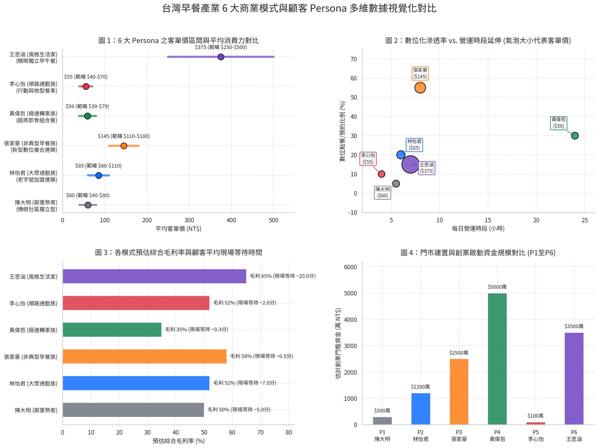

# 台灣早餐產業 6 大 Persona 與商業模式數據視覺化分析報告

本報告針對台灣早餐餐飲產業 6 大核心商業模式及其相對應之顧客 Persona 進行多維度數據交叉分析與視覺化圖表對比。

---

## 核心數據與關鍵洞察（The "So What?"）

### 1. 客單價梯隊分化（NT$39 – NT$500+）
- **極致平價梯隊（$39 – $80）**：包含**黃偉哲（超商即食 $59）**、**李心怡（行動餐車 $55）**與**陳大明（傳統社區 $60）**。此梯隊主打剛需高頻、極速取餐與銅板價效益。
- **大眾升級梯隊（$60 – $180）**：**林怡君（老字號加盟 $85）**與**張家豪（新型數位複合 $145）**。張家豪所在的新型連鎖透過全時段延伸（早午餐/午餐）與盤餐組合，使客單價較老字號加盟拉高 **+70.6%**。
- **高溢價體驗梯隊（$250 – $500+）**：**王思涵（精緻獨立早午餐 $375）**。客單價為傳統社區型之 **6.25 倍**，反映消費者願意為社交空間與情緒價值支付顯著溢價。

### 2. 數位化滲透與營運時段之雙輪驅動
- **數位預約突破瓶頸**：**張家豪（新型數位複合）**之數位 App 訂單比例高達 **55%**，成功將現場等待時間降至 **0.5 分鐘（智慧取餐櫃/預約秒取）**，帶動單店營收成長 **30%**。
- **全時段營運拉升坪效**：新型複合連鎖門市每日營運時段延長至 **8 小時（6:00–14:00）**，早午餐與午餐時段營收貢獻合計高達 **65%**，大幅分攤固定租金成本。

### 3. 現場等待時間 vs. 毛利率結構
- **極速效率導向**：**黃偉哲（超商）**與**李心怡（餐車）**將現場等待時間壓縮於 **0.3 – 2 分鐘** 內，滿足通勤族零等待需求；超商透過鮮食帶動單店貢獻，餐車則以低管銷維持 **52%** 綜合毛利率。
- **體驗與毛利雙高**：**王思涵（精緻獨立早午餐）**依靠精品咖啡與特調飲品拉升綜合毛利率至 **65%**（全產業最高），抵銷其較低之翻桌率與 **20 分鐘** 之體驗候位時間。

---

## 6 大 Persona 數據總覽表

| 模式 ID | 代表 Persona | 客單價範疇 (NT$) | 平均客單 (NT$) | 數位點餐比例 (%) | 每日營運時段 (hrs) | 現場等待時間 (分) | 預估綜合毛利率 (%) | 創業門檻資金 (萬 NT$) |
| :--- | :--- | :--- | :--- | :--- | :--- | :--- | :--- | :--- |
| **P1** | **陳大明** (傳統社區) | $40 – $80 | $60 | 5% | 5.5 | ~5.0 | 50% | $30 萬 |
| **P2** | **林怡君** (老字號加盟) | $60 – $110 | $85 | 20% | 6.0 | ~7.0 | 52% | $120 萬 |
| **P3** | **張家豪** (新型數位複合) | $110 – $180 | $145 | 55% | 8.0 | ~0.5 (預約) | 58% | $250 萬 |
| **P4** | **黃偉哲** (超商即食) | $39 – $79 | $59 | 30% | 24.0 | ~0.3 | 35% | $500 萬+ |
| **P5** | **李心怡** (行動餐車) | $40 – $70 | $55 | 10% | 4.0 | ~2.0 | 52% | $10 萬 |
| **P6** | **王思涵** (精緻獨立早午餐) | $250 – $500+ | $375 | 15% | 7.0 | ~20.0 | 65% | $350 萬 |

---

## 策略營運建議

1. **傳統與加盟升級點**：應導入輕量化線上點餐（如 LINE 官方帳號點餐），將現場排隊時間由 7 分鐘縮短至 2 分鐘內，防止客源流失至超商與新型數位連鎖。
2. **新型連鎖防禦點**：在菜單創新（如 IP 聯名與新品）與第一線廚房 SOP 簡化之間維持平衡，避免過度複雜之客製化備註導致錯單率上升。
3. **體驗型早午餐優化點**：強化高毛利特調飲品與手作甜點之配餐率（Target > 80%），以確保低翻桌率下之整體坪效與獲利極大化。
