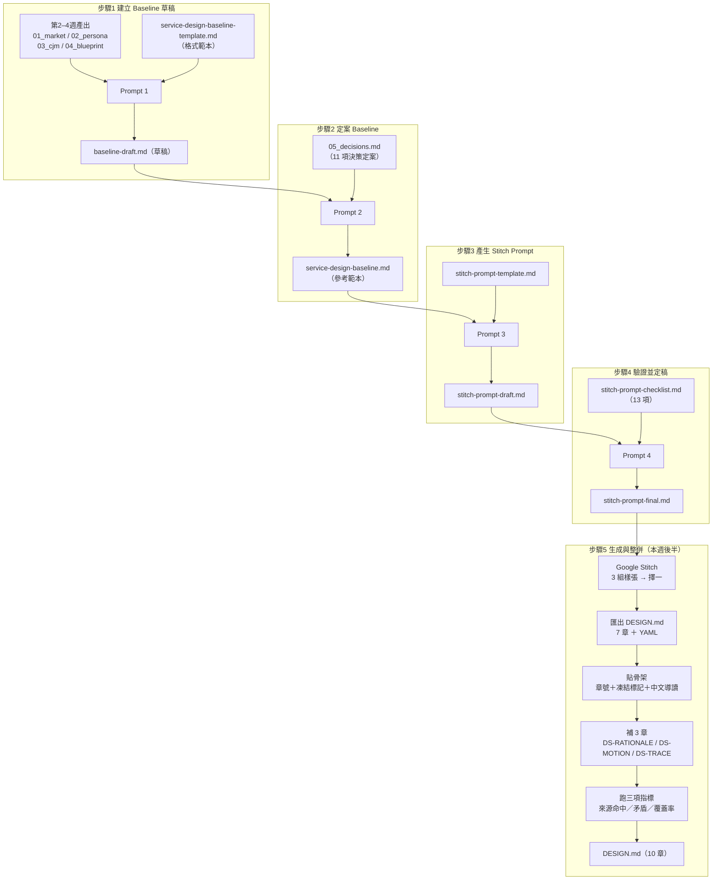

# 第 5 週：從服務設計決定版到 Design.md（10 章）

> 版本 **v7.0（內容）** ｜ 2026-10-28（v6.1 為 10-26；v6.0 重建於 10-25）｜ 舊版 `第05週_AI輔助風格設計5.md` 已凍結。
> 課堂長度 3 小時 ｜ 主專案：雲端早餐店訂餐管理系統 ｜ 對象：資工系（無視覺設計背景）

---


---

## 0. 本版修正導讀（先讀這一段）

> 這一版**改了角色任務的寫法**。你如果讀過舊版，只需要補讀三小段；如果第一次讀，直接從 §3.8 開始。

### 0.1 一句話

```
舊：角色 ｜ 工作事項 ｜ 對象      ← 三欄，只能描述「誰做什麼」
新：前置業務狀態｜A｜業務動作｜物件｜狀態轉換｜B｜B 的決策   ← 七格，能推導
```

**三欄不是錯，是不夠。** 它寫不出「世界怎麼變、交給誰、他拿它判斷什麼」，
所以第 6 週要推導 AC 與頁面時會卡住。

### 0.2 改了什麼（五處）

| # | 項目 | 舊 | 新 | 你要看哪 |
|---|---|---|---|---|
| 1 | 任務寫法 | 三欄 | **七格** | **§3.8** |
| 2 | 任務的語言 | 沒規定 | **禁用介面詞 ＋ 店長測試** | §3.8.1 |
| 3 | 設施（看板／取餐櫃） | 只列為角色 | **serves／substitutes／via** | §3.8.2 |
| 4 | Blueprint 範本 | 只有角色表 | 新增 §8 任務句、§9 設施替代 | `toolkit/04_blueprint_template.md` |
| 5 | 參考範本 | 只有角色表 | 新增「五之一 任務句範例」 | `toolkit/service-design-baseline.md` |

### 0.3 為什麼要改（三個理由）

| 理由 | 說明 |
|---|---|
| 推不出 AC | 沒有「狀態轉換」那一格，就不知道要驗什麼 |
| 推不出頁面 | 沒有「B 的決策」，就不知道 B 那頁要放什麼 |
| 設施沒有出處 | 沒寫「替代誰」，看板就像憑空出現的螢幕 |

### 0.4 你已經讀過舊版，只要補讀這三段

| # | 補讀 | 花多久 |
|---|---|---|
| 1 | §3.8 任務句七格 | 15 分鐘 |
| 2 | §3.8.1 禁用介面詞與店長測試 | 5 分鐘 |
| 3 | §3.8.2 設施的替代關係 | 5 分鐘 |

其餘章節（市場到 Persona、CJM、11 項決策、Design.md 10 章）**沒有變動**。

### 0.5 沒變的部分（先放心）

| 沒變 |
|---|
| 三層市場、三個 Persona |
| CJM 五階段與情緒曲線 |
| 11 項決策的內容 |
| DESIGN.md 的 10 章結構 |
| tokens 的角色（換風格只改它） |

> 「改」不是推翻，是**把同一件事寫得更精確**。上游一個字都沒動。

### 0.6 這版修正的紀錄在哪

| 文件 | 內容 |
|---|---|
| `06_CHANGELOG_改版紀錄.md` | v7.0 逐項變更 |
| `../06_UX設計/adr/ADR-001` | 為什麼是七格、考慮過哪些選項 |
| `../06_UX設計/18_推導修正的思考軌跡.md` | 八個回合的推理過程 |

---

## 1. 模組定位

### 1.1 這門課在教什麼（不是什麼）

**不是**在教「怎麼設計漂亮網站」。**是**在教「怎麼把一個服務的意圖，翻譯成一份 AI 讀得懂、人審得動、外包接得住的設計契約」。

學生帶走的能力不是審美，是三件事：
1. 知道**哪些設計決策必須有依據**；
2. 知道**哪些決策可以交給 AI、哪些不能**；
3. 知道**怎麼驗收 AI 的產出**（而不是「看起來還行」）。

### 1.2 本週在整條鏈上的位置

```text
[已完成] 產業研究 → 市場選擇 → Persona → 角色 → CJM
                                      ↓
                         Blueprint（W4 選項版）
                                      ↓
                         物件 → 資訊流 → 11 項決策
                                      ↓
              service-design-baseline.md（Blueprint baseline／凍結）
                                      ↓ ［本週］
                         DESIGN.md（10 章）＋ tokens.css
                                      ↓
          第 6 週：服務需求索引 → US-B → 資訊／狀態／線框
                                      ↓
                         US-I ＋ AC ＋ 可走原型
                                      ↓
                         第 7 週：spec.md 彙整
                                      ↓
                         第 8 週以後：plan → 實作
```

W4 的 Blueprint 是選項版，不得直接作為 Design／UX 的定案輸入。W5 必須完成 `05_decisions.md` 的 SD-01–SD-11，再將 `baseline-draft.md + 05_decisions.md` 整併成 `service-design-baseline.md`；只有 baseline 凍結後，才能進入 Design、UX 與 spec。

### 1.3 本週的兩個產出

| # | 產出 | 內容 |
|---|---|---|
| 1 | `05_decisions.md` ＋ `service-design-baseline.md` | SD-01–SD-11 全部定案；baseline-draft 與決策整併後凍結，開放選項 0 |
| 2 | `DESIGN.md`（10 章）＋ `tokens.css` | 只能從已凍結 baseline 萃取設計理由、規格與 tokens |

> **沒有整併紀錄，Design.md 不算完成。** 匯出檔只是原料，不是成品。

### 1.4 本週產出

這三項是**你要交的**。左半是「空白範本」，右半是「本案填好的示範答案」——
範本用來動手，示範答案用來對照「做到完整長什麼樣」。**不要照抄**：你的 baseline 不同，產出必然不同。

| # | 產出 | 格式 | 空白範本 | 本案示範答案 |
|---|---|---|---|---|
| 1 | `DESIGN.md`（10 章） | Markdown | `toolkit/06_designmd_template.md`／`02_附錄A` | `toolkit/範例_DESIGN_10章_平衡現代/DESIGN.md` |
| 2 | `design-tokens.css` | CSS | — | `toolkit/範例_DESIGN_10章_平衡現代/tokens.css` |
| 3 | 整併紀錄（三項指標） | Markdown | `toolkit/06_designmd_audit_record.md` | `toolkit/範例_DESIGN_10章_平衡現代/整併紀錄.md` |

> **沒有整併紀錄，Design.md 不算完成。** 匯出檔只是原料，不是成品。

**示範答案裡值得先看的四件事**

1. **第 2–8 章是 Stitch 原文**（只加章號與中文導讀）——你的也該是。
2. **第 10.3 節記了一個落差**：散文寫 `#134E4A`，YAML 的 `primary` 是 `#003633`。審計不是「看不出差異」，是「知道有差異、決定怎麼處理」。
3. **第 10.1 節末列記了缺項**：元件缺「通知／進度條」，UX 階段會用到 → 回寫 v1.1。
4. **`tokens.css` 分兩層**：`--m3-*`（工具原始）與 `--color-*`（語意）。換工具時只換前者。
> **改錯層不會有反應**（實測）：`--m3-*` 有 47 色，但 `--color-*` 只引用其中 **12 個**。
> 例如 `--m3-primary`（#003633）沒有任何別名指向它，**改它畫面不會變**。
> 要換風格，改「被引用」的那 12 個：「BT»primary-container`、`on-primary`、`secondary-container`、`background`、`on-surface` 等。
> （`tokens.css` 檔頭已列出完整清單；`lint-tokens` 會印出引用數。）

原始 vs 成品可以直接對照：`toolkit/範例_Stitch原始輸出/New-Style_C/`（7 章）↔ `範例_DESIGN_10章_平衡現代/`（10 章）。

---


## 2. 為什麼要這樣設計（本版的核心，也是過去最缺的一節）

### 2.1 問題：理工學生做 UI 的三個斷點

不是能力問題，是**知識型別不匹配**：

| # | 斷點 | 具體表現 |
|---|---|---|
| 1 | 不會把形容詞翻成參數 | 「我想要溫暖一點」→ 然後呢？是改色、改圓角、還是改間距？ |
| 2 | 不會排 | 知道要有標題、卡片、按鈕，但不知字級差多少、間距用幾 px |
| 3 | 不會判斷對錯 | 沒有審美標準，也無法驗證「這樣對不對」，只能憑感覺 |

**關鍵觀察**：這三個斷點，剛好都是 AI 的強項。
所以這門課的解法不是「讓學生變強」，而是**重新分工**——把斷點交給 AI，把判斷留給人。

### 2.2 四條路，為什麼選第四條

| 路 | 作法 | 為什麼不選 |
|---|---|---|
| 1 | 先教平面設計基礎（色彩學、字體學、構圖） | 16 週不夠，也不是資工核心；結果是「懂名詞但做不出來」 |
| 2 | 讓 AI 全權生成（無規格） | 快，但不可維護、不可交接、不可驗收；品質賭在單次生成；實測會得到一堆漂亮但各自為政的畫面 |
| 3 | 套現成 UI 框架（Bootstrap／Material） | 一致但同質，無法回應品牌人格；學不到「為什麼」，換品牌就無解 |
| **4** | **AI 生成 ＋ 機器可讀規格 ＋ 人類擇一** | **本課採用**：有憑有據、可交接、可替換 |

第 4 條路能成立，靠的是三個替代品：
- 用 **AI** 代替「設計直覺」→ 負責聯想與生成；
- 用 **Design.md** 代替「設計稿」→ 負責承載規格；
- 用 **審計** 代替「審美」→ 負責品質把關。

### 2.3 四條命題（本週的思想主幹）

**命題 1｜目標不是培養設計師，是產出可被專業接手的提案。**
判準不是「好看」，而是三個工程判準：**可審查、可交接、可替換**。

**命題 2｜AI 生成的價值只在「有規格」時才成立。**
沒有 Design.md 的 AI 生成，會得到 25 個漂亮但各自為政的畫面；有規格的生成，才會有「同一個系統的不同頁面」。**規格不是描述 AI 的成果，是約束 AI 的工具。**

**命題 3｜不滿意不是重來，是換模組。**
換掉的是「風格層」（第 2–8 章），不是服務層（baseline）也不是結構層（IA／狀態／Story）。這是整條鏈能持續推進的唯一理由。

**命題 4｜外包是升級路徑，不是逃生門。**
視覺設計專家拿到的是「有理由、有邊界、有回溯」的契約，所以能在短時間內提出更好的風格；回來的成果也必須併回同一份契約——這樣才是**越換越好，而不是越換越亂**。

### 2.4 Design.md 的真正身分：設計的介面契約（ABI）

這是本週最重要的一句話：

> **Design.md 不是「規格文件」，是「介面」。**
> 它讓三個維度可以各自替換，而互不破壞。

| 維度 | 可以換成 | 換的時候只需要動 | 契約保證什麼 |
|---|---|---|---|
| **工具** | Stitch → 未來更合适的工具 | 第 2–8 章的內容 | `DS-*` 章節 ID 不變，上下游引用不斷 |
| **風格** | 外包給視覺設計專家 | 第 2–8 章 ＋ token 表 | 第 1／9／10 章與 baseline 不動 |
| **實作** | omp → 其他 AI 或人工 | 只有程式碼 | Design.md 不動（改 token 才需重生） |

一句話：**換工具不換介面，換風格不換結構，換實作不換規格。**

### 2.5 四方讀者：同一份文件，四種讀法

| 讀者 | 只讀 | 要回答的問題 |
|---|---|---|
| 老闆／業主 | 第 1 章 | 「這是不是我要給客人的感覺？」 |
| 服務設計師 | 第 1 ＋ 10 章 | 「有沒有背叛服務承諾？有沒有超出可換範圍？」 |
| 視覺設計師／外包 | 第 1–9 章 | 「我可以在什麼邊界內優化？」 |
| 前端／AI 工具 | frontmatter ＋ 2–8 ＋ 10 | 「我要用哪些值？哪些不能改？」 |
| 教師／審查者 | 第 10 章 | 「每個值憑什麼？」 |

> 這個「四方讀者」設計，直接寫進 Design.md 的前言。它讓「一份文件給三種人看」從口號變成可操作。

---

## 3. 上游：服務設計決定版（走讀，不重講）

> **本節在主線的位置**：S3–S8（CJM → Blueprint → 物件 → 資訊流 → 決策 → DESIGN.md）。
> 完整地圖、十個閘門與回退規則見 `00_方法論主線與閘門.md`（工作區根目錄）。
> 迷路時先看那張表的「本週你應該交出什麼」。


### 3.1 輸入

本週的輸入是 `service-design-baseline.md`（決定版，9 節）。**這份文件的內容不重講**，課堂只做「走讀 ＋ 檢核」。

### 3.2 九節 → 10 章的對應（先看懂原料怎麼餵進成品）

| baseline 節 | 內容 | 餵給 Design.md 的哪一章 |
|---|---|---|
| 一 | 為什麼要先做決定版 | 無（方法論） |
| 二 | 市場選擇與約束鏈 | DS-RATIONALE §1.2 品牌人格（老闆目標） |
| 三 | 案例範圍與假設 | DS-RATIONALE §1.5 不可違反的限制（資金／人力／時段） |
| 四 | 三層 Persona | §1.2 品牌人格 ＋ §1.3 體驗目標 ＋ §1.5 情緒需求 |
| 五 | 角色表與 5 個交接 | DS-MOTION §9.1 節奏（交接越密越快）＋ DS-COMP 元件狀態 |
| 六 | 11 項服務決策 | DS-COMP 元件需求來源 ＋ DS-TRACE 回溯來源 |
| 七 | CJM（5 階段，最低點 −2） | §1.4 服務承諾 ＋ §1.5 情緒優先序 ＋ §9.1 節奏檔位 |
| 八 | Blueprint（3 層 2 線＋4 例外） | §1.4 服務承諾（前台）＋ 例外→DS-COMP 錯誤／空狀態 |
| 九 | 因果鏈追蹤表 | DS-TRACE 的種子（沿用 `SD-01`~`SD-11` 不重新編號） |

### 3.3 走讀檢核（5 題，全對才進 Part B）

1. CJM 的**情緒最低點**是哪一階段？幾分？為什麼它決定第 1 章的情緒優先序？
2. Blueprint 有**幾個例外**？分別對應 UI 的哪一種狀態（錯誤／空／載入／中斷）？
3. 11 項決策中，哪幾項屬於「**規則自動化**」、哪幾項屬於「**AI 增強**」？（提示：POS 扣庫存 ≠ AI）
4. 三層 Persona 各自的「**期望感受**」是什麼？哪一層的感受最影響 UI？
5. 哪**兩項以上**的決策會直接改變 UI 元件的設計？（例：KDS 狀態流 → 進度元件）

> 這 5 題答不出來，第 1 章一定寫成空話。**先回去讀 baseline，不要急著開 Stitch。**

### 3.4 三組風格預設（沿用，不改）

本案從服務設計推導三個情緒方向，各綁定一組參數：

| 預設 | 情緒方向 | 色彩 | 字體 | 間距 | 圓角 | 動效 | 回溯到 |
|---|---|---|---|---|---|---|---|
| 科技俐落 | 高效科技感 | 冷色基底 | 無襯線、幾何 | 緊湊 | 小 4–8px | 快 150ms | 張家豪期望「高效科技感」 |
| 溫暖信賴 | 安心舒適感 | 暖色但克制 | 無襯線、圓潤 | 寬鬆 | 大 12–16px | 慢 300ms | CJM 最低點需安心感 |
| **平衡現代** | 科技＋人情味 | 冷暖混搭 | 無襯線、中性 | 中等 | 中 8–12px | 中 200ms | 老闆目標「俐落、現代、可信賴」 |

**本案選定「平衡現代」**（教學示範決策，未經老闆實測核准）。理由：品牌人格要科技感（排除純暖），CJM 最低點要溫度（排除純冷）。

> 這張表是「參數級」規格，不是事實。**「溫暖＝慢動效」是慣例，不是定律**——後面 §5 會教怎麼標記這件事。

---

### 3.5 流程總覽：從 baseline 到 Design.md（五步）

整條流程只有一種結構：**輸入檔 → Prompt → 輸出檔**，每一步的輸出就是下一步的輸入。
學生只要照檔名走，就不會迷路；卡住時看自己在哪一格。



| 步 | 輸入 | 動作 | 輸出 | 工具 |
|---|---|---|---|---|
| 1 | 第 2–4 週的 4 個 .md ＋ <br>baseline 範本 | Prompt 1：草稿 | `baseline-draft.md` | omp／Claude |
| 2 | 草稿 ＋ `05_decisions.md` | Prompt 2：定案 | `service-design-baseline.md` | 同上 |
| 3 | baseline ＋ Prompt 範本 | Prompt 3：組裝 | `stitch-prompt-draft.md` | 同上 |
| 4 | 草稿 ＋ 驗證清單 | Prompt 4：修正 | `stitch-prompt-final.md` | 人工為主 |
| 5 | 最終 Prompt | Stitch 生成 → 匯出 → 整併 | `DESIGN.md`（10 章） | Stitch ＋ AI ＋ 人 |

**兩個接縫最容易出事**：

| 接縫 | 症狀 | 為什麼 |
|---|---|---|
| 步驟 2 → 3 | Prompt 的「關鍵服務規則」寫錯 | baseline 還沒定案就急著寫 Prompt，決策還在「A 或 B」的狀態 |
| **步驟 4 → 5** | 匯出後不知道要幹嘛，直接把 7 章當成品 | Prompt 好寫（有範本），匯出後的整併沒人教。**這正是本版補上的段落（§6、§7）** |

> 圖中「參考範本」指的是工具包裡那份示範檔（`toolkit/service-design-baseline.md`），
> 用來看「做到完整時長什麼樣」，不是你的答案；你的產出會不同，而且應該不同。

---

### 3.6 物件：決定版缺的第三個元素

到目前為止，我們只建模了「人」（角色）。但 Blueprint 的每一列都有第三欄——**對象**（下一節 §3.8 會把它升級成七格任務句）：

| 角色 | 動作 | 對象 |
|---|---|---|
| 店員 | 接收訂單並確認內容 | **訂單** |
| 老闆 | 更新菜單 | **菜單** |

那個「對象」就是**物件**。角色決定「誰做什麼」，物件決定「他看得到什麼、能判斷什麼」。

我們的問題不是忘了物件，而是**只建模了一個**：訂單有 7 個狀態、4 個例外、跨四端視圖；菜單、庫存、取餐號碼、櫃位、照片——一個都沒有。
所以「菜單該長什麼樣」「為什麼顧客端要有照片」「老闆對菜單有什麼需求」——沒有地方可以回答。

> **狀態機其實就是物件的生命週期。** 我們做了一個（訂單），漏了其他的。

#### 3.6.1 物件的四種類型與判準

| 類型 | 定義 | 本案 |
|---|---|---|
| 實體物 | 可觸摸、會消耗 | 餐點、食材、櫃位 |
| 紀錄物 | 描述發生過什麼 | 訂單、銷售紀錄、庫存 |
| 憑證物 | 一次性、用於識別或授權 | 取餐號碼、開櫃碼、訂單編號 |
| 內容物 | 表達性資產 | 菜單照片、文案、影片 |

> **內容只是其中一類。** 它不是獨立的一份文件，而是「內容物」的屬性。

**判準**（四條全過才列）：①跨角色 ②影響決策 ③有生命週期 ④可持有／傳遞／更新。
本案符合約 6–8 個：菜單品項、訂單、餐點、庫存、取餐號碼、櫃位、營業狀態、內容資產。

#### 3.6.2 角色 × 物件 × 資訊需求（IA 的種子）

同一個物件，**不同角色要的面向不同，做的決策也不同**。

| 角色 | 物件 | 要看到什麼 | 要做什麼決策 | 缺少會怎樣 |
|---|---|---|---|---|
| 顧客 | 菜單品項 | 實物照（份量）、價格、一句話、辣度 | 要不要點 | 不敢點、點了後悔 |
| 老闆 | 菜單品項 | 成本、毛利、照片品質、熱銷 | 要不要換品項、重拍 | 品牌與毛利失控 |
| 廚師 | 菜單品項 | 品名、份量、客製 | 怎麼做 | 做錯 |
| 店員 | 菜單品項 | 品名、客製、對應訂單 | 哪一張單 | 送錯 |

**這張表就解釋了「為什麼顧客端要有圖、後台不要圖」**——不是設計偏好，是不同角色對同一物件的資訊需求不同。

#### 3.6.3 可觀測性：每一次狀態轉換，誰需要知道？

| 檢查 | 結論 |
|---|---|
| 狀態轉換**有**觀測者 | 正常；觀測者的需求決定 IA |
| 狀態轉換**沒有**觀測者 | 這個狀態可能不必存在（過度設計） |
| 角色需要知道、**卻沒有入口** | **斷點** |

本案的例子：訂單從「製作完成」到「可取餐」之間多了「店員確認備妥」——因為**顧客需要知道，而廚師完成不足以代表可領取**。

> **設計順序**：先問「誰需要知道」，再問「用什麼顯示」。反過來做，會做出一堆沒人看的狀態。

#### 3.6.4 物件的增刪修併：設計師的創新語彙

物件不是給定的——**服務設計師可以創造它**。這是 Part A 最像「設計」的地方。

| 動詞 | 案例 | 解決什麼 |
|---|---|---|
| **增**（憑證） | 新增「取餐號碼」 | 找不到單、櫃前徘徊 |
| **增**（狀態） | 訂單加「完成待確認」 | 廚師完成但沒入櫃，顧客提早來 |
| **刪** | 刪掉紙本排隊號碼牌 | 顧客不用拿兩張紙 |
| **改** | 紙本單 → 訂單狀態機 | 跨端不同步 |
| **併** | 訂單號 ＝ 取餐號 | 顧客少記一組號碼 |

**三個判準**（答不出來就不是設計，是加功能）：
①解決哪個 Persona 的哪個痛點？②消除哪一次交接、哪一段等待？③這個新物件的狀態，誰需要觀測？

#### 3.6.5 交接給決策表：兩個方向

決策的依據有兩個來源：**人的需求** 與 **物的本質**。

| 欄位 | 回答 | 用途 |
|---|---|---|
| **受哪些物件影響** | 這個決策被什麼現實條件約束 | 進因果鏈的「依據」 |
| **影響哪些物件** | 這個決策改動了物件的什麼 | 換決策時的變更影響分析 |

**寫法紀律**：必須指到「屬性」。

```
❌ 受「菜單」影響
✅ 菜單品項.照片為必填且會過期 → 上架流程需含拍攝與審核 → 必須支援圖片上傳與裁切
```

| SD | 受哪些物件影響（約束） | 影響哪些物件（產出） |
|---|---|---|
| SD-02 廚房接收 | 訂單.狀態需即時；餐點.有製作順序與時間 | 訂單.狀態呈現、餐點.排序 |
| SD-04 取餐號碼顯示 | 取餐號碼.一次性、需對應櫃位；顧客.距離 4 公尺 | 取餐號碼.呈現方式 |
| SD-06 菜單維護 | 菜單品項.照片為必填且會過期；品項.有售完狀態 | 菜單品項.欄位與比例 |

> 這一欄如果早點存在，本次「線框沒有圖位」的漏洞在決策階段就會被攔下。

**兩個可 lint 的檢查**：物件覆蓋率（被決策引用的物件 ÷ 物件總數＝100%）、無依據決策率（既沒引用人也沒引用物＝0）。

**加碼：物件屬性決定自動化層級**

| 物件屬性 | 適合層級 | 例 |
|---|---|---|
| 高頻、小顆粒、可自動觸發 | 規則自動化 | 庫存數量 → 售完自動下架 |
| 需歷史累積才有意義 | AI 增強 | 歷史訂單 → 需求預測 |
| 低頻、需人工判斷 | 基本 | 菜單文案 → 老闆自己寫 |

這樣「為什麼 POS 扣庫存不是 AI」，就不用靠老師口頭解釋——物件屬性會自己說。

> 完整方法（六步驟）、範例與課堂練習見 `12_物件與資訊架構.md`。
> **本節閘門 G3**：物件覆蓋率 100%、角色 × 需求至少 3 個角色。

---


### 3.7 資訊流：物件會動，而且有人在等

物件模型（§3.6）回答「**有什麼**」。但只有靜態結構，到系統架構階段一定會漏——
因為架構要解的正是**併發、延遲、一致性**，而這些在靜態模型裡根本不存在。

物件導向分析給了物件、屬性、繼承、關聯，全是靜態的。它答不出三件事：

| 缺口 | 問題 | 本案例子 |
|---|---|---|
| **時序** | 什麼事件、依什麼順序改變物件？ | 廚師「完成」≠ 店員「確認」≠ 顧客「可取」 |
| **傳播** | 一次變更要通知誰？多久要送到？ | 訂單狀態一變，四端都要知道 |
| **競爭** | 誰會同時搶同一個物件？ | 兩位顧客搶最後一份、兩個店員同時發號 |

#### 3.7.1 名稱：用「資訊流」，不單獨用 IA

Rosenfeld 的 IA 是四個系統（組織／標籤／導覽／搜尋），本質是「**找得到**」，是靜態的。
把資訊流塞進 IA，會讓學生以為 IA 就是畫 sitemap。所以：

> **文件叫「資訊流（Information Flow）」**，副標「業務層的靜態結構與動態需求」。

分析詞彙借用既有理論（有出處，也方便交接給 plan.md）：

| 我們要問的 | 借用詞 | 出處 |
|---|---|---|
| 哪些資訊必須同時正確 | 聚合／不變式 | DDD |
| 什麼事發生了 | 領域事件 | DDD |
| 誰要立刻知道、多久 | 時效／傳播需求 | 資訊物流（Information Logistics） |
| 同一物件不同端看到什麼 | 讀模型／視圖 | DDD／CQRS |
| 會不會撞 | 競爭熱點 | 業務說法 |

資訊物流的原始命題，正好是我們那張表的四欄：
> 在**正確的時間**，把**正確的資訊**，以**正確的格式**，送到**正確的人**手上。

#### 3.7.2 四種動態原型（2 × 2）

**軸 1：傳播廣度**（1–2 端／3 端以上）　**軸 2：延遲容忍**（秒級／分—時級）

| | **秒級** | **分—時級** |
|---|---|---|
| **多端（3+）** | **廣播型**：訂單狀態 → 單一來源＋即時推送 | **彙總型**：營收、熱銷 → 批次即可 |
| **少數（1–2）** | **競爭型**：庫存、號碼、櫃位 → 唯一性＋防超賣 | **記錄型**：銷售明細 → 非同步即可 |

每一類交接給 plan.md 時代表什麼：

| 原型 | 必答 | plan.md 會做的事 |
|---|---|---|
| 廣播型 | 誰是唯一來源？多久要一致？ | 推送／單一寫入點 |
| 競爭型 | 誰會同時搶？怎麼保證唯一？ | 序號生成、鎖 |
| 彙總型 | 可以落後多久？ | 批次、排程 |
| 記錄型 | 保留多久？誰能看？ | 非同步寫入、稽核 |

#### 3.7.3 延遲容忍是「體驗參數」，不是技術參數

> **延遲容忍不是工程師決定的，是「誰在等」決定的。**

| 誰在等 | 狀態 | 容忍度 | 為什麼 |
|---|---|---|---|
| 顧客站在櫃前 | 可取餐 | **≤1 秒** | 人到了，看不到號碼就去問店員 |
| 廚師看 KDS | 新單 | **≤3 秒** | 慢一點可以，但不能漏 |
| 老闆看報表 | 營收 | **≤1 小時** | 沒有人站在報表前面等 |

這也解掉一個常見錯誤：**把所有東西都做成即時**。彙總型做即時是浪費，廣播型做批次會斷體驗。

#### 3.7.4 紀律：只寫需求，不寫方案

| ❌ 方案（留給 plan.md） | ✅ 需求（資訊流該寫的） |
|---|---|
| 用 Redis 做分散式鎖 | 同一個取餐號碼不得同時發給兩位顧客 |
| 用訊息佇列解耦 | 狀態變更後 1 秒內，四端顯示一致 |
| 讀寫分離 | 報表可落後 1 小時，但金額必須對 |

**SDD 的界線**（這一條要記牢）：

| 文件 | 回答 | 不可以出現 |
|---|---|---|
| **spec.md** | 業務要什麼（含**時效需求**） | Redis、訊息佇列、讀寫分離 |
| **plan.md** | 怎麼達成 | —（不再改需求） |

> `baseline → 物件與資訊流 → spec.md → plan.md → 實作`「1 秒內四端一致」屬於 spec；「用什麼機制達成」屬於 plan。

**驗收**：文件裡出現任何產品名或技術名，一律退回。

#### 3.7.5 兩個可 lint 的指標

| 指標 | 公式 | 抓什麼 |
|---|---|---|
| **時效覆蓋率** | 標了延遲容忍的物件 ÷ 物件總數 | 忘了問「誰在等」 |
| **單一來源率** | 指明唯一來源的廣播型物件 ÷ 廣播型物件總數 | 同一資訊有多份真相 |

> 完整填法、範例與練習見 `14_資訊流與動態需求.md`。
> **本節閘門 G4**：時效覆蓋率 100%、單一來源率 100%、技術名 0。

---

### 3.8 任務句：把「角色／動作／對象」升級成七格

§五的角色表只有三欄，它回答「誰做什麼、對誰」。但這個寫法**推不出後面的東西**：
沒有寫「狀態怎麼變」，第 6 週就生不出 AC；沒有寫「交給誰、他要拿它做什麼」，就生不出頁面。

所以每一列任務要升級成**七格**：

| 格 | 回答 | 例 |
|---|---|---|
| **前置業務狀態** | 世界處於什麼狀態，這件事才可能發生 | 顧客已決定餐點內容 |
| **A** | 誰做 | 顧客 |
| **業務動作** | 用業務動詞描述 | 提出訂單 |
| **物件 z** | 動到哪個物件 | OBJ-02 訂單 |
| **狀態轉換** | s1 → s2 | S1 草稿 → S2 已下單 |
| **B** | 交給誰 | 店員 |
| **B 的決策** | 他拿這個做什麼判斷 | 現在做還是排隊 |

**完整一句**：

`當顧客已決定餐點內容，顧客向店家提出訂單（S1 → S2），店員接收後判斷「現在做還是排隊」。`

#### 3.8.1 兩個語言規則

| 規則 | 內容 |
|---|---|
| **禁用介面詞** | 不得出現：頁、畫面、按鈕、按下、點選、輸入框、下拉、選單、彈窗、跳轉、滑動、勾選、掃碼 |
| **店長測試** | 念給店長聽；他若反問「哪個畫面？」→ 不合格 |

**錯誤示範**：

```
❌ 當顧客在菜單頁按下「加入購物車」並送出……
✅ 當顧客已決定餐點內容……
```

> 「按下按鈕」是 UX 的**結果**，不是需求。把它寫進需求，等於在需求階段就先做了設計決定。

#### 3.8.2 設施要寫「替代了誰」

設施（看板、取餐櫃）不是憑空出現的執行者，它**替代了某一段人際交接**：

| 欄位 | 意思 | 例 |
|---|---|---|
| **serves** | 服務哪些角色（可多個） | 顧客、店員 |
| **substitutes** | 替代了誰的哪個動作 | 店員口頭叫號 |
| **via** | 透過哪個設施 | 取餐看板 |

**驗收基準**：被替代掉的那段人際互動。店員原本會說「A-03 好了，這邊請」，
設施若只顯示號碼、不顯示位置，就是**退化**。

> 這條是第 6 週推導的起點：任務句 → 元素 → 線框 → SCR。七格寫不出來，後面全部推不動。

---
## 4. Design.md 的 10 章結構

### 4.1 為什麼是「7 ＋ 3」

Google Stitch 匯出的 DESIGN.md，body 實際是 **7 章**（外加最前面的 YAML frontmatter）：

`Brand & Style / Colors / Typography / Layout & Spacing / Elevation & Depth / Shapes / Components`

它**沒有**三件這門課最在意的事：

| 缺什麼 | 為什麼重要 | 誰來補 |
|---|---|---|
| **為什麼**（設計理由） | 沒有它，AI 知道用什麼色，但不知道「什麼時候可以變通」；外包設計師也不知道品牌意圖 | 人機協作（抽取） |
| **時間維度**（動效） | Stitch 生成的是靜態畫面；不定義動效，實作時會亂加 transition | 人機協作（聯想） |
| **憑什麼**（回溯） | 沒有它，Design.md 只是「好看的清單」，無法驗收、無法判斷可換範圍 | 人機協作（計算） |

所以：**7 章原封不動 ＋ 3 章人機協作 ＝ 10 章。**

### 4.2 10 章總表

| 章 | 穩定 ID | 章名 | 來源 | 狀態 | 這一章回答什麼 |
|---|---|---|---|---|---|
| （前言） | — | 使用說明、角色導覽、版本指紋 | 人寫 | 新增（不佔章號） | 誰該讀哪裡、哪裡不准手改 |
| **1** | `DS-RATIONALE` | 設計理由 | baseline 4／7／8 章 | **人機協作** | 為什麼是這個樣子 |
| **2** | `DS-BRAND` | Brand & Style | Stitch | **原封不動** | 這套系統的性格與反模式 |
| **3** | `DS-COLOR` | Colors | Stitch | **原封不動** | 色彩角色與用法 |
| **4** | `DS-TYPE` | Typography | Stitch | **原封不動** | 字體、字級、字重、行高 |
| **5** | `DS-SPACE` | Layout & Spacing | Stitch | **原封不動** | 網格、間距階、容器 |
| **6** | `DS-DEPTH` | Elevation & Depth | Stitch | **原封不動** | 層次與陰影策略 |
| **7** | `DS-SHAPE` | Shapes | Stitch | **原封不動** | 圓角與形狀語言 |
| **8** | `DS-COMP` | Components | Stitch | **原封不動** | 按鈕、卡片、表單、通知 |
| **9** | `DS-MOTION` | 動效原則 | baseline 5／7 章 | **人機協作** | 節奏、時長、降級 |
| **10** | `DS-TRACE` | 回溯表與可替換性契約 | 全部 | **人機協作** | 每個值憑什麼、哪些可換 |

> YAML frontmatter 保留在檔案最前面（機器讀取用），**不佔章號**。這樣口語與文件上都成立「10 章」。

### 4.3 為什麼用穩定 ID，不用章號

你以後會換工具。新工具的章節名不會叫 `Elevation & Depth`，章號一亂，所有交叉引用就崩。

所以沿用你在服務設計階段已經在用的「穩定代碼」哲學（`SD-01` 不重新編號）：

> **章號可以變（第 2 章、第 3 章），ID 永遠不變。**

引用方式：`見 DS-COLOR`、`依 DS-MOTION §9.1`。這跟 `SD-01` 是同一個思路，學生一秒就懂。

### 4.4 檔案骨架（照這個結構寫）

```markdown
---
# （以下 YAML 由 Stitch 產生，逐字保留，不得手改）
name: Balanced Modern Morning
colors:
  primary: '#134e4a'
  ...
typography:
  ...
rounded:
  ...
spacing:
  ...
---

<!-- 凍結區：DS-BRAND ~ DS-COMP 由 Stitch 產生 -->
<!-- 人寫區：DS-RATIONALE / DS-MOTION / DS-TRACE -->

# Design.md：雲端早餐店訂餐管理系統

## 文件導覽
| 版本 | v1.0 | 產生工具 | Google Stitch | Prompt 版次 | P-2026-10-21-01 |
| 凍結範圍 | DS-BRAND ~ DS-COMP | 人寫範圍 | DS-RATIONALE / DS-MOTION / DS-TRACE |
| 預設名稱 | 平衡現代 | 選定理由 | 見 §1.1 |
| 遠距顯示 | 見 `DESIGN-DISPLAY.md`（KDS／看板） | — | — | — |

## 1. 設計理由（DS-RATIONALE）
...

<!-- ===== 凍結區開始（勿手改，要改請回 Stitch 重生） ===== -->
## 2. Brand & Style（DS-BRAND）
...
## 8. Components（DS-COMP）
<!-- ===== 凍結區結束 ===== -->

## 9. 動效原則（DS-MOTION）
...
## 10. 回溯表與可替換性契約（DS-TRACE）
...
```

### 4.5 「原封不動」的邊界（一定要講清楚）

否則三個月後就名存實亡。**只允許三種修改**，其他一字不改：

| # | 允許的修改 | 說明 |
|---|---|---|
| 1 | 加章號前綴 | `## Brand & Style` → `## 2. Brand & Style` |
| 2 | 加凍結標記 | `<!-- 凍結區開始 -->` / `<!-- 凍結區結束 -->` |
| 3 | 在該章**下方**加「中文導讀」小節 | 原文不動，導讀另起一段 |

**要改內容**只有兩條路：回 Stitch 重生，或走 §6.4 的換版程序。**不准「順手潤飾」。**

### 4.6 中文導讀 = 評量裝置（一舉三得）

Stitch 的 body 是英文。**不要翻譯**（翻譯就破壞原文，也讓工具回寫時對不上）。改成：原文保留，下面加 3–5 行學生自己寫的中文導讀——「這章在說什麼、為什麼對我們的服務成立」。

這樣同時得到三件事：
1. 原文 100% 原封不動；
2. 學生必須**真的讀懂**才知道要導讀什麼；
3. 老師有東西可評分（導讀品質 = 理解力）。

---

## 5. 新增 3 章怎麼產生：AI 做什麼、學生做什麼

### 5.1 先分清楚：AI 的三種任務型別

這三章的理由**全部在前面的 baseline 裡**，所以本質是「抽取＋壓縮＋聯想」，不是創作。但不同型別的失敗模式不同，審計方式也不同：

| 任務型別 | 在哪幾章 | AI 的強項 | AI 的失敗模式 | 學生審什麼 |
|---|---|---|---|---|
| **聯想型**（形容詞 → 參數） | 1.2、9.1 | 讀過大量設計語彙，能把「俐落」對到間距／圓角／字體 | 把**慣例**講成**定律**（過度自信） | 「有沒有給反面案例」 |
| **抽取型**（文件 → 條目） | 1.3、1.4、10.1 | 60 萬字裡抓 10 行 | **幻覺來源**（說「來自 CJM」其實沒有） | 「原文片段存不存在」 |
| **計算型**（覆蓋率、一致性） | 10.2 | 可群組、可統計 | 偷懶不列被群組的項目 | 「數字對不對」 |

> 一句話：**AI 負責翻譯與壓縮，學生負責驗證這 10 行有沒有胡說。**

### 5.2 第 1 章：設計理由（DS-RATIONALE）

**目的**：讓一個沒讀過 baseline 的外包設計師，5 分鐘內知道「這個品牌要給人什麼感覺、不能違反什麼」。
**硬條件：這一章必須能脫離 baseline 單獨閱讀。**

| 小節 | 填什麼 | 從哪裡來 | 格式 |
|---|---|---|---|
| 1.1 風格一句話 | 〔人格〕×〔情緒〕×〔節奏〕 | 1.2 ＋ 1.5 壓縮 | 一句，≤25 字 |
| 1.2 品牌人格 | 3 個**可操作**的形容詞 | 老闆 Persona 目標 ＋ 顧客期望 | 表格：形容詞／視覺對應／型別／反面案例／來源 |
| 1.3 核心體驗目標 | 2–3 個感受 | 顧客 Persona 期望／不期望 | 目標／放大什麼／避免什麼 |
| 1.4 服務承諾 | 每個 CJM 階段一句 | Blueprint 前台行為 | 「在〔階段〕，顧客一定可以〔做到〕」 |
| 1.5 情緒需求 ＋ 限制 | 優先序 ＋ 硬限制 | CJM 情緒曲線＋課程固定限制 | 兩張清單 |

**AI 做**：從 baseline 抽取、寫成上表、附來源定位、標型別、給反面案例（Prompt 見附錄B-1）。
**學生做**：審 5 條（見 §8.2），重點是「這個形容詞在第 2–8 章有沒有對應的值」。
**Gate**：每條都能指回 baseline 章節；沒有不可操作的形容詞（「高級」「有質感」一律退回）；能單獨閱讀。

**範例（張家豪案）**

| 品牌人格 | 視覺對應 | 型別 | 反面案例 | 可替換性 |
|---|---|---|---|---|
| 俐落 | 緊湊間距（4px 基準）、小圓角 4–8px、無襯線 | **慣例** | 蘋果以大圓角表現俐落；北歐極簡以大留白表現俐落 | 可換 |
| 可信賴 | 克制用色、對比 ≥ 4.5:1、狀態不只靠顏色 | **定律** | 無（WCAG 有實測標準） | **不可換** |

### 5.3 第 9 章：動效原則（DS-MOTION）

**目的**：補上「時間維度」。不定義，實作時就會亂加動畫。
**為什麼 Stitch 沒有**：它生成靜態畫面，匯出檔只到 Elevation 與 Shapes。

| 小節 | 填什麼 |
|---|---|
| 9.1 節奏檔位 | 快 150ms／中 200–250ms／慢 300ms；本案選哪一檔、為什麼 |
| 9.2 動效清單表 | 觸發點／目的／時長／緩動／降級行為 |
| 9.3 禁止清單 | 視差、自動播放、>400ms 阻塞動畫、用動效掩飾載入 |
| 9.4 降級 | `prefers-reduced-motion` 時哪些全關、哪些只縮短 |

**AI 做**：從 CJM 使用情境（通勤／戶外／單手）推檔位，從第 1 章風格定義對應時長，列「狀態 × 元件」矩陣。
**學生做**：檢查「每個動效能不能回答『它幫使用者理解什麼』」——答不出來的刪掉。
**Gate**：時長只能從 9.1 的四個值裡選；標「裝飾」的一律在全域降級時關閉；總時長 ≤400ms（頁面轉場除外）。

### 5.4 第 10 章：回溯表與可替換性契約（DS-TRACE）

**目的**：這是整份文件的守門章，也是九章舊版最弱的一章（只有回溯，沒有邊界）。

| 小節 | 填什麼 |
|---|---|
| 10.1 回溯表 | 決策／依據／回溯到／驗證狀態／**可替換性** |
| 10.2 覆蓋率報告 | token 總數 N、已回溯 M、覆蓋率、未覆蓋清單 |
| 10.3 換版程序 | 外包回來的版本怎麼併回 |

**AI 做**：把第 2–9 章拆成「決策」（不是參數值）、填依據、算覆蓋率、標可替換性。
**學生做**：檢查覆蓋率是否 ≥80%、有沒有把「待驗證」謊報成「已驗證」。
**Gate**：隨抽 5 條，都能在 30 秒內回答「憑什麼／誰可以改／改了要動什麼」。

### 5.5 最重要的一個判斷：定律 or 慣例

**「俐落 → 小圓角」不是真理，是慣例。** 這正是資工學生最需要的批判意識。

| | 定律 | 慣例 |
|---|---|---|
| 例 | 對比 ≥4.5:1、焦點可見、內文 ≥16px | 俐落＝小圓角、溫暖＝暖色、高效＝緊湊 |
| 來源 | 標準（WCAG 等），可實測 | 文化聯想，可信度約七成 |
| Design.md 裡 | 第 1 章標「定律」→ 第 10 章標「不可換」 | 第 1 章標「慣例」→ 第 10 章標「可換」 |

**一個判斷同時服務兩個目的**：慣例＝可換（外包可以整組換掉）；定律＝不可換（換了會破壞無障礙或狀態語義）。

這樣文件會自我一致，學生也會第一次看懂「為什麼有些東西不能改」。

---

## 6. 整併：從 7 章匯出檔到 10 章定稿

### 6.1 五步流程

```
① 匯出 7 章 → ② 貼進骨架（加章號＋凍結標記）
  → ③ 補 3 章（第 1／9／10 章，人機協作）
    → ④ 跑三項品質指標（覆蓋率／矛盾數／來源命中率）
      → ⑤ 寫換版程序 → 定稿 v1.0
```

### 6.2 三項品質指標（可計算，直接當評分）

| 指標 | 定義 | 標準 |
|---|---|---|
| **回溯覆蓋率** | 已回溯 token 數 ÷ 第 2–8 章 token 總數 | ≥ 80% |
| **跨章矛盾數** | 章與章互相打臉的條目（1.2 說「緊湊」vs 9.1 說「300ms 慢」） | = 0 |
| **來源命中率** | 抽查 5 條中找得到 baseline 原文的比例 | = 100% |

> 這三個數字讓「設計文件」變成**可 lint 的文件**——老師不需要懂設計也能評分。

### 6.3 可替換性契約（三層）

| 層 | 內容 | 誰可以改 | 換了要同步 |
|---|---|---|---|
| **不可換（底座）** | 資訊層次、狀態語義、焦點可見、對比度、中文可讀、錯誤處理原則 | 只有專案負責人 | 改了要重跑整條鏈 |
| **可換（風格模組）** | 色彩、字體、圓角、陰影、動效速度、圖像風格 | **外包設計師可整組換** | 只換第 2–8 章 ＋ token 表 |
| **需連動** | token 名稱對應、元件尺寸、間距階 | 換風格時必須一起改 | 元件與間距重新對齊 |

### 6.4 換版程序（外包回來的版本怎麼併回）

```
外包只交：第 2–8 章（新風格）＋ 新 token 表
  → 逐條比對 6.3 的「不可換」清單（有沒有動到 IA、狀態、文案原則）
    → 通過 → merge，更新版本指紋（v1.1）
      → 不通過 → 退回，並指出違反哪一條
        → 通過後重跑 omp：只重生「視覺」，不改「結構」
```

> 這一步是「換風格不換結構」從口號變成流程的關鍵。沒有它，外包會順手把 IA 也改了。

---

## 7. AI 協作：兩階段工具策略

### 7.1 階段一：風格探索與規格產生（Stitch ＋ Claude Artifacts）

**Prompt 不是從零寫的**，是從第 2–5 週的成果**逐段組裝**。這本身就是「回溯」概念的實踐——Prompt 的每一段都有上游依據。

| Prompt 段落 | 從哪裡來 | 提取什麼 |
|---|---|---|
| 品牌背景 | baseline §2 市場 ＋ §4 老闆 Persona | 市場名稱、年齡／經驗／資金／目標、品牌人格 |
| 主要使用者 | baseline §4 顧客 Persona | 年齡／職業／情境、期望／不期望感受 |
| 服務流程 | baseline §7 CJM | 5 階段 ＋ 情緒分數，**特別標注最低點 −2** |
| 需要生成的畫面 | §7 CJM 接觸點 ＋ §8 前台行為 | 4 頁最小可比較集（首頁／下單確認／等待進度／取餐通知） |
| 關鍵服務規則 | §5 角色表 ＋ §6 KDS 流程 | 「廚師完成 ≠ 店員確認可領取」、取餐櫃是會互動的設施 |
| 風格要求 | §3.4 三組預設 | A／B／C 各 5 項參數（色彩／字體／間距／圓角／動效） |
| 負面約束 | 課程固定 | 不要紫藍漸層、不要 SaaS 感、不要 emoji 當圖示、不要全部圓角 16px |
| 裝置 | §7 使用情境 | 手機優先（通勤路上使用） |

**操作四步**

1. 貼 Prompt → 生成 3 組樣張（每組自帶一套 design system）。
2. 比較（同內容、同結構，只換參數）→ 選定一組。
3. `Settings → Design System → Export DESIGN.md` → 得到 **7 章 ＋ YAML**。
4. **注意：匯出檔是原料，不是成品。** 直接拿去用，等於放棄了第 1／9／10 章。

### 7.2 階段二：規格實作（omp）

- 把 `DESIGN.md` 放在專案根目錄，用 `@DESIGN.md` 引用（或用 skill 自動載入）。
- 驗證方式（不能只聽 AI 說「已讀取」）：**改一個 token，看畫面有沒有跟著變**。
  例：把 `--color-primary` 從 `#1B6E8C` 改成紅色 → 重生 → 檢查是否連動 → 改回。
- 這一個動作就是「規格有沒有生效」的實測，也是評量動作。

### 7.3 為什麼是「先風格、後 UX」

| | 風格（本週） | UX/UI（下週） |
|---|---|---|
| 規模 | **抽樣**：4 頁 | **全量**：N 頁 |
| 目的 | 驗證「感受」對不對 | 驗證「任務」能不能完成 |
| 成本 | 錯了只損失 4 頁 | 錯了要重畫全部 |
| 性質 | 常數（跨頁不變） | 變數（每頁不同） |

一句話：**風格先做是「抽樣校準」，UX 是把抽樣展開成全量。** 順序顛倒會浪費大量工作。

---

## 8. 審計：本週真正的核心能力

### 8.1 為什麼是「審計」而不是「修正」

學生沒有能力判斷「小圓角對不對」，但**完全有能力判斷「AI 說的來源存不存在」**。
所以驗收方式不是審美，是把「不可判斷的問題」轉成「可判斷的問題」。

| 問題 | 轉換後 |
|---|---|
| 「這個配色好嗎？」 | 「這個配色有沒有來源？有沒有矛盾？」 |
| 「這段文字對嗎？」 | 「這段文字的原文片段找得到嗎？」 |
| 「夠完整嗎？」 | 「覆蓋率多少？」 |

### 8.2 五條審計清單（每章都跑）

| # | 動作 | 怎麼做 | 通過標準 |
|---|---|---|---|
| 1 | **來源抽查** | 隨機抽 5 條，用 Ctrl+F 在 baseline 找引用原文 | 100% 命中 |
| 2 | **矛盾掃描** | 1.2 說「緊湊」vs 9.1 說「300ms」有沒有打架 | 0 個矛盾 |
| 3 | **對應完整性** | 1.2 每個形容詞，在 2–8 章找得到對應的值嗎 | 全部有對應 |
| 4 | **反面檢查** | 標「慣例」的有反例嗎？你同意這個反例嗎 | 每個慣例都有反例 |
| 5 | **誠實度** | 有沒有「待驗證」被寫成「已驗證」 | **100% 誠實（全審）** |

### 8.3 抽樣規則（審計不能無差別掃描）

| 類別 | 審計比例 | 理由 |
|---|---|---|
| 標「定律／不可換」 | **100%** | 錯了代價最高（無障礙、狀態語義） |
| 標「待驗證」 | **100%** | 唯一可能被謊報的欄位 |
| AI 自陳不確定的 3 條 | **100%** | 命中率最高、成本最低 |
| 標「慣例／可換」 | 隨機 30% | 錯了只是風格，可被替換 |

### 8.4 要 AI 自陳不確定（最有效的一招）

Prompt 最後強制加一句：**「列出你認為最不確定的 3 條，並說明原因。」**

學生必須對這 3 條**三選一表態**：

| 決策 | 寫什麼 |
|---|---|
| 採用 | 我接受，因為⋯ |
| 修正 | 我改成⋯，因為⋯ |
| 剔除 | 我刪掉，因為它沒有來源／與第 X 章矛盾 |

> 這比隨機抽查精準得多，因為它直接打在 AI 最脆弱的地方。

### 8.5 三種處置

| 情況 | 處置 |
|---|---|
| 來源命中 < 100% | **退回重生成**（出現幻覺，整章不可信） |
| 矛盾 > 0 | 修正後重跑（通常要改第 1 章或第 9 章其中一邊） |
| 覆蓋率 < 80% | 補回溯（要求 AI 列出被群組的 token 名稱） |

---

## 9. 課堂流程（180 分鐘）

| 時間 | 段落 | 內容 | 產出 |
|---|---|---|---|
| 0–20 | 為什麼 | 四命題、三條被排除的路、Design.md 是 ABI、四方讀者 | 理解 |
| 20–40 | 上游走讀 | baseline 九節 → 10 章對應；5 題檢核 | 檢核表 |
| 40–60 | 生成與匯出 | Prompt 五步組裝 → Stitch 生成 3 組 → 比較 → 匯出 | 7 章原料 |
| 60–80 | 貼骨架 | 加章號、凍結標記、中文導讀、版本指紋 | 骨架完成 |
| 80–110 | 第 1 章 | AI 產生 → 五條審計 → 修正 | DS-RATIONALE |
| 110–135 | 第 9 章 | AI 產生 → 目的檢查 → 刪裝飾項 | DS-MOTION |
| 135–160 | 第 10 章 | 回溯表 → 覆蓋率 → 可替換性契約 | DS-TRACE |
| 160–175 | 指標與換版 | 算三項指標、演練一次「外包版本併回」 | 整併紀錄 |
| 175–180 | 分享 | 2 組分享「你抓到的幻覺／矛盾」 | 交流 |

> 若時間不足，可拆成兩週：第 1 週（0–80 分）做骨架與匯出；第 2 週（80–180 分）做三章與審計。

---

## 10. 產出與評分

### 10.1 產出清單

| # | 產出 | 說明 |
|---|---|---|
| 1 | `Design.md`（10 章） | 7 章原封不動 ＋ 3 章人機協作，含凍結標記與版本指紋 |
| 2 | 三組風格樣張 | 同內容、同結構，只換參數 |
| 3 | 選定理由 | 為什麼選這組、為什麼不選其他（標注教學示範／待驗證） |
| 4 | **整併紀錄** | 三項品質指標的計算結果 |
| 5 | **審計紀錄** | 五條清單的結果、AI 自陳 3 條的處置 |
| 6 | `design-tokens.css` | 從 10 章提取的 CSS 變數 |

### 10.2 評分（60 ＋ 40）

| 面向 | 比重 | 判準 |
|---|---|---|
| **產出完整性** | 60% | 10 章齊全、凍結標記正確、token 齊備、版本指紋完整 |
| └ 章節結構 | 15% | 7 章原文逐字保留（抽查 3 段）、章號與 `DS-*` 正確 |
| └ 第 1 章品質 | 15% | 5 小節齊、每條有來源、形容詞可操作 |
| └ 第 9 章品質 | 15% | 檔位有理由、每個動效有目的、降級完整 |
| └ 第 10 章品質 | 15% | 覆蓋率 ≥80%、可替換性標註完整、有換版程序 |
| **審計品質** | 40% | 抓到的幻覺數／矛盾數、自陳 3 條的處理品質 |
| └ 審計紀錄完整度 | 15% | 五條清單都有做、抽樣符合規則 |
| └ 抓錯能力 | 15% | 實際抓到幾個來源錯誤／矛盾 |
| └ 決策品質 | 10% | 三選一表態是否合理、有沒有理由 |

**一條硬規則**：全部接受（0 個修正）或全部拒絕（不寫理由）→ 審計該項 0 分。
理由：**全盤接受等於沒有審計；全盤拒絕等於沒有讀懂。**

### 10.3 關鍵驗收問題（口試用）

1. 為什麼是 10 章而不是 9 章？那 3 章為什麼不能由 Stitch 產生？
2. 「俐落 → 小圓角」是定律還是慣例？你怎麼判斷？它可不可以換？
3. 匯出檔為什麼不能直接給第 6 週用？
4. 覆蓋率怎麼算？如果只有 60% 你會怎麼辦？
5. 老闆不滿意風格，要換的是哪幾章？哪幾章絕對不能動？
6. 你抓到的 AI 幻覺長什麼樣？你怎麼發現的？
7. 為什麼「廚師完成 ≠ 店員確認可領取」會影響 UI 元件的設計？

---

## 11. 與下週的銜接：為什麼風格之後才做 UX/UI 與 Wireframe

### 11.1 六步流程

| # | 階段 | 產出 | Gate |
|---|---|---|---|
| 1 | 服務需求索引與 US-B | `10_tasks.md`：角色任務＋CJM 痛點／機會＋交接＋US-B | 每項需求有來源；每條 US 有「以便」；無介面詞 |
| 2 | 資訊元素與任務流 | `11_elements.md`、任務流、狀態表、文案 | 每個元素有用途／來源；每個例外有落點 |
| 3 | Wireframe／SCR | `12_UX.md`、`13_wireframes/` | 元素、狀態、token 與端別全對應 |
| 4 | US-I ＋ AC | `14_stories.md`：路徑與 EARS 驗收條件 | US-B→路徑；每條 AC 指回狀態 |
| 5 | UX 走查與回流 | `15_review.md`、必要的 Design.md v1.1 回寫 | 規則層與體驗層都有證據 |
| 6 | spec 鎖定 | W7 `16_spec.md` | 只彙整，不在 spec 首次設計 |

### 11.2 三個容易混淆的觀念（下週展開）

**（1）風格 vs UX 的分工**
風格管「感受」，UX 管「任務能不能完成」。CJM 最低點（等待取餐 −2）不是靠顏色解決的，是靠**狀態機＋ETA＋通知**解決的；顏色只能讓焦慮不那麼刺眼。

**（2）角色任務 vs User Story**
兩者都可能描述「誰做什麼」，但回答不同問題：

| | 角色任務（Blueprint） | US-B（業務版） | US-I（介面版） |
|---|---|---|---|
| 回答 | 服務要成立，誰必須做什麼、交給誰 | 這個人想達成什麼、為什麼 | 用哪些 SCR 路徑完成 US-B |
| 視角 | 供給側（生產流程） | 需求側（價值意圖） | 介面契約（可走路徑） |
| 主體 | 人或設施（取餐櫃） | 人 | 人 |
| 完成判準 | handoff 完成 | 有痛點／機會與「以便」 | 路徑存在，且能接 AC |

**一句話**：角色任務是「怎麼分工」，US-B 是「為什麼值得做」，US-I 是「介面怎麼走」。
**試紙**：你不會寫「作為取餐櫃，我想要⋯」；US-B 不能出現畫面詞，US-I 才能出現 SCR 路徑。

**（3）業務語言 vs 工程語言**
User Story 與驗收條件**仍然用業務語言**，因為它們是行為契約，不是實作規格。
**最好用的判準**：把句子裡的「系統」換成「店員」，還讀得通就是業務語言。
（「系統通知顧客」→「店員通知顧客」✓；「系統呼叫推播 API」→「店員呼叫推播 API」✗）

**語言真正換檔的地方，是 `spec.md` 的實作附錄**——不是 Blueprint。
所以有兩個邊界，不要混在一起：
- **選項 → 決定**：Blueprint 之後（決策表）
- **業務 → 工程**：`spec.md` 的實作附錄

### 11.3 spec.md 是「唯一入口」，不是「唯一檔案」

```
spec.md            ← 契約層與索引（US / AC / WIRE / SD 交叉引用）
├── design/Design.md       ← 視覺常數（本週產出）
├── design/api-spec.md     ← 介面契約（可變）
├── design/data-model.md   ← 資料結構（可變）
└── decisions/ADR-xxx.md   ← 每個「為什麼這樣決定」的 5 行紀錄
```

理由：不同受眾的變更頻率差太多（業務規則一季、API 一週、token 半年）。全部塞進一份檔案，任何小改動都會讓整份文件「看起來都變了」，最後沒人敢改。

> 有效率的「單一事實」不是「只有一個檔案」，而是**同一個問題只有一個地方能回答，而且那個地方永遠是最新的**。

---

## 12. 本週核心一句話

> **風格回答「同一個東西長什麼樣」，UX 回答「有哪些東西、先後順序、壞掉時怎麼辦」。**
> **Design.md 不是規格文件，是介面契約：換工具不換介面，換風格不換結構，換實作不換規格。**
> **AI 負責把理由翻成參數，學生負責驗證參數有沒有胡說——驗證方式不是審美，是字串比對、矛盾掃描、覆蓋率計算。**

---

## 附錄索引

| 檔案 | 用途 |
|---|---|
| `02_附錄A_Designmd十章骨架範本.md` | 可直接複製的填空範本（含凍結標記與前言） |
| `03_附錄B_三章Prompt骨架與審計清單.md` | 三份可直接貼的 Prompt ＋ 三張審計表 |
| `04_附錄C_評分規準與審計Rubric.md` | 60/40 評分表、抽查表、口試題庫 |
| `05_簡報改版內容稿_4頁.md` | 投影片新增 4 頁的文字與版式建議 |
| `06_CHANGELOG_改版紀錄.md` | v5 → v6 的逐項變更 |

> 版本紀錄：v6.0（2026-10-25）重建。舊版 `第05週_AI輔助風格設計5.md` 已凍結，勿改。
